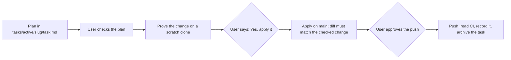

# Agent Instructions

These rules apply to every coding agent in this repository (Claude Code, Cursor, Copilot, and others). Read `CLAUDE.md` first: its rules apply in full. Then read `tasks/todo.md` (current priorities) and `docs/lessons.md` (past mistakes). For frontend work, also read `apps/frontend-ts/AGENTS.md` (Next.js rules).

## Workflow

- Plan first. Write `tasks/active/<slug>/task.md` with checkable criteria, and stop for the user's check.
- Prove each change before it lands: a red test first, then the CI checks. Backend: black, ruff, the mypy gate (`apps/backend-py/scripts/mypy_gate.py`), pytest. Frontend: eslint, tsc, vitest, prettier, the Next.js build, and the Playwright E2E suites (app and demo) when the UI changes.
- Small changes go through the handoff runner: `apps/backend-py/.venv/bin/python apps/backend-py/scripts/run_handoff.py <handoff.md>`. The runner takes its repository from the handoff file's path.
- Apply to `main` only after the user says "Yes, apply it". Push only after a separate approval. All work is on `main`.
- Commit only the files the change names. Never `git add -A`. Leave `tasks/archive/step-2-local-first/handoff-2026-10-19.md` and `handoff-step2.md` unstaged.
- A scratch clone has its own `.venv` and `node_modules` (`./scripts/dev.sh deps`). Never link a clone to this repository's environments.

## Guardrails

- Never read `apps/backend-py/.env`, `apps/frontend-ts/.env.local`, `apps/backend-py/data/settings/user_settings.json`, or the contents of any `data/` folder. They hold secrets and personal data. The `.env.example` files are safe to read.
- Never run `apps/backend-py/scripts/mypy_gate.py --update`. Only the user shrinks the baseline. New code adds 0 mypy errors.
- Keep dry run as the default. Do not make LinkedIn auto-submit reachable.
- Publishing the demo (the GitHub Pages workflow) needs the user's approval each time.
- Local models: 7B or smaller, and keep VRAM well below 8 GB. Heavy GPU load has crashed this machine. Never run a coding agent's local model at the same time as the app's pipeline models. Use the one Ollama service in WSL; never add an Ollama container.
- Setup scripts never create or change paths outside the repository.

## Environment

- The repository is `~/personal-projects/job-raider` in WSL. Run commands there, with paths relative to the repository root.
- `make dev` repairs the environments, then starts the backend (port 8000) and the frontend (port 3000). `make dev-deps` runs only the repair.
- Docker images contain the code: after a change, run `./docker-rebuild.sh`.

## Documentation

- Write in ASD-STE100 Simplified Technical English. No emojis. Include a mermaid flow diagram.
- Put each terminal command in its own code block, with a label before it.
- Tracking documents (`tasks/todo.md`, `docs/lessons.md`) describe state, not commit hashes.
