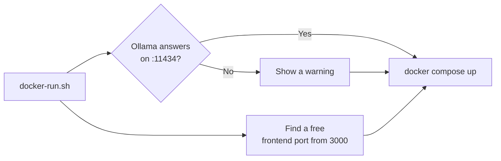

# Job Raider - Docker Guide

This guide covers running Job Raider using Docker containers.

## Prerequisites

- Docker installed (https://docs.docker.com/get-docker/)
- Docker Compose installed (usually included with Docker)

## Quick Start

### Using Make (Recommended)

```bash
# Start all services (auto-finds available ports)
make docker-up

# View logs
make docker-logs

# Stop all services
make docker-down
```

### Using docker-run.sh

```bash
# Start with port detection
./docker-run.sh
```

### Using docker compose directly

```bash
# Build and start
docker compose up -d

# View logs
docker compose logs -f

# Stop
docker compose down
```

## Services

The following services are started:

| Service | Port | Description |
|---------|------|-------------|
| Backend API | 8000+ | FastAPI web server |
| Frontend | 8501+ | Streamlit web dashboard |
| Ollama | 11434 | Local LLM server (the WSL service; Docker does not start it) |
| MLflow | 5000 | Shared experiment tracking (`~/docker-services`; not started here) |

## Port Detection

The `docker-run.sh` script finds a free host port for the frontend, starting from 3000. The backend is not published on the host. Ollama and MLflow run outside this compose project, on their own ports:

- Ollama: 11434, the WSL service. See [One Ollama per Machine](docs/architecture.md#one-ollama-per-machine).
- MLflow: 5000, the shared service in `~/docker-services`.

The script shows these addresses. It gives a warning when Ollama does not answer.



## Access Points

Once running:

- **Dashboard**: http://localhost:8501
- **API Docs**: http://localhost:8000/docs
- **API Health**: http://localhost:8000/api/health
- **API Version**: http://localhost:8000/api/version
- **Ollama**: http://localhost:11434
- **MLflow UI**: http://localhost:5000 (when enabled)

## GPU Support

Ollama runs as the WSL service and uses the GPU through the WSL CUDA driver. Docker does not run Ollama, so Docker needs no GPU setting for it. Do not add an Ollama container. See [One Ollama per Machine](docs/architecture.md#one-ollama-per-machine).

## Docker Image Structure

The project uses multiple Dockerfiles organized by purpose:

| File | Purpose | Base Image |
|------|---------|------------|
| `docker/Dockerfile` | Production backend (CUDA + GPU) | nvidia/cuda:12.4.0-runtime-ubuntu22.04 |
| `docker/Dockerfile.dev` | Development backend (slim) | python:3.12-slim |
| `frontend-py/docker/Dockerfile` | Frontend (Streamlit) | python:3.12-slim |

All Dockerfiles run as non-root user `jobraider` for security.

## Configuration

Job Raider uses a two-tier configuration system:

### Credentials (.env)

API keys and secrets are configured in `apps/backend-py/.env`:

```bash
cp apps/backend-py/.env.example apps/backend-py/.env
# Edit apps/backend-py/.env with your credentials
```

Key variables:
- `ANTHROPIC_API_KEY`: For API fallback (optional)
- `RAPIDAPI_KEY`: For JSearch job aggregation (recommended)
- `KAGGLE_USERNAME`, `KAGGLE_KEY`: Optional. For a manual download with the Kaggle CLI. The notebook does not download the dataset.
- `LINKEDIN_EMAIL`, `LINKEDIN_PASSWORD`: For Easy Apply (optional)
- `SENTRY_DSN`: For error tracking (optional, disabled by default)
- `MLFLOW_TRACKING_URI`: For experiment tracking (default: http://localhost:5000)

Frontend environment variables are configured in `frontend-py/.env`:

```bash
cp frontend-py/.env.example frontend-py/.env
```

Key variables:
- `BACKEND_API_URL`: Backend API base URL (default: http://localhost:8000)
- `REQUEST_TIMEOUT_SEC`: HTTP request timeout (default: 120)

### Application Settings (config/*.yaml)

All non-sensitive configuration lives in YAML files mounted under `./config`:
- `app_config.yaml`: General settings, paths, monitoring
- `model_config.yaml`: LLM model selection and routing
- `scrapers_config.yaml`: Scraper settings and rate limits
- `search_config.yaml`: Default keywords and locations
- `scoring_config.yaml`: Scoring weights and thresholds
- `logging_config.yaml`: Logging configuration

Configuration changes take effect on container restart.

## Data Persistence

The following directories are mounted as volumes:

- `./data` - All application data
- `./config` - Configuration files

Data persists across container restarts.

## Troubleshooting

### Port already in use

The `docker-run.sh` script automatically finds available ports. If you see port conflicts:

```bash
# Check what's using the port
lsof -i :8000

# Stop the conflicting service or use docker-run.sh
./docker-run.sh
```

### Container won't start

```bash
# Check logs
docker compose logs backend

# Rebuild
docker compose build --no-cache
docker compose up -d
```

### Ollama not responding

Check the Ollama service (WSL):

```bash
systemctl status ollama --no-pager
```

Start the Ollama service (WSL):

```bash
sudo systemctl start ollama
```

Pull the default models (WSL):

```bash
ollama pull qwen2.5:3b && ollama pull qwen2.5:7b && ollama pull nomic-embed-text
```

## Production Deployment

For production, consider:

1. Using environment-specific `apps/backend-py/.env` files
2. Enabling Redis for task state management
3. Setting up proper log rotation
4. Using a reverse proxy (nginx/caddy)
5. Enabling HTTPS/TLS
6. Pre-pulling Ollama models: `qwen2.5:3b`, `qwen2.5:7b`, `nomic-embed-text`

## Development with Docker

For development with hot-reload, prefer the local `dev.sh` script:

```bash
# Local development (hot reload)
./dev.sh

# Docker (no hot reload)
make docker-up
```
