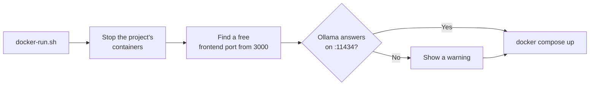

# Job Raider - Docker Guide

This guide covers running Job Raider using Docker containers.

## Prerequisites

- Docker installed (https://docs.docker.com/get-docker/)
- Docker Compose installed (usually included with Docker)

## Quick Start

### Using Make (Recommended)

```bash
# Start all services (auto-finds available ports)
make docker-up

# View logs
make docker-logs

# Stop all services
make docker-down
```

### Using docker-run.sh

```bash
# Start with port detection
./docker-run.sh
```

### Using docker compose directly

```bash
# Build and start
docker compose up -d

# View logs
docker compose logs -f

# Stop
docker compose down
```

## Services

Docker Compose starts two containers. Ollama and MLflow run outside this compose project.

| Service | Port | Description |
|---------|------|-------------|
| Backend API (`job-raider-backend`) | 8000, Compose network only | FastAPI web server. Not published on the host. |
| Frontend (`job-raider-frontend`) | 3000+ on 127.0.0.1 | Next.js web dashboard |
| Ollama | 11434 | Local LLM server (the WSL service; Docker does not start it) |
| MLflow | 5000 | Shared experiment tracking (`~/docker-services`; not started here) |

## Port Detection

The `docker-run.sh` script stops the project's containers first. Then it finds a free host port for the frontend, starting from 3000. The backend is not published on the host. Ollama and MLflow run outside this compose project, on their own ports:

- Ollama: 11434, the WSL service. See [One Ollama per Machine](docs/architecture.md#one-ollama-per-machine).
- MLflow: 5000, the shared service in `~/docker-services`.

The script shows these addresses. It gives a warning when Ollama does not answer.



## Access Points

Once running:

- **Dashboard**: http://127.0.0.1:3000 (or the port that `docker-run.sh` shows)
- **Ollama**: http://localhost:11434
- **MLflow UI**: http://localhost:5000 (when the shared MLflow runs)

The backend is not published on the host, so the API pages (`/docs`, `/api/health`, `/api/version`) do not open in a browser. The dashboard reaches the backend through its server-side proxy. To call the backend directly, send the request from the backend container.

Check the backend health (repository root):

```bash
docker compose exec backend curl -s http://localhost:8000/api/health
```

## GPU Support

Ollama runs as the WSL service and uses the GPU through the WSL CUDA driver. Docker does not run Ollama, so Docker needs no GPU setting for it. Do not add an Ollama container. See [One Ollama per Machine](docs/architecture.md#one-ollama-per-machine).

## Docker Image Structure

The project uses multiple Dockerfiles organized by purpose:

| File | Purpose | Base Image |
|------|---------|------------|
| `docker/Dockerfile` | Backend, used by `docker-compose.yml` | nvidia/cuda:12.4.0-runtime-ubuntu22.04 |
| `docker/Dockerfile.dev` | Development backend (slim) | python:3.12-slim |
| `docker/Dockerfile.overlay` | Temporary code-only update on a built backend image | job-raider-backend:pre-overlay |
| `apps/frontend-ts/Dockerfile` | Frontend (Next.js), used by `docker-compose.yml` | node:24-alpine |
| `frontend-py/docker/Dockerfile` | Old Streamlit frontend, not used by `docker-compose.yml` | python:3.12-slim |

The images set non-root users: `jobraider` (backend) and `nextjs` (frontend). `docker-compose.yml` runs the backend container as `root` (`user: root`).

## Configuration

Job Raider uses a two-tier configuration system:

### Credentials (.env)

API keys and secrets are configured in `apps/backend-py/.env`:

```bash
cp apps/backend-py/.env.example apps/backend-py/.env
# Edit apps/backend-py/.env with your credentials
```

Key variables:
- `ANTHROPIC_API_KEY`: For API fallback (optional)
- `RAPIDAPI_KEY`: For JSearch job aggregation (recommended)
- `KAGGLE_USERNAME`, `KAGGLE_KEY`: Optional. For a manual download with the Kaggle CLI. The notebook does not download the dataset.
- `LINKEDIN_EMAIL`, `LINKEDIN_PASSWORD`: For Easy Apply (optional)
- `SENTRY_DSN`: For error tracking (optional, disabled by default)
- `MLFLOW_TRACKING_URI`: For experiment tracking (default: http://localhost:5000)

Frontend environment variables are configured in `apps/frontend-ts/.env.local`.

Copy the frontend example file (repository root):

```bash
cp apps/frontend-ts/.env.example apps/frontend-ts/.env.local
```

Key variables:
- `API_KEY`: Shared secret that the proxy sends as `X-API-Key`. It must match `API_KEY` in `apps/backend-py/.env`. `setup.sh` generates it on the first run.
- `BACKEND_API_URL`: Backend API base URL. `docker-compose.yml` sets it to `http://backend:8000`.
- `NEXT_PUBLIC_WS_URL`: WebSocket URL for live progress. `docker-compose.yml` sets it empty, because the browser cannot reach the backend. The Live Monitor then uses status polling.

### Application Settings (config/*.yaml)

All non-sensitive configuration lives in YAML files in `apps/backend-py/config/`. The backend image copies them at build time:
- `app_config.yaml`: General settings, paths, monitoring
- `model_config.yaml`: LLM model selection and routing
- `scrapers_config.yaml`: Scraper settings and rate limits
- `search_config.yaml`: Default keywords and locations
- `scoring_config.yaml`: Scoring weights and thresholds
- `logging_config.yaml`: Logging configuration

Configuration changes take effect after a rebuild. `make docker-up` rebuilds the images that changed.

## Data Persistence

This directory is mounted into the backend container:

- `./apps/backend-py/data` - All application data (at `/app/backend-py/data`)

Data persists across container restarts.

## Troubleshooting

### Port already in use

The `docker-run.sh` script stops the project's containers, then finds a free frontend port from 3000. If another program holds port 3000, the dashboard moves to the next free port, and the script shows it.

Check what uses port 3000 (WSL):

```bash
lsof -i :3000
```

### Container won't start

```bash
# Check logs
docker compose logs backend

# Rebuild
docker compose build --no-cache
docker compose up -d
```

### Ollama not responding

Check the Ollama service (WSL):

```bash
systemctl status ollama --no-pager
```

Start the Ollama service (WSL):

```bash
sudo systemctl start ollama
```

Pull the default models (WSL):

```bash
ollama pull qwen2.5:3b && ollama pull qwen2.5:7b && ollama pull nomic-embed-text
```

## Production Deployment

For production, consider:

1. Using environment-specific `apps/backend-py/.env` files
2. Enabling Redis for task state management
3. Setting up proper log rotation
4. Using a reverse proxy (nginx/caddy)
5. Enabling HTTPS/TLS
6. Pre-pulling Ollama models: `qwen2.5:3b`, `qwen2.5:7b`, `nomic-embed-text`

## Development with Docker

For development with hot-reload, prefer the local `dev.sh` script:

```bash
# Local development (hot reload)
./dev.sh

# Docker (no hot reload)
make docker-up
```
