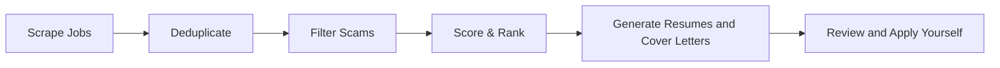
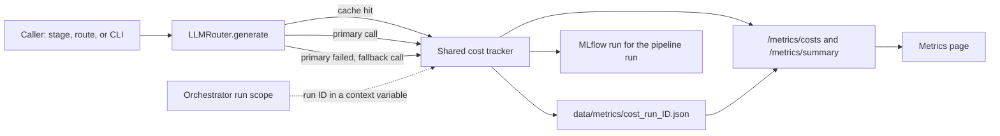
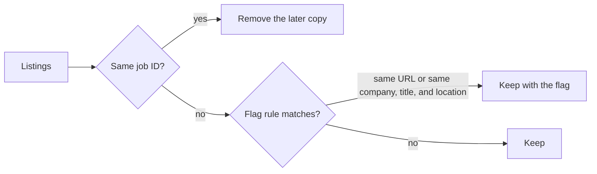
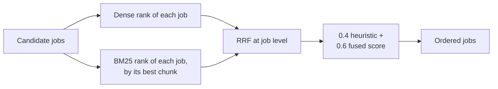
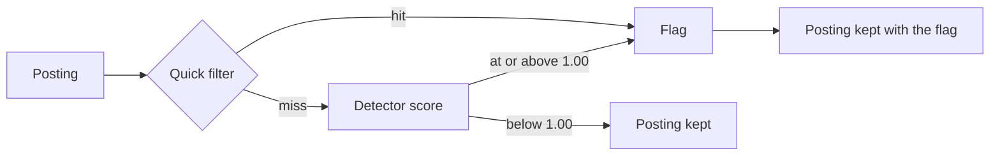
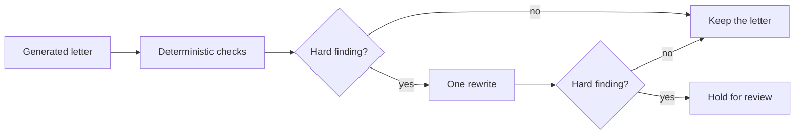

# Job Raider

Local-first job search pipeline. It collects listings from several job boards, flags likely scams, scores each job against your resume, and writes tailored resumes and cover letters with local LLMs. You review and apply yourself; the pipeline does not submit applications.

## Features

- **Multi-Platform Job Aggregation**: LinkedIn (Playwright), JSearch API (50+ boards via Google for Jobs), and Singapore sources (MyCareersFuture, JobStreet; Careers@Gov is opt-in)
- **Smart Filtering**: Keyword matching, rule-based scam detection (10 indicators in 5 groups), profile-based filtering
- **Relevance Scoring**: 100-point heuristic scoring with configurable thresholds
- **Semantic Matching**: RAG-powered similarity search using ChromaDB vector store and embeddings
- **Resume Generation**: Two-model approach (small for selection, large for writing)
- **Resume Analysis**: AI-powered general and job-specific gap analysis with scoring
- **LinkedIn Profile Analysis**: Inbound-attraction scoring and recruiter-focused recommendations
- **AI Cover Letter Generation**: Tailored cover letters from profile and job description, with deterministic grounding checks; a letter that claims skills or experience that are not in the resume is rewritten one time, then held for review
- **Career Coach**: `/api/agents/*` career analysis, gap analysis, roadmaps, and goals
- **DISC Personality Assessment**: Most/least forced-choice assessment with job matching
- **Technical Assessment Trainer**: Practice engine for coding and technical interviews
- **Job Trust Analysis**: Scam detection and employer-trust scoring
- **Fresh-Graduate Scoring Mode**: Projects 35%, Skills 30%, Education 20% weighting
- **Light/Dark Theme Toggle**: UI theme switching via the sidebar
- **Frontend Testing Infrastructure**: Vitest unit tests + Playwright E2E tests
- **Dry Run by Default**: The pipeline does not submit applications
- **Local Models by Default**: Generation runs on Ollama on your machine; a cloud model is used only as a fallback when you set an API key
- **Application Tracking**: Track applications from submission to offer with custom statuses

## Measured Results

Each number comes from a labeled set and a command in this repository, except the real letters, which are private. The sections have the commands and the limits. Read the limits: on real letters, the grounding rules find few of the errors, and the scam rules do not detect the frauds in EMSCAD.

| Part | Set | Result | Date |
|------|-----|--------|------|
| [Cover letter grounding](#cover-letter-grounding) | 65 constructed letters | Sentence precision 0.154, recall 0.638 | 2026-11-05 |
| | 23 holdout letters, one run | Sentence precision 0.104, recall 0.727 | 2026-10-24 |
| | 10 real letters, private | Sentence precision 0.182, recall 0.154 | 2026-10-31 |
| [Job ranking](#job-ranking) | 140 labeled pairs | NDCG@10: BM25 0.915, hybrid 0.851, heuristic 0.818, dense 0.806 | 2026-11-04 |
| [Duplicate detection](#duplicate-detection) | 31 labeled pairs | Identified precision 0.833, recall 0.938 | 2026-11-05 |
| [Scam detection](#scam-detection) | 8,940 held-out postings, one run | 0 of 433 frauds found; false-positive rate 0.0027 | 2026-10-26 |
| [Structured output](#structured-output) | 43 cases at 9 call sites | Strict answers 0.845 before, 1.000 after | 2026-11-01 |
| [Writer model](#writer-model) | 65 pairs, 3 letters each | First drafts with placeholders: `qwen2.5:7b` 0 of 195, `qwen2.5:3b` 18 of 195 | 2026-11-05 |

## Architecture



### Two-Model Approach

1. **Small Model (qwen2.5:3b)** - Selects relevant projects and keywords
2. **Large Model (qwen2.5:7b)** - Writes tailored resumes

The small model does the selection step, so the large model gets a short, focused prompt. Both run locally on Ollama by default, so a default local route has no per-token API cost. The Metrics page shows the recorded cost when a cloud fallback or a cloud route is used.

Cover letters also use `qwen2.5:7b` by default; see [Writer Model](#writer-model).

## Cost and usage tracking

Each call through the LLM router is recorded: token counts, latency, cache hit, fallback, error, and cost. There is no prompt text and no response text in a record.

You can see the records in three places:

- the Metrics page
- `apps/backend-py/data/metrics/cost_run_<id>.json` for each pipeline run
- the MLflow experiment `pipeline-runs`



Limits:

- Embeddings are not recorded. They use the embedding client, not the router.
- Ollama counts come from the Ollama chat response. The Metrics page marks a count that is a length estimate.
- Cloud prices come from the official Anthropic and Google pages on 2026-10-27. The prices can change.
- In a pipeline run, only resume generation (full mode) calls the LLM. A discover-mode run records 0 calls.
- Process totals start at 0 when the backend starts again. The last run comes from its file.

## Tech Stack

Job Raider is a Python-centric backend with a Next.js dashboard. The stack is chosen to keep processing local where possible, fallback to cloud LLMs when needed, and run consistently across local development and Docker.

| Layer | Technologies |
|-------|--------------|
| Backend | Python 3.11+, FastAPI 0.115+, Uvicorn 0.30+, Pydantic 2.5+ |
| Data | SQLAlchemy 2.0+, Alembic 1.13+, asyncpg 0.29+, Supabase 2.4+, pgvector 0.2+, ChromaDB 1.0+ |
| LLMs | Ollama, Anthropic API, Google GenAI |
| Scraping & Documents | Playwright 1.40+, BeautifulSoup4 4.12+, pypdf 4.0+, python-docx 1.1+, reportlab 4.0+ |
| Frontend | Next.js 16.2.4, React 19.2.4, TypeScript 5, Tailwind CSS 4, shadcn/ui 4.5.0 |
| Frontend Libraries | TanStack Query 5.100.5, React Hook Form 7.74.0, Zod 4.3.6, Recharts 3.8.1 |
| Operations | Docker, Docker Compose, MLflow 2.0+, Sentry SDK 1.40+ |
| Testing | pytest 8.0+, Vitest 1.0+, Playwright 1.40+ |

## Quick Start

### Prerequisites

- Python 3.11+
- Node.js 24 (for the Next.js frontend; `.nvmrc` sets the version)
- 8GB VRAM (for local models)
- Ollama installed

### Installation

```bash
# Clone repository
git clone https://github.com/neoncircuit/job-raider.git
cd job-raider

# Run setup
./setup.sh

# Pull Ollama models
ollama pull qwen2.5:3b
ollama pull qwen2.5:7b
ollama pull nomic-embed-text

# Configure environment
cp apps/backend-py/.env.example apps/backend-py/.env
# Edit apps/backend-py/.env with your API keys
```

### Usage

#### Interactive Mode

```bash
cd apps/backend-py
.venv/bin/python main.py --interactive
```

#### CLI Mode

```bash
# Basic search with dry run
cd apps/backend-py
.venv/bin/python main.py \
  --resume my_resume.pdf \
  --keywords "python engineer" \
  --locations "remote" \
  --dry-run

# Stop after scoring
cd apps/backend-py
.venv/bin/python main.py \
  --resume my_resume.pdf \
  --keywords "fintech AI" \
  --locations "Singapore" \
  --stop-at score_and_rank
```

Each value after `--keywords` or `--locations` is one search term. Quote a term that contains spaces.

## Pipeline Stages

| Stage | Description | Output |
|-------|-------------|--------|
| 1. Scrape | Collect from LinkedIn, JSearch (50+ boards), and Singapore sources | Raw listings |
| 2. Deduplicate | Remove only exact copies (the same job ID). Flag possible duplicates and keep them. | Unique job IDs, flagged listings |
| 3. Filter Scams | Flag likely scams; flagged postings are kept | Flagged listings |
| 4. Filter by Profile | Match user preferences | Relevant listings |
| 5. Score & Rank | Heuristic relevance scoring (0-100) | Ranked listings |
| 6. Hybrid Re-Rank | Fuse the dense and BM25 ranks of each job, then combine with the heuristic score | Re-ranked listings |
| 7. Detect Apply Method | Record how each job is applied to | Apply method per job |
| 8. LinkedIn Check | Check only whether LinkedIn credentials are set | Status |
| 9. Present Selection | Take the top-ranked jobs | Selected jobs |
| 10. Generate Resumes | Tailored resumes (5 templates, ATS mode) and grounded cover letters | PDF/DOCX files |
| 11. Submit (dry run) | Report what would be submitted; nothing is sent | Run summary |

The default "discover" mode stops after stage 6, so you review the shortlist on the Jobs page.

## Duplicate Detection

The stage removes a listing only when it has the same job ID as an
earlier listing. Other listings stay. Two flag rules mark possible
duplicates: the same cleaned URL with the same title and location, or
the same company, title, and location. The suite measures
"identified": merged or flagged.

Committed set (31 labeled pairs). One run. Wilson 95% intervals:

| Metric | Value | Counts | Wilson 95% |
|--------|-------|--------|------------|
| Precision | 0.8333 | 15 of 18 | 0.6078 to 0.9416 |
| Recall | 0.9375 | 15 of 16 | 0.7167 to 0.9889 |
| False-identify rate | 0.2000 | 3 of 15 | 0.0705 to 0.4519 |

How to run the suite:

```bash
cd apps/backend-py
.venv/bin/python main.py eval dedupe
```

Limits:

- The set separates its labels on the description, so no description
  signal is used.
- Location formats ("Singapore" and "Central, Singapore") and title
  abbreviations are not matched.
- Two openings with the same company, title, and location are flagged.
- A shared careers page that shows one title at one location for two
  jobs is flagged.
- The URL rule does not join http and https URLs.
- The flag is not shown in the UI yet.



## Scoring Heuristic

| Category | Points | Description |
|----------|--------|-------------|
| Keywords | 30 | Keyword overlap with targets |
| Skills | 40 | Skills match against profile |
| Experience | 20 | Experience level alignment |
| Location | 10 | Location preference match |
| **Total** | **100** | **Threshold: 60 to apply** |

## Job Ranking

Each method ranks all 70 jobs for each profile. The set has 2 synthetic
profiles, 70 constructed jobs, and 140 labels: apply, maybe, or not
relevant. NDCG@10 uses the label as the gain. Recall@10 is the share of
the `apply` jobs in the top 10.

Run of 2026-11-04 (git `0794d5c`, MLflow run
`d0cc16f055ba4dd1a9fa5982cde70743`):

| Method | NDCG@10 | Recall@10 | NDCG@10 before the fixes | Runs in |
|--------|---------|-----------|--------------------------|---------|
| BM25 | 0.915 | 0.784 | 0.882 | CI and local |
| Hybrid, used by the pipeline | 0.851 | 0.739 | 0.707 | Local |
| Heuristic | 0.818 | 0.568 | 0.788 | CI and local |
| Dense | 0.806 | 0.614 | 0.806 | Local |

What the numbers mean: BM25 alone is the best method on this set. The
pipeline keeps hybrid, because the set is small and clean, and lexical
matching can be easier on clean text. Before the fixes, hybrid ranked
below each of its parts: jobs inside the hybrid result and jobs outside
it had scores on two scales. `docs/decision-log.md` has the causes.



How to run the heuristic and BM25 methods (no model needed):

```bash
cd apps/backend-py
.venv/bin/python main.py eval ranking
```

How to run all four methods (WSL; the embedding model loads on the GPU):

```bash
cd apps/backend-py
.venv/bin/python main.py eval ranking --methods heuristic,bm25,dense,hybrid
```

CI fails when the heuristic or BM25 metrics fall below their pins in
`tests/fixtures/eval/ranking/thresholds.json`. Dense and hybrid need the
embedding model, so they are not in the CI gate.

Limits:

- The set has 2 profiles and 70 clean constructed jobs, so these numbers
  compare the methods on this set only.
- No weight or constant is tuned on this set.
- The suite ranks all 70 jobs. The pipeline ranks only the jobs that pass
  the heuristic gate.
- The hybrid score comes from ranks, so the best job of a weak group gets
  a fused score of 1.0.
- The cross-encoder is off by default and is not measured.

## Scam Detection

Rule-based scoring with 10 indicators in 5 groups:

| Group | Indicators |
|-------|------------|
| Payment | Payment required |
| Contact | Messaging-app-only contact, personal email domain |
| Urgency | Immediate hire, no interview |
| Compensation | Unrealistic salary |
| Listing quality | Suspicious company name, vague description, poor grammar, suspicious job title |

The number that is measured is the pipeline decision: the quick filter,
or a detector score at or above the threshold.

The operating point is threshold 1.00 and action `flag`. The rules that
chose it on the EMSCAD tuning part are: a false-positive rate of at most
0.005, and `drop` only when precision is at least 0.50 and at least 10
frauds are flagged. Flagged postings are kept. The pipeline records the
score and the reasons.

Held-out EMSCAD part (8940 postings: 433 frauds, 8507 legitimate). One
run. Wilson 95% intervals:

| Metric | Value | Counts | Wilson 95% |
|--------|-------|--------|------------|
| Precision | 0.0000 | 0 of 23 | 0.0000 to 0.1431 |
| Recall | 0.0000 | 0 of 433 | 0.0000 to 0.0088 |
| False-positive rate | 0.0027 | 23 of 8507 | 0.0018 to 0.0041 |

Confusion: TP 0, FP 23, FN 433, TN 8484. All 23 flags come from the
quick filter. The highest detector score on the held-out part is 0.65,
below the threshold.

What the numbers mean: at this operating point the rule detector does
not detect EMSCAD frauds. The pipeline does not remove a posting. The
user judges each posting.

Limits:

- EMSCAD postings are from 2012 to 2014 and are mostly from the US.
  Emails, links, and phone numbers are masked. There are no company
  names and no line breaks.
- The committed set (46 written and fixture postings) guards the six
  hard negatives in CI. It does not measure recall.
- Known limits of the rule patterns: a closed list of contact verbs; an
  app name with an ID label and a handle without "@"; negation guards
  only on some payment patterns, and two of those guards also look after
  the sign; phrase anchors that miss a long sentence; and scam wording
  that is outside the listed shapes (a deposit before training, a fee
  before the first day of work, a passive sentence that says interviews
  are not needed).

A notebook shows the tuning-part metrics. How to run it is in
[apps/backend-py/notebooks/README.md](apps/backend-py/notebooks/README.md).



## Cover Letter Grounding

Deterministic rules check each generated letter against the profile,
with no LLM. A hard finding causes one rewrite. When the rewrite still
has a hard finding, the letter is held for review. An unfilled
placeholder such as `[Company]` is also a hard finding: [Writer
Model](#writer-model) has its counts.



Precision and recall for each check on three sets. A letter has the
label or it does not, except for the last row, which counts sentences.
"Count" is the number of letters (or sentences) with the error, and n/a
means that the check found nothing, or that the set has no such error.

| Check | 65 constructed: precision | Recall | Count | 23 holdout: precision | Recall | Count | 10 real: precision | Recall | Count |
|-------|------|------|------|------|------|------|------|------|------|
| `fabricated_technology` | 0.800 | 1.000 | 8 | 1.000 | 1.000 | 3 | n/a | 0.000 | 1 |
| `inflated_duration` | 1.000 | 1.000 | 5 | 1.000 | 1.000 | 2 | n/a | n/a | 0 |
| `inconsistent_metric` | 1.000 | 1.000 | 3 | 1.000 | 1.000 | 1 | n/a | n/a | 0 |
| `fabricated_experience` | 0.857 | 0.750 | 8 | 0.500 | 1.000 | 2 | 0.000 | n/a | 0 |
| `analogical_claim` | 1.000 | 1.000 | 3 | 1.000 | 1.000 | 1 | n/a | 0.000 | 7 |
| `scope_inflation` | 1.000 | 1.000 | 4 | 0.500 | 1.000 | 1 | 1.000 | 1.000 | 2 |
| `technique_mismatch` | 0.750 | 1.000 | 3 | 1.000 | 1.000 | 1 | n/a | n/a | 0 |
| `ungrounded_claims` | 0.523 | 1.000 | 34 | 0.500 | 1.000 | 11 | 0.875 | 0.778 | 9 |
| All checks (micro) | 0.653 | 0.971 | 68 | 0.611 | 1.000 | 22 | 0.818 | 0.474 | 19 |
| `ungrounded_claims`, sentences | 0.154 | 0.638 | 69 | 0.104 | 0.727 | 11 | 0.182 | 0.154 | 26 |

Clean false-positive rate (clean letters with at least one flag): 1.000
on the constructed set (29 of 29) and 0.909 on the holdout (10 of 11).

What the numbers mean: the constructed sets put one clear error in each
letter, and the rules find nearly all of those errors. Real errors are
different. On the real letters, the rules find 4 of 26 ungrounded
sentences and 0 of 7 duties that only the job names. Most flagged
sentences are false flags on every set. So the rules are a guard against
some clear errors, not proof that a letter is correct. Read each letter
before you send it.

How to run the constructed set (no model needed):

```bash
cd apps/backend-py
.venv/bin/python main.py eval grounding
```

CI fails when a count goes above its pin in
`tests/fixtures/eval/grounding/thresholds.json`.

The other two sets:

- Holdout: one run on 2026-10-24 (MLflow run
  `cb3e608baa354a21844913f2c8a5dd2f`). A set that is run again after a
  fix no longer tests that fix, so it is not for routine runs. Its
  README has the command.
- Real letters: one run on 2026-10-31 (MLflow run
  `6759197d7a2548ff8315a5cf7331a5fe`). The letters were written by
  `qwen2.5:7b` for a real profile, so they stay in `data/` (gitignored),
  and nobody else can run this set. The labels were drafted by Claude
  and checked by the user.

Limits:

- The rules miss a result credited to the wrong work, because each word
  is in the profile. They also miss duties that only the job names, and
  added outcomes.
- The rules flag sentences about the employer, some closings, plans, and
  statements such as "aligns with your role".
- `split_letter_sentences` splits a company name after "PTE." in
  "PTE. LTD.".
- On the holdout, a short employer name gave false `fabricated_experience`
  findings, and an object before the verb gave a false `scope_inflation`
  finding.
- The constructed letters use a repeated frame (36 of 65 letters), so the
  sentence precision and the clean false-positive rate describe those
  letters.
- The counts are small. On the holdout, one case moves a value for a
  specific check by 0.33 to 1.0.

## Structured Output

Each LLM task that answers in JSON sends its schema to Ollama, and the
answer must match the schema as a whole. The suite ran the 9 call sites
on 43 synthetic cases, 3 times for each case.

| Run | MLflow run | Strict | Rescued by the old regex | Failed |
|-----|------------|--------|--------------------------|--------|
| Before, 2026-11-01 | `ade9802558bf497ea05c2eceeaf40661` | 0.845 | 0.132 | 0.023 |
| After, 2026-11-01 | `3882e8625b774a89bd32be9d891191e1` | 1.000 | 0 | 0 |

How to run the suite (it needs Ollama, and it loads models on the GPU):

```bash
cd apps/backend-py
.venv/bin/python main.py eval structured
```

Limit: the inputs of the set are short (the longest prompt is about
1,330 tokens), so the set measures the answer format, not long inputs.

## Writer Model

`qwen2.5:7b` is the default cover-letter writer. `qwen2.5:3b` was the
default from 2026-11-02 to 2026-11-05, on a comparison that could not see
one defect: it writes literal placeholders such as `[Company]`.

First drafts with an unfilled placeholder, 3 letters for each of 65
profile-job pairs (2026-11-05):

| Model | Prompt rule | Letters with placeholders | Valid share |
|-------|-------------|---------------------------|-------------|
| `qwen2.5:3b` | No | 81 of 195 | 0.508 |
| `qwen2.5:3b` | Yes | 18 of 195 | 0.779 |
| `qwen2.5:7b` | No | 1 of 195 | 0.815 |
| `qwen2.5:7b` | Yes | 0 of 195 | 0.810 |

A letter with a placeholder now fails validation, so the service rewrites
it one time, and the prompt forbids them. Through the service with
`qwen2.5:3b`, 0 of 24 final letters had one.

The comparison of 2026-11-02, before the placeholder check:

| Model | Flagged sentences in a letter | Words (median) | Mean score | Latency (median) | Peak VRAM |
|-------|------|------|------|------|------|
| `qwen2.5:7b` | 3.96 | 243 | 90.5 | 2.9 s | 6,656 MiB |
| `qwen3.5:4b` | 2.97 | 185 | 85.5 | 2.0 s | 5,848 MiB |
| `qwen2.5:3b` | 3.10 | 223 | 92.0 | 1.6 s | 4,189 MiB |
| `gemma3:4b` | 1.71 | 160 | 82.7 | 1.8 s | 5,890 MiB |

How to run one model (WSL; the model loads on the GPU, so close other
GPU-heavy apps first):

```bash
cd apps/backend-py
.venv/bin/python main.py eval writer --model qwen2.5:7b
```

Limits:

- The evidence is the rule validator only. Most flagged sentences are
  false flags, so the numbers show how often the rules fire, not an error
  rate.
- The placeholder check finds square brackets only. It misses `<Company>`
  and `XYZ Corp`.
- The runs use 3 synthetic profiles and measure the first draft only. No
  run measures final letters on `qwen2.5:7b`.
- `qwen2.5:7b` needs room on an 8 GB GPU. When other apps hold GPU memory,
  a guard moves the work to the CPU, and a run takes about 1.5 times as
  long.

`docs/decision-log.md` has the rules and the MLflow runs.

## Project Structure

```
job-raider/                      # Project root (monorepo)
├── apps/backend-py/                  # Python backend
│   ├── .venv/                   # Python virtual environment
│   ├── config/                  # Configuration files
│   │   ├── agent_config.yaml
│   │   ├── app_config.yaml
│   │   ├── logging_config.yaml
│   │   ├── model_config.yaml
│   │   ├── prompt_templates.yaml
│   │   ├── rag_config.yaml
│   │   ├── scoring_config.yaml
│   │   ├── scrapers_config.yaml
│   │   └── search_config.yaml
│   ├── src/                     # Source code
│   │   ├── agents/              # Multi-agent system (coordinator, communication bus, career coach)
│   │   ├── api/                 # FastAPI REST API (routes, models, websocket)
│   │   ├── assessment/          # Technical assessment trainer + DISC engine
│   │   ├── classifiers/         # LLM-based job classification
│   │   ├── config/              # YAML config loader
│   │   ├── database/            # Database models and connection helpers
│   │   ├── extractors/          # Resume and JD parsing (pypdf)
│   │   ├── generation/          # Resume generation (selector, writer, formatter) + analyzers
│   │   ├── health/              # System health checks (including MLflow)
│   │   ├── linkedin/            # LinkedIn session and profile fetch (Easy Apply code is not used)
│   │   ├── llm/                 # LLM clients (Claude, Ollama, router)
│   │   ├── metrics/             # Cost tracking, outcome tracking, MLflow integration
│   │   ├── models/              # Pydantic V2 data models
│   │   ├── pipeline/            # Pipeline orchestration and stages
│   │   ├── rag/                 # RAG pipeline (embeddings, vector store, ranker, chunker)
│   │   ├── reports/             # HTML report generation
│   │   ├── scrapers/            # Job scraping (LinkedIn, JSearch API)
│   │   ├── scoring/             # Filtering, matching, scam detection, trust analysis
│   │   ├── submission/          # Application submission and detection
│   │   └── utils/               # Caching, logging, Sentry, utilities
│   ├── tests/                   # Unit and integration tests
│   ├── notebooks/               # Jupyter notebooks
│   ├── main.py                  # CLI entry point
│   └── requirements.txt         # Python dependencies
├── apps/frontend-ts/                 # Next.js + Tailwind dashboard (active frontend)
│   ├── src/
│   │   ├── app/                 # Next.js App Router pages (13 in the sidebar)
│   │   ├── components/          # Shared UI components + layout
│   │   └── lib/                 # API client, types, utilities
│   ├── tests/                   # Vitest unit + Playwright E2E tests
│   ├── Dockerfile               # Multi-stage production build (standalone)
│   └── package.json             # Node dependencies
├── frontend-py/                 # Legacy Streamlit dashboard (superseded by frontend-ts)
├── data/                        # Shared data storage
│   ├── alerts/                  # Alert records
│   ├── applications/            # Tracked applications
│   ├── applied_jobs/            # Jobs already applied to
│   ├── cache/                   # LLM response cache
│   ├── chroma/                  # ChromaDB vector store persistence
│   ├── disc_results/            # DISC assessment results
│   ├── experiments/             # A/B test results
│   ├── linkedin_session/        # LinkedIn browser session data
│   ├── listings/                # Scraped listings
│   ├── logs/                    # Application logs
│   ├── metrics/                 # Cost/outcome metrics
│   ├── outputs/                 # General output files
│   ├── profiles/                # User profile data
│   ├── reports/                 # Generated HTML reports
│   ├── results/                 # Pipeline results
│   │   ├── applications/        # Generated application packages
│   │   └── resumes/             # Generated resumes
│   ├── screenshots/             # Automation screenshots
│   └── settings/                # User settings snapshots
├── docker/                      # Backend Dockerfiles
│   ├── Dockerfile               # Production (CUDA + GPU)
│   └── Dockerfile.dev           # Development (slim)
├── docs/                        # Documentation
│   ├── api.md
│   ├── architecture.md
│   ├── disk-space.md
│   ├── fresh-grad-profile-guide.md
│   ├── index.md
│   ├── manual-verification-checklist.md
│   ├── mlflow-setup.md
│   ├── testing.md
│   ├── troubleshooting.md
│   └── usage.md
├── scripts/                     # Shell/utility scripts
│   ├── cleanup.sh               # Temporary file cleanup
│   └── find-port.sh             # Dynamic port discovery
├── tasks/                       # Task tracking (index.md, todo.md, active/, archive/)
├── .github/workflows/           # CI/CD pipelines
├── docker-compose.yml           # Multi-service orchestration
├── docker-rebuild.sh            # Docker rebuild helper (WSL2 caching workaround)
├── docker-run.sh                # Docker startup with port detection
├── setup.sh                     # One-command setup script
├── dev.sh                       # Local development with hot reload
├── Makefile                     # Common development commands
└── README.md                    # This file
```

## Documentation

- **[Documentation Index](docs/index.md)** - Documentation hub and quick links
- **[Architecture](docs/architecture.md)** - System architecture and design
- **[Usage Guide](docs/usage.md)** - Installation and usage
- **[API Reference](docs/api.md)** - Complete API documentation
- **[Testing Guide](docs/testing.md)** - Backend and frontend test commands
- **[Troubleshooting](docs/troubleshooting.md)** - Common issues and solutions
- **[Disk Space Management](docs/disk-space.md)** - Data retention policies

## Configuration

Job Raider uses a two-tier configuration system:

### Credentials (.env)

API keys and secrets live in `apps/backend-py/.env` (copy from `apps/backend-py/.env.example`).

```bash
# Required for API fallback
ANTHROPIC_API_KEY=your_key_here

# Required for JSearch API (job aggregation from 50+ boards)
RAPIDAPI_KEY=your_rapidapi_key_here

# Optional: Kaggle API (manual CSV download only; the notebook does not download the dataset)
KAGGLE_USERNAME=your_username
KAGGLE_KEY=your_key

# Optional: LinkedIn login (for LinkedIn profile analysis)
LINKEDIN_EMAIL=your_email
LINKEDIN_PASSWORD=your_password

# Optional: Sentry error tracking
SENTRY_DSN=your_sentry_dsn_here

# Optional: MLflow experiment tracking (shared service)
MLFLOW_TRACKING_URI=http://localhost:5000
```

### Application Settings (config/*.yaml)

All non-sensitive configuration lives in YAML files under `apps/backend-py/config/`:

| Config File | Purpose |
|-------------|---------|
| `agent_config.yaml` | Multi-agent system configuration (coordinator, career coach) |
| `app_config.yaml` | General settings (paths, development flags, monitoring) |
| `model_config.yaml` | LLM model selection, routing, caching, rate limits |
| `rag_config.yaml` | RAG pipeline configuration (embeddings, chunking, vector store) |
| `scoring_config.yaml` | Scoring weights, thresholds, skill categories |
| `scrapers_config.yaml` | Scraper settings, rate limiting, browser automation |
| `search_config.yaml` | Default keywords, locations, filters |
| `logging_config.yaml` | Logging levels and output configuration |
| `prompt_templates.yaml` | LLM prompt templates |

Example: Edit `apps/backend-py/config/search_config.yaml` to change default search keywords:

```yaml
keywords:
  - "python"
  - "software engineer"
  - "backend"
  - "remote"
```

## System Requirements

### Minimum

- Python 3.11+
- 16GB RAM
- 8GB VRAM
- Ollama installed

### Recommended

- NVIDIA GPU (RTX 3070 Ti or better)
- 32GB RAM
- SSD storage

## Development

### Web Dashboard (Next.js)

The web dashboard (`apps/frontend-ts/`) is a Next.js + Tailwind CSS application that provides a visual interface for the full pipeline. It is the active frontend; the legacy Streamlit dashboard in `frontend-py/` is retained but superseded.

```bash
# Start backend API first (http://localhost:8000)
make dev-api

# In another terminal, start the Next.js dashboard (http://localhost:3000)
make dev-frontend

# Or start both together
make dev
```

Or use Docker to start all services at once:

```bash
bash docker-run.sh
```

The sidebar has 13 pages: Dashboard (overview), Pipeline (run/monitor), Jobs (search and review), Applications (tracker), Profile (resume upload), Cover Letter, Resume Analysis, LinkedIn Analysis, Career Coach, Assessment (technical trainer and DISC), Metrics, Logs, and Settings.

### Running Tests

```bash
# Backend tests
cd apps/backend-py
.venv/bin/python -m pytest tests/
# Expected: all pass (2,104 tests on 2026-11-05)

# Frontend unit tests
cd apps/frontend-ts
npm run test -- --run
# Expected: all pass (257 tests in 48 files on 2026-11-05)

# Frontend E2E tests
cd apps/frontend-ts
npm run test:e2e
# Expected: all pass (21 tests on desktop and mobile Chrome, 42 runs)

# Or use make from project root
make test
```

### Code Style

```bash
# From project root
make format      # Format code
make lint        # Run linting

# Or manually
cd apps/backend-py
.venv/bin/python -m black main.py scripts/mypy_gate.py src/ tests/
.venv/bin/python -m ruff check main.py scripts/mypy_gate.py src/ tests/
.venv/bin/python scripts/mypy_gate.py
```

`scripts/mypy_gate.py` fails on any mypy error that is not in `mypy-baseline.txt`. See [Testing Guide](docs/testing.md#mypy-baseline-gate).

## Contributing

Contributions welcome! Please:

1. Read the [architecture documentation](docs/architecture.md)
2. Follow code style guidelines
3. Add tests for new features
4. Update documentation

## Acknowledgments

- The drafter-reviewer loop used in the cover-letter pipeline was inspired by Mads Lorentzen's [`ai-job-search`](https://github.com/MadsLorentzen/ai-job-search) project. The Job Raider implementation, prompts, code, and UI were written independently.

## License

MIT License - See LICENSE file for details
