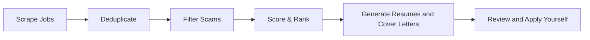
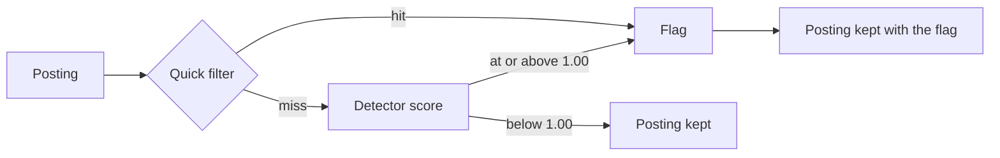

# Job Raider

Local-first job search pipeline. It collects listings from several job boards, flags likely scams, scores each job against your resume, and writes tailored resumes and cover letters with local LLMs. You review and apply yourself; the pipeline does not submit applications.

## Features

- **Multi-Platform Job Aggregation**: LinkedIn (Playwright), JSearch API (50+ boards via Google for Jobs), and Singapore sources (MyCareersFuture, JobStreet; Careers@Gov is opt-in)
- **Smart Filtering**: Keyword matching, rule-based scam detection (10 indicators in 5 groups), profile-based filtering
- **Relevance Scoring**: 100-point heuristic scoring with configurable thresholds
- **Semantic Matching**: RAG-powered similarity search using ChromaDB vector store and embeddings
- **Resume Generation**: Two-model approach (small for selection, large for writing)
- **Resume Analysis**: AI-powered general and job-specific gap analysis with scoring
- **LinkedIn Profile Analysis**: Inbound-attraction scoring and recruiter-focused recommendations
- **AI Cover Letter Generation**: Tailored cover letters from profile and job description, with deterministic grounding checks; a letter that claims skills or experience that are not in the resume is rewritten one time, then held for review
- **Career Coach**: `/api/agents/*` career analysis, gap analysis, roadmaps, and goals
- **DISC Personality Assessment**: Most/least forced-choice assessment with job matching
- **Technical Assessment Trainer**: Practice engine for coding and technical interviews
- **Job Trust Analysis**: Scam detection and employer-trust scoring
- **Fresh-Graduate Scoring Mode**: Projects 35%, Skills 30%, Education 20% weighting
- **Light/Dark Theme Toggle**: UI theme switching via the sidebar
- **Frontend Testing Infrastructure**: Vitest unit tests + Playwright E2E tests
- **Dry Run by Default**: The pipeline does not submit applications
- **Local Models by Default**: Generation runs on Ollama on your machine; a cloud model is used only as a fallback when you set an API key
- **Application Tracking**: Track applications from submission to offer with custom statuses

## Architecture



### Two-Model Approach

1. **Small Model (qwen2.5:3b)** - Selects relevant projects and keywords
2. **Large Model (qwen2.5:7b)** - Writes tailored resumes

The small model does the selection step, so the large model gets a short, focused prompt. Both run locally on Ollama, so a pipeline run has no per-token API cost.

## Tech Stack

Job Raider is a Python-centric backend with a Next.js dashboard. The stack is chosen to keep processing local where possible, fallback to cloud LLMs when needed, and run consistently across local development and Docker.

| Layer | Technologies |
|-------|--------------|
| Backend | Python 3.11+, FastAPI 0.115+, Uvicorn 0.30+, Pydantic 2.5+ |
| Data | SQLAlchemy 2.0+, Alembic 1.13+, asyncpg 0.29+, Supabase 2.4+, pgvector 0.2+, ChromaDB 1.0+ |
| LLMs | Ollama, Anthropic API, Google GenAI |
| Scraping & Documents | Playwright 1.40+, BeautifulSoup4 4.12+, pypdf 4.0+, python-docx 1.1+, reportlab 4.0+ |
| Frontend | Next.js 16.2.4, React 19.2.4, TypeScript 5, Tailwind CSS 4, shadcn/ui 4.5.0 |
| Frontend Libraries | TanStack Query 5.100.5, React Hook Form 7.74.0, Zod 4.3.6, Recharts 3.8.1 |
| Operations | Docker, Docker Compose, MLflow 2.0+, Sentry SDK 1.40+ |
| Testing | pytest 8.0+, Vitest 1.0+, Playwright 1.40+ |

## Quick Start

### Prerequisites

- Python 3.11+
- Node.js 24 (for the Next.js frontend; `.nvmrc` sets the version)
- 8GB VRAM (for local models)
- Ollama installed

### Installation

```bash
# Clone repository
git clone https://github.com/neoncircuit/job-raider.git
cd job-raider

# Run setup
./setup.sh

# Pull Ollama models
ollama pull qwen2.5:3b
ollama pull qwen2.5:7b
ollama pull nomic-embed-text

# Configure environment
cp apps/backend-py/.env.example apps/backend-py/.env
# Edit apps/backend-py/.env with your API keys
```

### Usage

#### Interactive Mode

```bash
cd apps/backend-py
.venv/bin/python main.py --interactive
```

#### CLI Mode

```bash
# Basic search with dry run
cd apps/backend-py
.venv/bin/python main.py \
  --resume my_resume.pdf \
  --keywords "python engineer" \
  --locations "remote" \
  --dry-run

# Stop after scoring
cd apps/backend-py
.venv/bin/python main.py \
  --resume my_resume.pdf \
  --keywords "fintech AI" \
  --locations "Singapore" \
  --stop-at score_and_rank
```

Each value after `--keywords` or `--locations` is one search term. Quote a term that contains spaces.

## Pipeline Stages

| Stage | Description | Output |
|-------|-------------|--------|
| 1. Scrape | Collect from LinkedIn, JSearch (50+ boards), and Singapore sources | Raw listings |
| 2. Deduplicate | Remove duplicate listings (same job ID) | Unique listings |
| 3. Filter Scams | Flag likely scams; flagged postings are kept | Flagged listings |
| 4. Filter by Profile | Match user preferences | Relevant listings |
| 5. Score & Rank | Heuristic relevance scoring (0-100) | Ranked listings |
| 6. Semantic Re-Rank | Embedding similarity with ChromaDB | Re-ranked listings |
| 7. Detect Apply Method | Record how each job is applied to | Apply method per job |
| 8. LinkedIn Check | Check only whether LinkedIn credentials are set | Status |
| 9. Present Selection | Take the top-ranked jobs | Selected jobs |
| 10. Generate Resumes | Tailored resumes (5 templates, ATS mode) and grounded cover letters | PDF/DOCX files |
| 11. Submit (dry run) | Report what would be submitted; nothing is sent | Run summary |

The default "discover" mode stops after stage 6, so you review the shortlist on the Jobs page.

## Scoring Heuristic

| Category | Points | Description |
|----------|--------|-------------|
| Keywords | 30 | Keyword overlap with targets |
| Skills | 40 | Skills match against profile |
| Experience | 20 | Experience level alignment |
| Location | 10 | Location preference match |
| **Total** | **100** | **Threshold: 60 to apply** |

## Scam Detection

Rule-based scoring with 10 indicators in 5 groups:

| Group | Indicators |
|-------|------------|
| Payment | Payment required |
| Contact | Messaging-app-only contact, personal email domain |
| Urgency | Immediate hire, no interview |
| Compensation | Unrealistic salary |
| Listing quality | Suspicious company name, vague description, poor grammar, suspicious job title |

The number that is measured is the pipeline decision: the quick filter,
or a detector score at or above the threshold.

The operating point is threshold 1.00 and action `flag`. The rules that
chose it on the EMSCAD tuning part are: a false-positive rate of at most
0.005, and `drop` only when precision is at least 0.50 and at least 10
frauds are flagged. Flagged postings are kept. The pipeline records the
score and the reasons.

Held-out EMSCAD part (8940 postings: 433 frauds, 8507 legitimate). One
run. Wilson 95% intervals:

| Metric | Value | Counts | Wilson 95% |
|--------|-------|--------|------------|
| Precision | 0.0000 | 0 of 23 | 0.0000 to 0.1431 |
| Recall | 0.0000 | 0 of 433 | 0.0000 to 0.0088 |
| False-positive rate | 0.0027 | 23 of 8507 | 0.0018 to 0.0041 |

Confusion: TP 0, FP 23, FN 433, TN 8484. All 23 flags come from the
quick filter. The highest detector score on the held-out part is 0.65,
below the threshold.

What the numbers mean: at this operating point the rule detector does
not detect EMSCAD frauds. The pipeline does not remove a posting. The
user judges each posting.

Limits:

- EMSCAD postings are from 2012 to 2014 and are mostly from the US.
  Emails, links, and phone numbers are masked. There are no company
  names and no line breaks.
- The committed set (46 written and fixture postings) guards the six
  hard negatives in CI. It does not measure recall.
- Known limits of the rule patterns: a closed list of contact verbs; an
  app name with an ID label and a handle without "@"; negation guards
  only on some payment patterns, and two of those guards also look after
  the sign; phrase anchors that miss a long sentence; and scam wording
  that is outside the listed shapes (a deposit before training, a fee
  before the first day of work, a passive sentence that says interviews
  are not needed).

A notebook shows the tuning-part metrics. How to run it is in
[apps/backend-py/notebooks/README.md](apps/backend-py/notebooks/README.md).



## Project Structure

```
job-raider/                      # Project root (monorepo)
├── apps/backend-py/                  # Python backend
│   ├── .venv/                   # Python virtual environment
│   ├── config/                  # Configuration files
│   │   ├── agent_config.yaml
│   │   ├── app_config.yaml
│   │   ├── logging_config.yaml
│   │   ├── model_config.yaml
│   │   ├── prompt_templates.yaml
│   │   ├── rag_config.yaml
│   │   ├── scoring_config.yaml
│   │   ├── scrapers_config.yaml
│   │   └── search_config.yaml
│   ├── src/                     # Source code
│   │   ├── agents/              # Multi-agent system (coordinator, communication bus, career coach)
│   │   ├── api/                 # FastAPI REST API (routes, models, websocket)
│   │   ├── assessment/          # Technical assessment trainer + DISC engine
│   │   ├── classifiers/         # LLM-based job classification
│   │   ├── config/              # YAML config loader
│   │   ├── database/            # Database models and connection helpers
│   │   ├── extractors/          # Resume and JD parsing (pypdf)
│   │   ├── generation/          # Resume generation (selector, writer, formatter) + analyzers
│   │   ├── health/              # System health checks (including MLflow)
│   │   ├── linkedin/            # LinkedIn session and profile fetch (Easy Apply code is not used)
│   │   ├── llm/                 # LLM clients (Claude, Ollama, router)
│   │   ├── metrics/             # Cost tracking, outcome tracking, MLflow integration
│   │   ├── models/              # Pydantic V2 data models
│   │   ├── pipeline/            # Pipeline orchestration and stages
│   │   ├── rag/                 # RAG pipeline (embeddings, vector store, ranker, chunker)
│   │   ├── reports/             # HTML report generation
│   │   ├── scrapers/            # Job scraping (LinkedIn, JSearch API)
│   │   ├── scoring/             # Filtering, matching, scam detection, trust analysis
│   │   ├── submission/          # Application submission and detection
│   │   └── utils/               # Caching, logging, Sentry, utilities
│   ├── tests/                   # Unit and integration tests
│   ├── notebooks/               # Jupyter notebooks
│   ├── main.py                  # CLI entry point
│   └── requirements.txt         # Python dependencies
├── apps/frontend-ts/                 # Next.js + Tailwind dashboard (active frontend)
│   ├── src/
│   │   ├── app/                 # Next.js App Router pages (13 in the sidebar)
│   │   ├── components/          # Shared UI components + layout
│   │   └── lib/                 # API client, types, utilities
│   ├── tests/                   # Vitest unit + Playwright E2E tests
│   ├── Dockerfile               # Multi-stage production build (standalone)
│   └── package.json             # Node dependencies
├── frontend-py/                 # Legacy Streamlit dashboard (superseded by frontend-ts)
├── data/                        # Shared data storage
│   ├── alerts/                  # Alert records
│   ├── applications/            # Tracked applications
│   ├── applied_jobs/            # Jobs already applied to
│   ├── cache/                   # LLM response cache
│   ├── chroma/                  # ChromaDB vector store persistence
│   ├── disc_results/            # DISC assessment results
│   ├── experiments/             # A/B test results
│   ├── linkedin_session/        # LinkedIn browser session data
│   ├── listings/                # Scraped listings
│   ├── logs/                    # Application logs
│   ├── metrics/                 # Cost/outcome metrics
│   ├── outputs/                 # General output files
│   ├── profiles/                # User profile data
│   ├── reports/                 # Generated HTML reports
│   ├── results/                 # Pipeline results
│   │   ├── applications/        # Generated application packages
│   │   └── resumes/             # Generated resumes
│   ├── screenshots/             # Automation screenshots
│   └── settings/                # User settings snapshots
├── docker/                      # Backend Dockerfiles
│   ├── Dockerfile               # Production (CUDA + GPU)
│   └── Dockerfile.dev           # Development (slim)
├── docs/                        # Documentation
│   ├── api.md
│   ├── architecture.md
│   ├── disk-space.md
│   ├── fresh-grad-profile-guide.md
│   ├── index.md
│   ├── manual-verification-checklist.md
│   ├── mlflow-setup.md
│   ├── testing.md
│   ├── troubleshooting.md
│   └── usage.md
├── scripts/                     # Shell/utility scripts
│   ├── cleanup.sh               # Temporary file cleanup
│   └── find-port.sh             # Dynamic port discovery
├── tasks/                       # Task tracking (index.md, todo.md, active/, archive/)
├── .github/workflows/           # CI/CD pipelines
├── docker-compose.yml           # Multi-service orchestration
├── docker-rebuild.sh            # Docker rebuild helper (WSL2 caching workaround)
├── docker-run.sh                # Docker startup with port detection
├── setup.sh                     # One-command setup script
├── dev.sh                       # Local development with hot reload
├── Makefile                     # Common development commands
└── README.md                    # This file
```

## Documentation

- **[Documentation Index](docs/index.md)** - Documentation hub and quick links
- **[Architecture](docs/architecture.md)** - System architecture and design
- **[Usage Guide](docs/usage.md)** - Installation and usage
- **[API Reference](docs/api.md)** - Complete API documentation
- **[Testing Guide](docs/testing.md)** - Backend and frontend test commands
- **[Troubleshooting](docs/troubleshooting.md)** - Common issues and solutions
- **[Disk Space Management](docs/disk-space.md)** - Data retention policies

## Configuration

Job Raider uses a two-tier configuration system:

### Credentials (.env)

API keys and secrets live in `apps/backend-py/.env` (copy from `apps/backend-py/.env.example`).

```bash
# Required for API fallback
ANTHROPIC_API_KEY=your_key_here

# Required for JSearch API (job aggregation from 50+ boards)
RAPIDAPI_KEY=your_rapidapi_key_here

# Optional: Kaggle API (manual CSV download only; the notebook does not download the dataset)
KAGGLE_USERNAME=your_username
KAGGLE_KEY=your_key

# Optional: LinkedIn login (for LinkedIn profile analysis)
LINKEDIN_EMAIL=your_email
LINKEDIN_PASSWORD=your_password

# Optional: Sentry error tracking
SENTRY_DSN=your_sentry_dsn_here

# Optional: MLflow experiment tracking (shared service)
MLFLOW_TRACKING_URI=http://localhost:5000
```

### Application Settings (config/*.yaml)

All non-sensitive configuration lives in YAML files under `apps/backend-py/config/`:

| Config File | Purpose |
|-------------|---------|
| `agent_config.yaml` | Multi-agent system configuration (coordinator, career coach) |
| `app_config.yaml` | General settings (paths, development flags, monitoring) |
| `model_config.yaml` | LLM model selection, routing, caching, rate limits |
| `rag_config.yaml` | RAG pipeline configuration (embeddings, chunking, vector store) |
| `scoring_config.yaml` | Scoring weights, thresholds, skill categories |
| `scrapers_config.yaml` | Scraper settings, rate limiting, browser automation |
| `search_config.yaml` | Default keywords, locations, filters |
| `logging_config.yaml` | Logging levels and output configuration |
| `prompt_templates.yaml` | LLM prompt templates |

Example: Edit `apps/backend-py/config/search_config.yaml` to change default search keywords:

```yaml
keywords:
  - "python"
  - "software engineer"
  - "backend"
  - "remote"
```

## System Requirements

### Minimum

- Python 3.11+
- 16GB RAM
- 8GB VRAM
- Ollama installed

### Recommended

- NVIDIA GPU (RTX 3070 Ti or better)
- 32GB RAM
- SSD storage

## Development

### Web Dashboard (Next.js)

The web dashboard (`apps/frontend-ts/`) is a Next.js + Tailwind CSS application that provides a visual interface for the full pipeline. It is the active frontend; the legacy Streamlit dashboard in `frontend-py/` is retained but superseded.

```bash
# Start backend API first (http://localhost:8000)
make dev-api

# In another terminal, start the Next.js dashboard (http://localhost:3000)
make dev-frontend

# Or start both together
make dev
```

Or use Docker to start all services at once:

```bash
bash docker-run.sh
```

The sidebar has 13 pages: Dashboard (overview), Pipeline (run/monitor), Jobs (search and review), Applications (tracker), Profile (resume upload), Cover Letter, Resume Analysis, LinkedIn Analysis, Career Coach, Assessment (technical trainer and DISC), Metrics, Logs, and Settings.

### Running Tests

```bash
# Backend tests
cd apps/backend-py
.venv/bin/python -m pytest tests/
# Expected: all pass (1,067 tests on 2026-10-19)

# Frontend unit tests
cd apps/frontend-ts
npm run test -- --run
# Expected: all pass (232 tests in 41 files on 2026-10-19)

# Frontend E2E tests
cd apps/frontend-ts
npm run test:e2e
# Expected: all pass (21 tests on desktop and mobile Chrome, 42 runs)

# Or use make from project root
make test
```

### Code Style

```bash
# From project root
make format      # Format code
make lint        # Run linting

# Or manually
cd apps/backend-py
.venv/bin/python -m black main.py scripts/mypy_gate.py src/ tests/
.venv/bin/python -m ruff check main.py scripts/mypy_gate.py src/ tests/
.venv/bin/python scripts/mypy_gate.py
```

`scripts/mypy_gate.py` fails on any mypy error that is not in `mypy-baseline.txt`. See [Testing Guide](docs/testing.md#mypy-baseline-gate).

## Contributing

Contributions welcome! Please:

1. Read the [architecture documentation](docs/architecture.md)
2. Follow code style guidelines
3. Add tests for new features
4. Update documentation

## Acknowledgments

- The drafter-reviewer loop used in the cover-letter pipeline was inspired by Mads Lorentzen's [`ai-job-search`](https://github.com/MadsLorentzen/ai-job-search) project. The Job Raider implementation, prompts, code, and UI were written independently.

## License

MIT License - See LICENSE file for details
