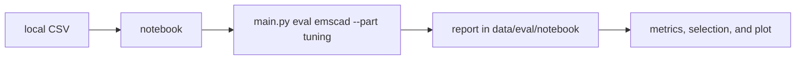

# Job Raider - Example Notebooks

This directory contains Jupyter notebooks demonstrating Job Raider usage.

## Notebooks

### example_usage.ipynb
A comprehensive walkthrough of Job Raider's key features:
- Creating user profiles
- Scraping job listings
- Scoring and ranking jobs
- Resume content selection
- Cost tracking
- Outcome tracking

### scam_detector_evaluation.ipynb

This notebook shows the EMSCAD tuning metrics. The evaluation logic is in
`src/evaluation/suites/emscad.py`. The notebook calls that logic through
the eval CLI. It does not download the CSV, and it does not run the
held-out part. Do not commit cell outputs.

The CSV is local. After you check the license, put the file at
`apps/backend-py/data/kaggle/fake_job_postings.csv`. The keys in
`.env.example` stay optional, for a manual download with the Kaggle CLI.



Activate the backend virtual environment (from `apps/backend-py`):

```bash
source .venv/bin/activate
```

Run the notebook once, with the output outside the repository:

```bash
.venv/bin/python -m jupyter nbconvert --to notebook --execute notebooks/scam_detector_evaluation.ipynb --output-dir /tmp/scam-notebook-run
```

Open the notebook in Jupyter (from `apps/backend-py`):

```bash
jupyter notebook notebooks/scam_detector_evaluation.ipynb
```

## Running the Notebooks

1. Activate the virtual environment:
```bash
source .venv/bin/activate
```

2. Install Jupyter:
```bash
pip install jupyter notebook
```

3. Start Jupyter:
```bash
jupyter notebook
```

4. Navigate to the `notebooks` directory and open a notebook.

## Notes

- Some notebooks may require API keys (set in `.env`)
- Scraping examples are designed to be dry-run by default
- Cost estimates use local models (Ollama) by default
