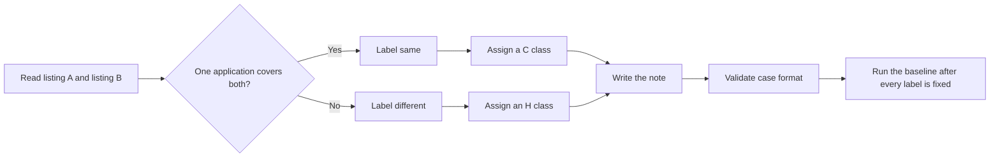

# Dedupe Evaluation Labeling Guide

This guide defines the labels for the listing-pair evaluation set. The
labels state whether one application covers both listings. They do not
describe the current `deduplicate` function. The baseline report measures
the difference between these labels and the merge decision.

## Labeling Rules

### Rule 1: Same Means One Application Covers Both

Two listings are `same` when they are the same employer, the same role,
and the same place of work. A later posting with a new `job_id` or a new
URL is still `same` if one application covers both.

Two listings are `different` when they are not the same vacancy. The same
title, company, and location stay `different` when the text shows anothe
role (another level, team, or contract type).

Decide from both listings. A shared word in the title does not decide the
label.

### Rule 2: Write Labels Before the Suite Runs

Write `expected` and `class` before you run `deduplicate`. Do not change a
label because of a merge result.

If a definition is unclear or wrong:

1. Change the definition in this guide.
2. Add the reason to [Changes](#changes).
3. Relabel every affected case in the same way.
4. Run the suite only after the relabeling is complete.

## Label Definitions

### `same`

Use this label when one application covers both listings.

### `different`

Use this label when the two listings are two vacancies.

## Classes

| Class | Label | What differs between A and B |
|-------|-------|------------------------------|
| C0 | same | Nothing. The same `job_id` appears twice. This checks that the baseline merges something. |
| C1 | same | Source and `job_id` prefix. The pair also changes at least one of: company suffix or punctuation, title case or punctuation, location format, HTML in one description, a shortened description, or the URL domain. |
| C2 | same | `job_id` only. The URL is the same. |
| C3 | same | The URL form: a trailing slash, letter case, a `utm_` parameter, or a fragment. |
| C4 | same | `job_id` and URL. The text stays the same. |
| H1 | different | Location. Title and company stay the same. |
| H2 | different | The other role is visible in the text (another level, team, or contract type). Title, company, and location stay the same. |
| H3 | different | Two jobs share one careers-page or aggregator URL. |
| H4 | different | Company (for example an agency and its client). Title stays the same. |
| H5 | different | Company or title is "Confidential", "Unknown", or empty. |

## Case Format

Each line of `cases.jsonl` is one JSON object:

- `case_id`: `<class in lower case>__<short_name>`, unique.
- `class`: C0 to C4 or H1 to H5.
- `expected`: `same` or `different`, and it agrees with the class.
- `a` and `b`: `JobListing` fields. `JobListing.model_validate` accepts each one. `job_id` uses the scraper prefixes (`mcf-`, `js-`, `cag-`, a LinkedIn id, or a JSearch id).
- `source`: `constructed` or `fixture:<path>#<index>`.
- `note`: why the pair has this class. The note is not part of a listing.

Apart from C0, `a` and `b` have different `job_id` values.

## How the Pairs Were Made

Most pairs are constructed. Each listing is written in the voice of the
employer or the job board. The title, the company, and the description do
not state the label or the class.

A later local file (`data/dedupe_catalog/cases.jsonl`) holds catalog pairs
for a real check. That file is not committed. The user labels it after a
script writes `expected` as `TODO`.

## Diversity Limits

- The set has at least 10 distinct company names.
- One company name appears in at most 4 cases.
- One title appears in at most 3 cases.

## Limits of the Set

- Every `same` pair has the same or a contained description, and every
  `different` pair has a different one. Do not judge a description
  signal on this set.
- The constructed pairs are short board-style postings. They do not cove
  every board layout.
- Lengths overlap between `same` and `different`, but the set is small.
- The set does not include personal data.
- A private probe set, held by the reviewer, measures classes that this
  file does not name.

## Changes

| Date | Change |
|------|--------|
| 2026-10-26 | First guide and the Stage A committed set. |
