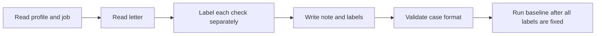

# Grounding Evaluation Labeling Guide

This guide defines the labels for the grounding evaluation set. The labels
state what each check must find. They do not describe the current validator.
The baseline report measures the difference between these labels and the
validator output.

## Labeling Rules

### Rule 1: Label Each Check Separately

Decide every label with its own definition. One sentence can have more than
one label.

Example: The sentence "I run Kubernetes clusters" has
`fabricated_technology` and `ungrounded_claims` when the profile does not
contain Kubernetes. It names an unsupported technology as the candidate's
own, and it states an unsupported fact about the candidate.

### Rule 2: Write Labels Before the Validator Runs

Write `expected_issues` before you run the validator. Do not change a label
because of validator output.

If a definition is unclear or wrong:

1. Change the definition in this guide.
2. Add the reason to [Changes](#changes).
3. Relabel every affected case in the same way.
4. Run the validator only after the relabeling is complete.

## Label Definitions

### `fabricated_technology`

Use this label when the letter claims a technology as the candidate's own,
but the technology is not in the profile skills or in the technologies of an
experience or project. Claims include "used," "built with," and "experienced
in." A technology that appears only in the job description is unsupported.
Short names such as AWS, GCP, Go, and C# count.

Do not use this label when the mention is a disclaimer or a learning goal,
such as "rather than Java" or "keen to learn Go." Do not use it when the word
has a normal English meaning, such as "express my interest," "spring
semester," "a swift reply," or "spark curiosity."

### `inflated_duration`

Use this label when a duration claim, such as "over 5 years," "3-5 years," or
"five years of," is longer than the profile's merged experience. Also use it
when the claim is longer than the `years_of_experience` value of a skill that
the same sentence names.

Do not use this label when the duration is within both limits.

### `inconsistent_metric`

Use this label when one sentence states "from A% to B%" and a gain Z% that
matches neither:

- `B - A`, nor
- `(B - A) / A × 100`.

Allow a difference of 2 percentage points.

Do not use this label when the values agree or when there are no from/to
endpoints. An unsupported number without endpoints is `ungrounded_claims`,
not `inconsistent_metric`.

### `fabricated_experience`

Use this label when the letter presents a project, employer, job title,
degree, or certification as the candidate's own, but the profile does not
contain it.

Do not use this label when the profile contains the item. This definition is
wider than the current code, which checks only selected project names.

### `analogical_claim`

Use this label when the letter maps a resume fact onto a duty that only the
job description names. The mapping uses an analogy such as "my X work is like
Y," "similar to," or "translates directly to," and Y is not in the profile.

Do not use this label when Y is in the profile.

### `scope_inflation`

Use this label when the letter uses leadership or ownership wording beyond
what the profile documents for that work. Examples include "led," "managed a
team," "owned," "architected," and "spearheaded."

Do not use this label when the profile has the same kind of wording for that
work.

### `technique_mismatch`

Use this label when the letter assigns a named technique to a profile project
that does not document that technique. Named techniques include retrieval,
fine-tuning, RAG, and reinforcement learning.

Do not use this label when the project documents that technique.

### `ungrounded_claims`

Use this label when a sentence states a fact about the candidate that no
profile field supports. Facts include actions, achievements, numbers,
responsibilities, and uses of skills. This label includes unsupported numbers
such as "cut costs by 90%" and "3x faster," and fake employers.

Do not use this label for:

- a greeting;
- a closing or call to action;
- a statement of interest or motivation, such as "I am excited about your
  mission"; or
- a company fact from the job description.

## Case Format

`cases.jsonl` contains one JSON object per line. Each object uses the
`GroundingCase` format:

- `case_id`: Unique `<group>__<short_name>` identifier.
- `profile_id`: Key from `profiles.json`.
- `job`: Inline fictional job data accepted by `JobListing`.
- `selection`: Optional selection data used by the validator.
- `letter`: A fictional 120-to-300-word cover letter with a greeting, two or
  three paragraphs, and a closing.
- `expected_issues`: Labels assigned with this guide.
- `note`: The injected condition and why each applicable label is present or
  absent.

## Labeling Process

1. Read the complete synthetic profile.
2. Read the fictional job and optional selection.
3. Read the letter without running the validator.
4. Evaluate every label in this guide, one at a time.
5. Write all applicable labels in `expected_issues`.
6. Explain the main injection and overlapping labels in `note`.
7. Check the JSONL format and dataset counts.
8. Freeze the labels.
9. Run the baseline.

## Changes

No label definition changes have been made after the initial guide
(2026-10-22).
