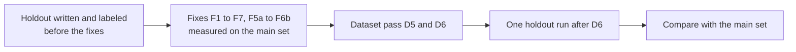

# Grounding Holdout Set

This folder holds a second, smaller set of labeled cover letters. It shows whether the validator fixes of Step 3.2 (F1 to F7, then F5a, F6a, F5b, and F6b in `tasks/todo.md`) work on letters that the fixes were not measured on.



## Rules

1. **Do not open the cases while you fix the validator.** Read only this file. A fix that is tuned to these letters makes the holdout useless.
2. The labels follow the main labeling guide, `../grounding/README.md`, including its Changes section and the decisions of 2026-10-22 (SQL is supported when the profile has a SQL database; a duration range is compared by its top).
3. The validator runs on this set one time, after the fixes (F1 to F7, then F5a, F6a, F5b, and F6b) and the dataset pass D6 (decision 3 after F1 to F3, decision 1 after F4 to F7, and decision 1 after F5a and F6a, 2026-10-23). Before that run, Claude adds the `ungrounded_sentences` labels of D6 to these cases, so the fixer still does not open them:

    Run the holdout (from `apps/backend-py`):

    ```bash
    .venv/bin/python main.py eval grounding --dataset tests/fixtures/eval/grounding_holdout
    ```

4. Record the numbers in `tasks/todo.md` next to the main-set numbers after F7. Do not change a label or a letter after that run. A later round of fixes needs a new holdout set.

## Contents

- `profiles.json`: 2 fictional profiles (`platform`, `analytics`), different from the main set.
- `cases.jsonl`: 23 cases, written on 2026-10-22 before any fix. Each case has a `note` that explains its labels.
- `ungrounded_sentences` (D6): added by Claude on 2026-10-24, before the holdout run and without running the validator on this set. 11 sentences in 11 cases; the other 12 cases have an empty list. No case-level label changed. Convention: the technologies of an experience support a sentence that names them for the work of that experience ("I built the report with Python and PostgreSQL").
- `tests/unit/test_grounding_holdout.py` checks the format, the diversity limits (also with company and title replaced), and that no case ID, company, or long sentence is shared with the main set. It does not run the validator.
