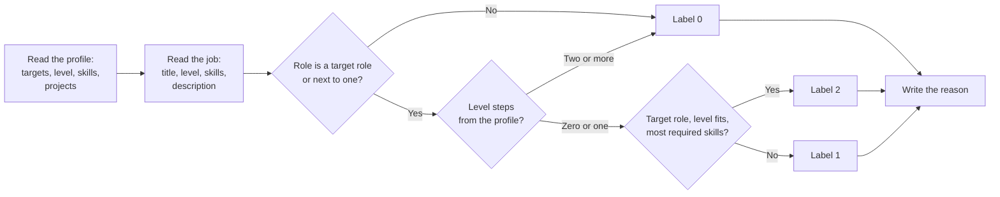

# Ranking Evaluation Labeling Guide

This guide defines the labels for the ranking evaluation set. A label states how useful one job is for one profile. It does not describe the current matcher or ranker. The baseline report measures the difference between these labels and each ranking method.

## Files

| File | Content |
|------|---------|
| `profiles.json` | Profile ID to a `UserProfile`. The profiles are synthetic. |
| `modes.json` | Profile ID to the matcher settings that the pipeline uses for that profile (`fresh_grad_mode`). |
| `jobs.jsonl` | One constructed `JobListing` for each line. No job copies a real posting. |
| `labels.jsonl` | One label for each profile and job: `profile_id`, `job_id`, `label`, and `reason`. |

Each profile is ranked against every job in `jobs.jsonl`, so each profile has a label for every job.

## Labeling Rules

### Rule 1: Label the Job for This Profile Only

Decide each label from the profile and the job. Do not compare the job with other jobs, and do not give a fixed number of each label.

### Rule 2: Write Labels Before Any Ranker Runs

Write every label before you run the matcher or a ranker on the set. Do not change a label because of a ranking result.

If a definition is unclear or wrong:

1. Change the definition in this guide.
2. Add the reason to [Changes](#changes).
3. Relabel every affected pair in the same way.
4. Run the rankers only after the relabeling is complete.

### Rule 3: Read the Text, Not Shared Words

A word that the job and the profile share does not decide the label. "Java" in the profile does not make a JavaScript job relevant, and "AI" in the targets does not make an email marketing job relevant. Decide from what the job asks the person to do.

## Terms

- **Target role**: a role that the profile's target keywords name, or the role of its experience and projects.
- **Role next to a target role**: a role that uses the same core skills for a nearby purpose. Examples: data analyst, BI or analytics engineering, data engineer, MLOps, or AI evaluation for a data scientist or machine learning target; a software role in the profile's main language (or open to any language) for a machine learning profile; site reliability, DevOps, cloud, data engineering, integration, full-stack, or backend services inside an AI or data product (for example LLM features built as API services) for a backend target.
- **Level steps**: Internship, Entry Level, Mid Level, Senior, Lead, Principal, in this order. A job without a level is placed by the years of experience that it asks for (0 to 2 years: Entry Level; 2 to 5: Mid Level; 5 to 10: Senior; more: Lead). The profile's level is its target level.

## Label Definitions

### `2` (apply)

The candidate would apply. All of these are true:

- The role is a target role.
- The level fits (zero steps).
- The profile has most of the required skills (from the job's skill list or, when the list is empty, from the description).

### `1` (maybe)

The candidate might apply after a closer look. The job is not a `2`, and both of these are true:

- The role is a target role or a role next to a target role.
- The level is zero or one step from the profile.

### `0` (not relevant)

The candidate would not apply. One of these is true:

- The role is neither a target role nor next to one.
- The level is two or more steps from the profile.

## The Reason

Write one short line that names the deciding point, for example "Fits: entry ML role, has Python and PyTorch" or "Senior role, 8+ years; profile is entry level".

## Changes

- 2026-11-03: First version (Step 3.4).
- 2026-11-03: Before any ranker ran, the user's check: backend services inside an AI or data product are next to a backend target. Relabeled: rk-003 for `mid_backend` from 0 to 1. No other label changes: rk-010, rk-024, and rk-026 already had this reading.
