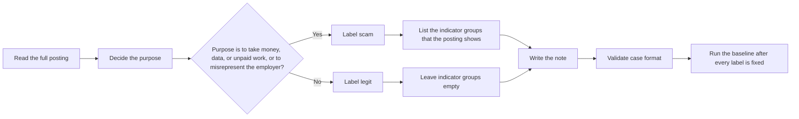

# Scam Evaluation Labeling Guide

This guide defines the labels for the scam evaluation set. The labels state
the purpose of each posting. They do not describe the current filter or
detector. The baseline report measures the difference between these labels
and the pipeline decision.

## Labeling Rules

### Rule 1: Label by Purpose, Not by Single Words

A posting is `scam` when its purpose is to take money, personal data, or
unpaid work from the applicant, or when it misrepresents the employer.

A posting is `legit` when a recruiter can accept it as a real vacancy:
named work, a named employer that is not hidden, and no request that the
applicant pay, forward money, or move the hire to a personal channel only.

Decide from the whole posting. One word does not decide the label.
Examples: "signal" in a signal processing role is not a scam. "WhatsApp"
in a WhatsApp Business API role is not a scam. "bitcoin" in an engineering
role at a bitcoin exchange is not a scam.

### Rule 2: Write Labels Before the Detector Runs

Write `expected` and `indicator_groups` before you run `ScamFilter` or
`JobScamDetector`. Do not change a label because of detector output.

If a definition is unclear or wrong:

1. Change the definition in this guide.
2. Add the reason to [Changes](#changes).
3. Relabel every affected case in the same way.
4. Run the detector only after the relabeling is complete.

## Label Definitions

### `scam`

Use this label when the posting exists to extract money, personal data, or
unpaid work, or when the named employer is not real. Typical forms include
a fee before the first day, a kit the applicant must buy, a check the
applicant must cash and forward, a hire that exists only on a messaging
app or a personal mailbox, a start date with no check, pay that cannot
fit the work, or a vacancy with no real duties.

### `legit`

Use this label when the posting is a real vacancy. The employer and the
work can be named. The applicant does not pay a fee, buy a kit, or
forward money. Contact stays on a company channel, or on a public board,
unless the note records a hard-negative form that a recruiter still
accepts.

## Indicator Groups

List every group that the posting shows. A scam can show more than one
group. A legitimate posting has an empty list.

### `payment`

The applicant pays a fee, buys equipment or a kit, or receives money to
forward. Examples: a training fee before the start date, a starter kit
from a named vendor, a check that the applicant must cash and wire back.

### `contact`

The hire moves to a messaging app or a personal email address only.
Examples: interviews on WhatsApp or Telegram only, applications to a
Gmail or Yahoo address with no company domain.

### `urgency`

A hire with no interview, or a start today with no checks. Examples:
"reply in two hours and you are hired," "start this afternoon, skip the
background check."

### `compensation`

Pay that does not fit the work, the hours, or the role. Examples: several
thousand per week for data entry, a large hourly rate for simple clicks,
an intern wage at a senior executive level.

### `listing_quality`

No real employer, no real duties, or a very short or generic text.
Examples: a confidential firm with no product, a two-sentence vacancy
that names no work, a brand with no location and no manager.

## Hard-Negative Forms

A hard negative is a legitimate posting. Each form below is legitimate
for a reason a recruiter accepts. Write new words for each form. Do not
copy text from EMSCAD or from another dataset.

1. A signal processing role. The word "signal" names the work.
2. A posting that offers competitive pay and the chance to work on a
   named product.
3. An integration role for the WhatsApp Business API. The product is the
   API. The hire does not move to WhatsApp.
4. An engineering role at a bitcoin exchange. The word "bitcoin" names
   the market. The applicant does not send bitcoin.
5. A legitimate posting with an anti-fraud notice that names payment
   words. The notice may use "scam" or "fraud". The `case_id` is
   `hard_negative__antifraud_notice`. The note records that those words
   appear.
6. A senior role with an annual maximum above 156,000.

## Case Format

`cases.jsonl` contains one JSON object per line. Each object uses the
`ScamCase` format:

- `case_id`: Unique `<group>__<short_name>` identifier. Groups:
  `legit_fixture`, `legit_written`, `hard_negative`, `scam_payment`,
  `scam_contact`, `scam_urgency`, `scam_compensation`, `scam_listing`.
- `job`: Inline job data accepted by `JobListing` (title, company,
  description, and, when useful, `salary_range`, `recruiter_email`,
  `source_url`).
- `expected`: `scam` or `legit`.
- `indicator_groups`: Groups that a scam shows. Empty for a legitimate
  posting.
- `source`: `fixture:<path>#<index or id>` or `written`.
- `note`: Why the label is right, in one or two sentences.

`scam_*` cases have `expected` `scam`. `legit_*` and `hard_negative`
cases have `expected` `legit`.

## Labeling Process

1. Read the complete posting (title, company, description, and optional
   fields).
2. Decide the purpose of the whole posting. Do not run the detector.
3. Assign `scam` or `legit` from the definitions in this guide.
4. For a scam, list every indicator group that the posting shows.
5. Explain the purpose and the groups in `note`.
6. Check the JSONL format, the counts, the Voice rule, and the diversity
   limits.
7. Freeze the labels.
8. Run the baseline.

## Voice

Write each posting as an employer writing to applicants. No sentence
names the dataset, a label, or the test. The words "label", "test case",
"indicator", "dataset", and the phrase "this posting is" never appear in
the title or the description. "scam" and "fraud" may appear only in the
anti-fraud notice of `hard_negative__antifraud_notice`. The note of that
case records those words.

Use real-looking but fictional company names for written cases. A
company is in at most 2 cases.

## Diversity Limits

The limits apply to written cases unless a limit names companies. A long
sentence has 8 or more words after whitespace is joined. Digits become
`#`. The limits are a floor, not the goal.

- S1: A long sentence is in at most 2 cases.
- S2: Two cases share at most 1 long sentence.
- S3: Distinct long sentences divided by all long sentences is at least
  0.90.
- S4: With the company and the title replaced by slots, a sentence frame
  is in at most 3 cases.
- S5: A 4-word sentence opening (company replaced) is in at most 4
  cases.
- S6: At least 25 distinct companies. A company is in at most 2 cases.
- S7: The Voice rule.
- S8: Word counts from 30 to 450. At least 6 written postings have more
  than 200 words.

After the tests pass, read 10 cases from start to end and check that
each one reads like a real posting.

## Counts

The committed set has at least 40 cases:

- At least 20 legitimate: every usable public posting from the source
  fixtures (`tests/fixtures/careersatgov/`, `jobstreet/`,
  `mycareersfuture/`, `jd_paste/`), then written legitimate postings,
  and at least 6 hard negatives.
- At least 20 scams, with at least 4 cases for each indicator group.

## Changes

- **2026-10-24, initial guide (Step 3.3 Stage A).** Purpose-based labels
  for `scam` and `legit`, five indicator groups, six hard-negative
  forms, Voice, and diversity limits S1 to S8. Reason: measure the
  pipeline decision before any R3 fix.
