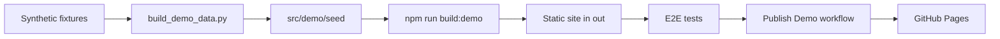

# Public Demo

The public demo shows the core loop of Job Raider in a browser, with no backend, no model, and no resume. The site is static. A service worker from MSW answers each API request in the browser with sample data.



## What the demo shows

The seed script runs the real scoring and writing code on synthetic input, so the scores and the letter are real output. The candidate, the jobs, and the companies are fictional.

Each write returns a 501 with a message. The demo keeps no state, and nothing leaves the browser. An E2E test fails when a page sends a request to another host.

## Build and test on your machine

Build the demo on the base path of the site (from `apps/frontend-ts`):

```bash
NEXT_PUBLIC_BASE_PATH=/job-raider npm run build:demo
```

Run the E2E tests on the exported site:

```bash
npm run test:e2e:demo
```

To use a Chromium that is already installed, set `PLAYWRIGHT_CHROMIUM_PATH` before this command.

Serve the site to read it in a browser. Then open `http://localhost:4599/job-raider/`.

```bash
node scripts/serve-demo.mjs
```

## Check the server build

The server build must have no demo code. Run this check after `npm run build`:

```bash
npm run check:no-demo
```

## Publish

The Publish Demo workflow runs only when a person starts it. A push to `main` does not publish the site. The workflow stops when an E2E test fails.

Set Settings > Pages > Source to GitHub Actions once. Then start the workflow:

```bash
gh workflow run pages.yml --ref main
```
