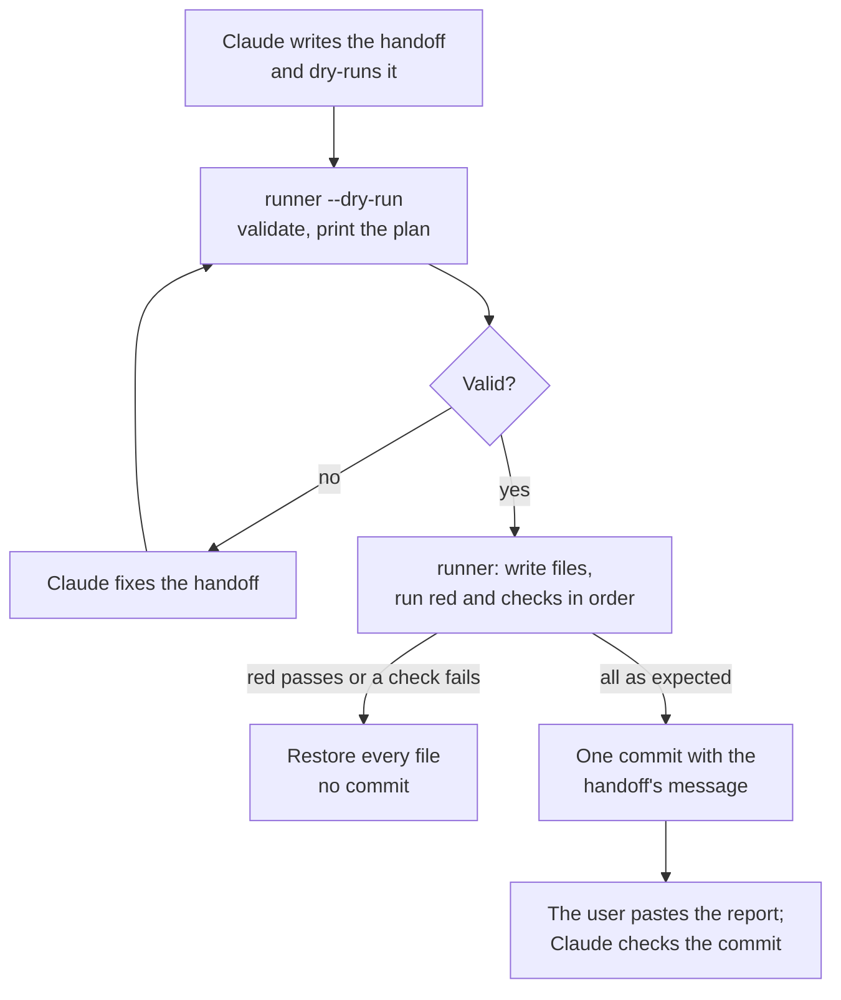

# Handoff Runner

The handoff runner applies a micro-handoff without an LLM agent. Claude writes each micro-handoff with the complete code, the exact edits, and the commands. The runner reads the handoff file, writes the files, runs the commands, and commits. It needs no model, no GPU, and no quota.

The script is `apps/backend-py/scripts/run_handoff.py` (Python standard library only). Its tests are in `apps/backend-py/tests/unit/test_run_handoff.py`.

## Why

Small local models (7B or smaller, which keep the GPU below its safe limit) did not finish a micro-handoff in opencode or Aider, and the free hosted quota can run out. The handoffs already give every line of code, so the agent only copies text and runs commands. A script does that exactly, and it cannot add code that the handoff does not contain. See `tasks/archive/handoff-runner/notes.md`.

## Flow



## Handoff format

The runner reads only fenced code blocks whose info string has a runner attribute after the language word. It skips all other blocks, so a handoff stays readable as normal Markdown. It processes the blocks in the order of the file.

| Info string | Action |
|---|---|
| `python new=<path>` | Create the file with the block text. If the file exists with the same text, keep it. If it exists with other text, stop. |
| `python edit=<path>` | Replace one exact text. The block holds `<<<<<<< OLD`, the old lines, `=======`, the new lines, and `>>>>>>> NEW`. The old text must occur exactly once in the file. |
| `bash red cwd=<dir>` | Run the command. It must fail (the test is written first and the code is not there yet). |
| `bash check cwd=<dir>` | Run the command. It must pass. |
| `text commit` | The commit message. A handoff has exactly one. |

The language word can be any word (`python`, `tsx`, `text`). Paths and `cwd` are relative to the repository root. The default `cwd` is the root. Commands run with `bash -c`, so a frontend check can start with `source ~/.nvm/nvm.sh && nvm use 24 &&`.

An example of an edit block:

```text
<<<<<<< OLD
MESSAGE = "hello"
=======
MESSAGE = "hi"
>>>>>>> NEW
```

## Safety rules

- The runner checks the whole handoff before it writes: the format, one commit block, the paths, each new file, and each old text (against the file as the earlier blocks leave it).
- It never writes outside the repository, in `apps/backend-py/data/`, in `.git/`, or to a `.env` file (`.env.example` is allowed).
- It stops when files are staged, or when a file to edit has changes other than line endings. A commit then holds only the handoff's work.
- When the red command passes, a check fails, or the commit fails, it restores every file that it wrote and does not commit.
- It stages only the files that the handoff names. A check that formats them (black, prettier) is included in the commit.
- It writes UTF-8 text with LF line endings.

## Commands

All commands run in WSL from `apps/backend-py`.

Validate a handoff and print its plan (writes nothing):

```bash
.venv/bin/python scripts/run_handoff.py ../../tasks/active/TASK/HANDOFF.md --dry-run
```

Apply a handoff and commit:

```bash
.venv/bin/python scripts/run_handoff.py ../../tasks/active/TASK/HANDOFF.md
```

Use another repository root (the default is the repository that holds the handoff):

```bash
.venv/bin/python scripts/run_handoff.py ../../tasks/active/TASK/HANDOFF.md --repo /path/to/repo
```

The runner prints each step with its exit code and the last lines of each command's output, then the commit hash. Exit code 0 means the handoff is committed (or the dry run is valid). Exit code 1 means the run stopped; the message says why, and the files are as they were.

## Rules for Claude when writing a handoff

1. Give each new file in a `new=` block, each test file before its code, and the red command right after the test.
2. Give each change to an existing file as an `edit=` block whose old text occurs exactly once.
3. Put the "Done when" commands in `check` blocks, and the commit message in one `text commit` block.
4. Run the runner on a scratch clone before the handoff goes to the user: the red command must fail and every check must pass.
