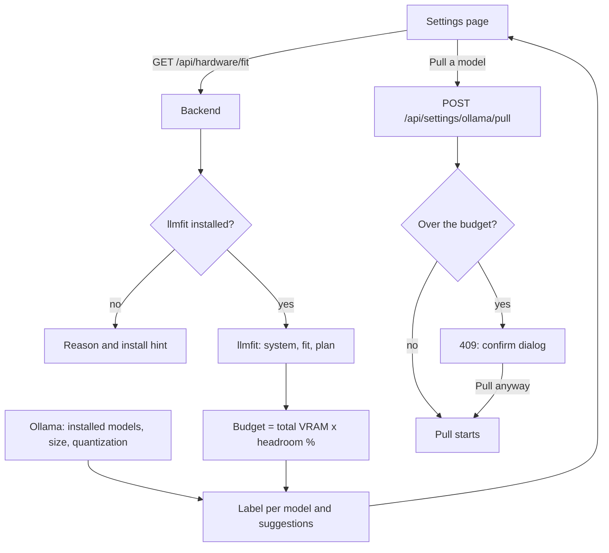

# Hardware Fit

Job Raider runs open-source models on your own machine. Hardware fit tells you which local models your hardware can run, so you choose your models with evidence. It uses [llmfit](https://github.com/AlexsJones/llmfit) (MIT), which is optional and recommended. Without llmfit, the app works as before, and the Settings page tells you how to install it.

## What you see

Open **Settings**. The **Local models** card shows:

- A **fit label** for each installed Ollama model: Fits, Over budget, Too large, or Unknown. Hover a label to see the memory that the model needs and where the number comes from.
- The **safety budget**: the share of your GPU memory that a model may use, and the GPU that llmfit found.
- **Suggested for your hardware**: models that fit the budget, each with a Pull button. You choose what to pull. The app never pulls a model by itself.
- A **confirm dialog** when you pull a model that is over the budget. The pull starts only after you click **Pull anyway**.

The **Hardware Fit** card in Settings has the **GPU memory budget (%)** field: 30 to 100, default 75.



## Why Job Raider has its own budget

llmfit can call a model a good fit when the model fills almost all of the GPU memory. Heavy GPU load can make a desktop unstable. So Job Raider labels each model against its own safety budget:

| Label | Meaning |
|---|---|
| Fits | The model needs no more memory than the budget. |
| Over budget | The model needs more than the budget, but less than the total GPU memory. It can run, with less headroom than you asked for. |
| Too large | The model needs more than the total GPU memory. |
| Unknown | There is no GPU, or no estimate for the model. |

## Where the numbers come from

- **llmfit plan**: when llmfit knows the model, Job Raider asks llmfit for the memory need at the quantization of the file that you have (for example Q4_K_M), at a context of 8,192 tokens.
- **Rough estimate**: when llmfit does not know the model (for example a tag that you made yourself), the need is the file size plus 1 GB for the context and the runtime.
- **File-size floor**: Ollama loads the whole file, so an llmfit plan below the file size is not used. This happens for a Gemma "e" model, where llmfit assumes that part of the weights stays off the GPU. The label then uses the rough estimate and says so.
- **Units**: GB here means 1024³ bytes, as `nvidia-smi` and llmfit report the VRAM and as the Size column shows a file.
- **Suggestions**: models with an Ollama name, at 4-bit quantization or more, under the 9B pull limit, within the budget.

All numbers are estimates, not benchmarks. The backend keeps the results for 10 minutes. The refresh button on the card runs llmfit again.

## Install llmfit

`setup.sh` installs the pinned llmfit version into the backend environment. The version is in `apps/backend-py/requirements-optional.txt`.

Run setup (from the project root):

```bash
./setup.sh
```

To skip llmfit:

```bash
./setup.sh --no-llmfit
```

To install llmfit later without the full setup:

```bash
apps/backend-py/.venv/bin/pip install -r apps/backend-py/requirements-optional.txt
```

The backend looks for llmfit in this order: the `LLMFIT_PATH` variable, the backend `.venv`, and then `PATH`. A version older than the pinned version gives "update recommended", and hardware fit stays off.

## Limits

- **Docker**: the backend image does not install llmfit, and a container cannot see the GPU without the NVIDIA runtime. Run the backend on the host (`make dev-api`) to use hardware fit.
- **WSL**: llmfit finds an NVIDIA GPU through `nvidia-smi`, which WSL provides.
- **Privacy**: Job Raider runs only the read-only llmfit commands `system`, `fit`, and `plan`. They read the hardware and the local Ollama, and they send nothing to the internet.
- **Demo**: the public demo runs in the browser and reads no hardware, so it shows the install hint.
