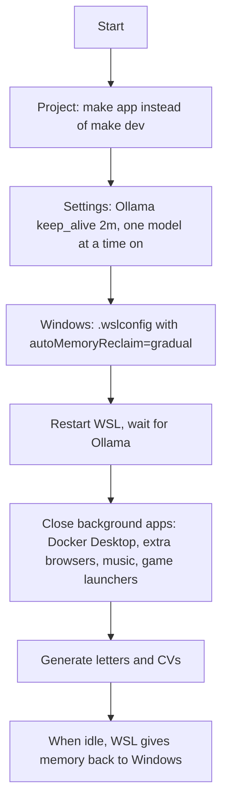
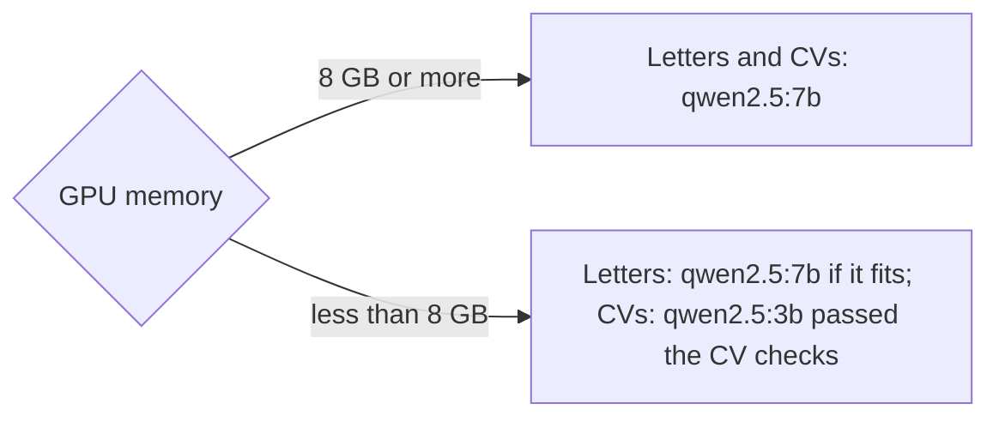

# Low-Memory Guide

This guide is for machines with 16 GB RAM and an 8 GB GPU, for example a laptop with an RTX 2070. It tells you what uses memory when Job Raider runs, how to set up a lean run, and what the lean run changes. The numbers come from measurements on such a laptop (2026-11-15, `tasks/archive/lean-setup/notes.md`).



## What Uses Memory

WSL gets half of the host RAM by default (7.8 GB on a 16 GB machine). The local models use the GPU, but their files go through the RAM when they load.

| Part | Memory | Note |
|---|---|---|
| Backend (uvicorn) | about 820 MB | The same in `make dev` and `make app` |
| Frontend, dev server (`make dev`) | about 880 MB after one page | Grows as pages compile |
| Frontend, production server (`make app`) | about 120 MB | Builds once, then reuses the build |
| `qwen2.5:7b` | 4.7 GB GPU | Writer model |
| `qwen2.5:3b` | 2.2 GB GPU | Selection and checks |
| WSL file cache (`vmmemWSL`) | up to 7 GB during model loads | Windows cannot use it until WSL gives it back |
| Windows apps | varies | Browsers, Docker Desktop, Notion, chat and music apps |

With one model at a time on, the GPU holds only one model. Each letter changes models about three times (3b for selection and checks, 7b for writing). Each change reads the model file again, so each change makes the RAM and the page file busy.

## Lean Setup

### 1. Run the lean app

`make app` runs the backend without auto-reload and the Next.js production server. The first start builds the frontend (about 30 s on the laptop). Later starts reuse the build until the frontend source changes. Use `make dev` only when you change the code.

Command (WSL, from the project root):

```bash
make app
```

`next start` prints a warning about `output: standalone`. The Docker image uses that setting. The pages work; you can ignore the warning for local use.

### 2. Set the model options

On the Settings page, in the Cost Limits card:

- Set **Ollama keep_alive** to `2m`. A model leaves the GPU 2 minutes after its last use.
- Keep **one model at a time** on.
- Click **Save Settings**.

### 3. Let WSL give memory back

Create the file `.wslconfig` in your Windows user folder, with this content:

```ini
[experimental]
autoMemoryReclaim=gradual
```

PowerShell writes the file with the correct name (Notepad can add `.txt`). Command (Windows PowerShell):

```powershell
Set-Content -Path "$env:USERPROFILE\.wslconfig" -Value "[experimental]`nautoMemoryReclaim=gradual"
```

WSL reads the file only when it starts. Stop WSL, then open the Ubuntu terminal again. Command (Windows PowerShell):

```powershell
wsl --shutdown
```

With systemd on, Ollama starts when systemd finishes its start. On the laptop this took about 90 s. Check that Ollama runs before you start the app. Command (WSL):

```bash
systemctl is-active ollama
```

The result must be `active`.

### 4. Close background apps

Close apps that you do not need while you generate documents. Use the tray icon (Quit or Exit): many apps keep running when you close the window.

- Docker Desktop: Job Raider does not need it when Ollama runs as the WSL service and `make app` runs the app.
- A second browser, music apps, and game launchers.
- Browser tabs that you do not need. A browser with many tabs can use 2 GB.

### 5. Check the GPU

Many laptops draw the desktop on the built-in GPU. Then the NVIDIA GPU is free for the models. On the laptop, the idle GPU memory was 16 MiB of 8,192 MiB. Command (WSL):

```bash
nvidia-smi --query-gpu=name,memory.used,memory.total --format=csv
```

If the idle use is high (more than 1 GB), the NVIDIA GPU draws the desktop. Then close GPU apps (games, video players) before you generate documents.

## Measured Result

Workload: 3 cover letters with Deep validation and Review & rewrite on. Before: `make dev` and the usual Windows apps. After: the lean setup above.

| | Before | After (lean) |
|---|---|---|
| Total time | 204 s | 168 s |
| Model loads | 10 | 10, 4 to 18 s each |
| GPU peak | 4.7 GB | 4.7 GB |
| Committed memory, peak | 34.9 GB | 30.3 GB |
| Page file activity, peak | 121,718 pages/s | 64,950 pages/s |
| Windows free RAM, minimum | 0.42 GB | 0.32 GB |
| `vmmemWSL`, peak | 6.7 GB | 7.1 GB |

- The lean setup was 18 % faster and used about 4.5 GB less committed memory. The page file activity peak halved.
- Free RAM stays low during a run. Windows uses free memory as cache, and WSL keeps its file cache while it works.
- WSL gives memory back after the run, when it is idle. With `autoMemoryReclaim=gradual`, the release started about 3 minutes after the run and continued at about 0.3 GB per minute. After 10 minutes, `vmmemWSL` was 4.2 GB (from 6.6 GB) and Windows free RAM was 2.5 GB (from 1.1 GB).

## Smaller GPUs: Writer Models

The writer models use the most GPU memory. A comparison on the laptop (2026-11-15, `tasks/archive/lighter-writer/notes.md`) measured `qwen2.5:7b`, `qwen2.5:3b`, and `llama3.2:3b` with the writer suite (195 letters each) and the resume suite (65 CVs each), against a rule that was fixed before the runs.



| | `qwen2.5:7b` | `qwen2.5:3b` | `llama3.2:3b` |
|---|---|---|---|
| GPU memory | 4.7 GB | 2.2 GB | 2.6 GB |
| Letters: result | baseline | not good enough: unfilled placeholders (21 of 195), more stock phrases | not good enough: placeholders, one invented technology, short letters |
| CVs: result | baseline | good enough: no invented skills, no unsupported numbers, no stock phrases after the polish step | not good enough: stock phrases stay after the polish step |
| Time per CV (p50) | 7.2 s | 4.1 s | 4.4 s |

- Keep `qwen2.5:7b` for cover letters. No smaller model wrote letters of the same quality.
- `qwen2.5:3b` wrote CVs as accurate as `qwen2.5:7b`, with half the GPU memory and about half the time. Its CV text is shorter (median 68 words of prose, against 82). The default CV writer is still `qwen2.5:7b`; a change is a separate decision.
- Do not use `llama3.2:3b` as a writer. In the samples, it wrote a letter in the third person, invented a project, and put job-ad duties into a CV as experience.

## Problems and Solutions

| Problem | Cause | Solution |
|---|---|---|
| The Settings page stops after "Local models" | The backend has no `API_KEY` and rejects every request | Make sure `apps/backend-py/.env` and `apps/frontend-ts/.env.local` have the same `API_KEY` value and Unix line endings, then start the app again |
| "address already in use" for port 8000 or 3000 | The app already runs in another terminal | Stop the other instance (`q` in mprocs, or `Ctrl+C`) |
| A letter takes several minutes and Ollama logs "context canceled" | A cold model load took longer than the chat timeout (fixed: the client now loads the model first with a 600 s timeout) | Update to the current version |
| Ollama is not active after `wsl --shutdown` | systemd has not finished its start | Wait about 90 s, then check again |
