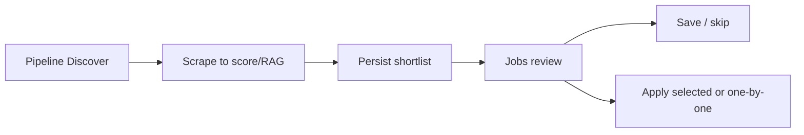
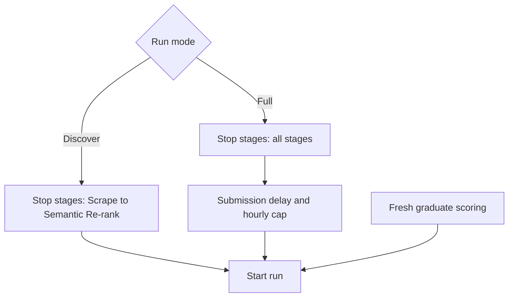
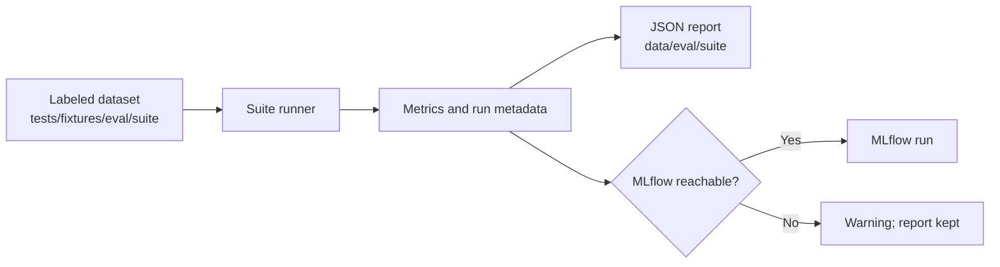
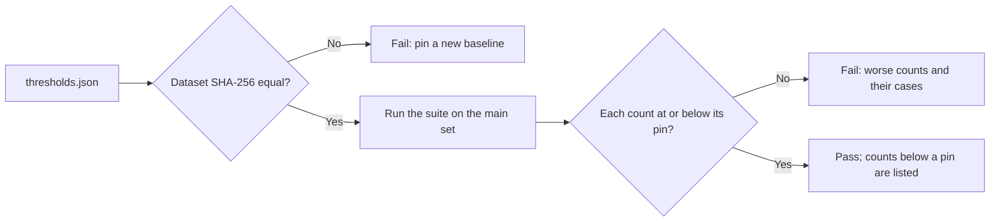
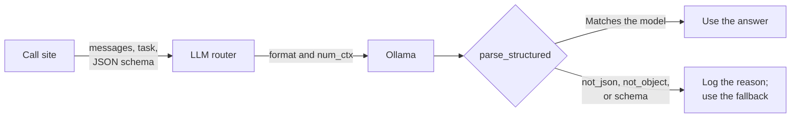
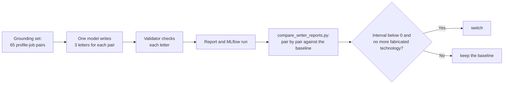
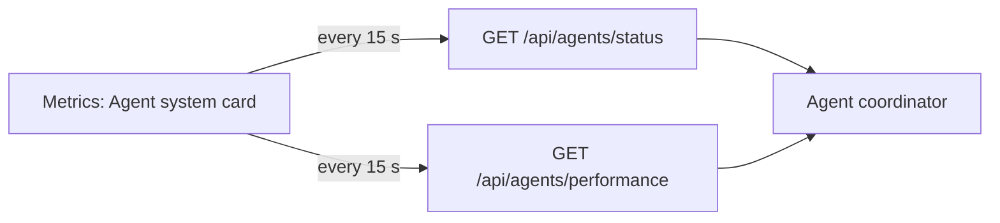
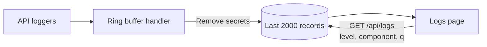
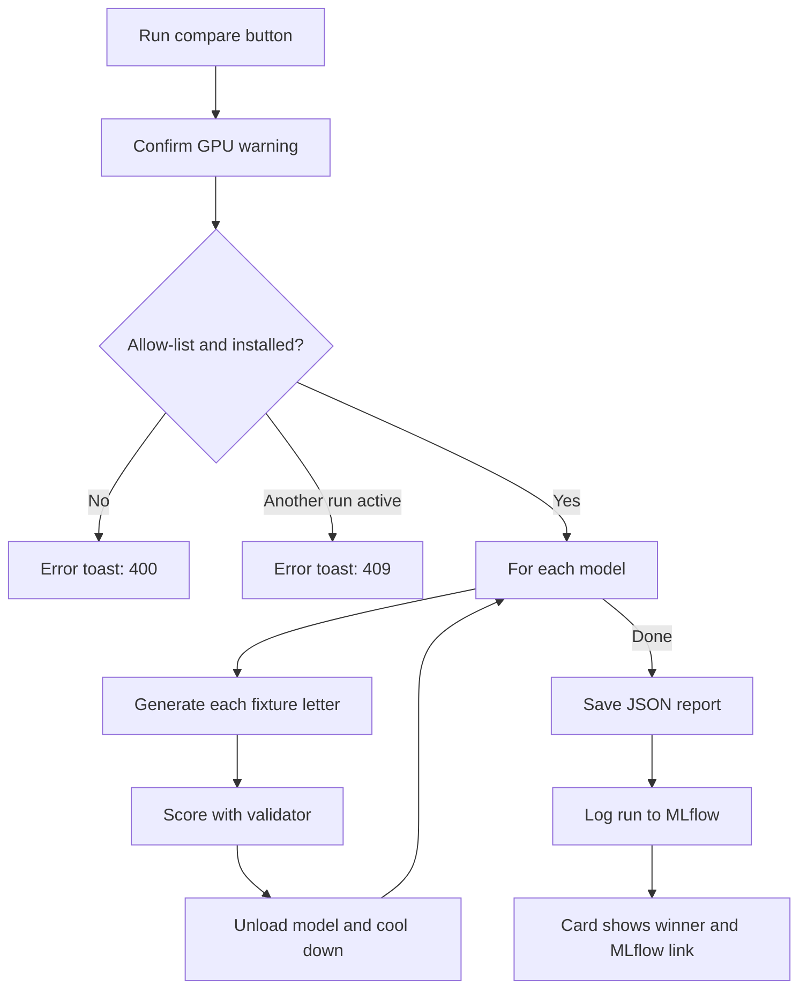
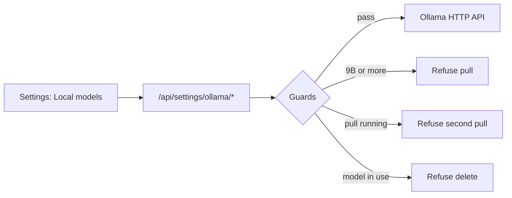

# Job Raider - User Guide

## Quick Start

### Prerequisites

- Python 3.11+
- WSL 2 (Windows) or Linux/macOS
- NVIDIA GPU with 8GB+ VRAM (recommended)
- Ollama installed (for local models)
- Anthropic API key (optional, for fallback)

### Installation

```bash
# Clone the repository
git clone https://github.com/yourusername/job-raider.git
cd job-raider

# Run setup (creates apps/backend-py/.venv, installs Python + Node deps)
./setup.sh

# Pull Ollama models
ollama pull qwen2.5:3b
ollama pull qwen2.5:7b

# Configure backend credentials
cp apps/backend-py/.env.example apps/backend-py/.env
# setup.sh writes a random API_KEY into both env files; they must match
# Edit apps/backend-py/.env — add ANTHROPIC_API_KEY, RAPIDAPI_KEY if needed
# Auth is required unless AUTH_DISABLED=1 is set in the backend .env

# Configure frontend
cp apps/frontend-ts/.env.example apps/frontend-ts/.env.local
# Edit apps/frontend-ts/.env.local — BACKEND_API_URL and the same API_KEY
```

### Running Locally

```bash
# Start both services together
make dev

# Or start them individually
make dev-api          # FastAPI backend on :8000
make dev-frontend     # Next.js dashboard on :3000
```

Open http://localhost:3000 in your browser.

## Discover then review on Jobs

Default Pipeline mode is **Discover**: scrape through score/RAG, persist a shortlist, and stop. Apply is never the silent default.



1. On **Pipeline**, leave mode as Discover (recommended). Start the run.
2. When complete, open **Review on Jobs** (or go to Jobs). The feed shows the latest shortlist with a run banner (counts and run id).
3. Review listings, Save, or Apply one-by-one (dry-run by default). No automatic submit after discover.
4. Optional: switch Pipeline to **Full pipeline (advanced)** for detect/generate/submit stages (still defaults to dry-run).

OCR / vision models are not used in this flow — job listings are text scraped from boards.

### Pipeline page options

The **Advanced options** panel on the Pipeline page gives the same controls as the CLI flags. You do not need a terminal to use them.



| UI control | CLI flag | Range | Default | Modes |
|------------|----------|-------|---------|-------|
| Fresh graduate scoring | `--fresh-grad` | on or off | off | Discover, Full |
| Stop after stage | `--stop-at` | stages of the mode | all stages | Discover, Full |
| Delay between submissions (s) | `--submission-delay` | 0.5 to 60 | 2 | Full |
| Max submissions per hour | `--max-submissions` | 1 to 100 | 30 | Full |

- In Discover mode, the last stage you can select is Semantic Re-rank. The API rejects a later stop stage.
- When you change from Full to Discover, a stop stage that Discover does not have is cleared.
- The **Fresh graduate** switch on the Jobs search bar applies the same scoring to a direct search.

### Basic Usage

#### Interactive Mode

```bash
cd apps/backend-py
python main.py --interactive
```

This will guide you through:
1. Providing your resume path
2. Entering job keywords
3. Specifying locations
4. Choosing sources
5. Confirming options

#### CLI Mode

```bash
# Basic search with dry run
cd apps/backend-py
python main.py \
  --resume my_resume.pdf \
  --keywords "python engineer" \
  --locations "new york remote" \
  --dry-run

# Full pipeline with submission
cd apps/backend-py
python main.py \
  --resume my_resume.pdf \
  --keywords "fintech AI" \
  --locations "remote" \
  --sources linkedin jsearch \
  --no-dry-run

# Stop after scoring
cd apps/backend-py
python main.py \
  --resume my_resume.pdf \
  --keywords "SWE" \
  --stop-at score_and_rank
```

## Command-Line Options

### Required Arguments

| Option | Description |
|--------|-------------|
| `--resume PATH` | Path to your resume (PDF or DOCX) |
| `--keywords WORDS` | Job keywords to search (space-separated) |
| `--locations LOCS` | Job locations (space-separated) |

### Optional Arguments

#### Search Options

| Option | Description | Default |
|--------|-------------|---------|
| `--sources` | Sources to search | all |
| `--target-keywords` | Additional profile keywords | - |
| `--target-locations` | Additional profile locations | - |
| `--target-experience` | Experience levels | - |

#### Pipeline Options

| Option | Description | Default |
|--------|-------------|---------|
| `--dry-run` | Simulate submissions | true |
| `--no-dry-run` | Enable actual submissions | - |
| `--skip-submission` | Skip submission entirely | false |
| `--stop-at STAGE` | Stop after this stage | - |

Resume from a stage is not available. The pipeline does not save the output of each stage, so every run starts at the scrape stage.

#### Scoring Options

| Option | Description | Default |
|--------|-------------|---------|
| `--min-score` | Minimum relevance (0-100) | 60 |
| `--fresh-grad` | Enable fresh graduate scoring mode | false |
| `--scam-threshold` | Scam confidence (0-1) | 1.0 |
| `--max-jobs` | Jobs to present | 20 |

**Fresh Graduate Mode:**
When `--fresh-grad` is enabled, the scoring algorithm adjusts to prioritize projects and education over work experience:

- **Projects (35%)** - Academic projects, portfolio, hackathons
- **Skills (30%)** - Technical skills match against job requirements
- **Education (20%)** - Degree level, major relevance, GPA
- **Experience (10%)** - Internships, part-time work (reduced weight)
- **Location (5%)** - Geographic preferences

The minimum score threshold is also reduced to 50 (from 60) to increase opportunities for entry-level candidates.

#### Submission Options

| Option | Description | Default |
|--------|-------------|---------|
| `--submission-delay` | Delay between submissions (sec) | 2.0 |
| `--max-submissions` | Max submissions per hour | 30 |

#### Storage Options

| Option | Description | Default |
|--------|-------------|---------|
| `--data-dir` | Data storage directory | data |
| `--results-dir` | Results directory | data/results |

#### Logging Options

| Option | Description | Default |
|--------|-------------|---------|
| `--log-level` | Logging level | INFO |
| `--log-file` | Log file path | stdout only |

## Usage Examples

### Example 1: First-Time User

```bash
# Interactive mode for first-time setup
cd apps/backend-py
python main.py --interactive
```

### Example 2: Remote Job Search

```bash
cd apps/backend-py
python main.py \
  --resume ~/Documents/my_resume.pdf \
  --keywords "remote python engineer" \
  --locations "remote united states" \
  --dry-run
```

### Example 3: Target Specific Companies

```bash
cd apps/backend-py
python main.py \
  --resume ~/resume.pdf \
  --keywords "fintech blockchain" \
  --locations "new york san francisco" \
  --sources linkedin \
  --min-score 70
```

### Example 4: High-Volume Application

```bash
cd apps/backend-py
python main.py \
  --resume ~/resume.pdf \
  --keywords "software engineer" \
  --locations "remote" \
  --max-jobs 50 \
  --no-dry-run
```

### Example 5: Fresh Graduate Search That Stops After Scoring

```bash
cd apps/backend-py
python main.py \
  --resume ~/resume.pdf \
  --keywords "python" \
  --fresh-grad \
  --stop-at score_and_rank
```

## Pipeline Stages

### Stage 1: Scrape

Scrapes job listings from configured sources.

```bash
# Specific sources only
cd apps/backend-py
python main.py \
  --resume resume.pdf \
  --keywords "python" \
  --locations "remote" \
  --sources linkedin jsearch
```

### Stage 2: Deduplicate

Removes a listing only when it has the same job ID as an earlier
listing. Other listings stay. Possible duplicates get a flag with a
reason (the same cleaned URL, or the same company, title, and location).

### Stage 3: Filter Scams

Flags potential scam listings using 10 indicators. The default action is
`flag`: the pipeline keeps every posting and records the score. Use
`--scam-threshold` to set the score that counts as a flag (default 1.0).

### Stage 4: Filter by Profile

Filters listings matching your profile preferences (keywords, locations, experience levels, and optional `exclude_internships`).

### Stage 5: Score and Rank

Scores listings by relevance (0-100 scale).

```bash
# Adjust minimum score
cd apps/backend-py
python main.py \
  --resume resume.pdf \
  --keywords "python" \
  --locations "remote" \
  --min-score 70
```

### Stage 6: Detect Auto-Submit

Identifies "Easy Apply" opportunities.

### Stage 7: Present Selection

Shows ranked list for selection.

```bash
# Adjust number of jobs presented
cd apps/backend-py
python main.py \
  --resume resume.pdf \
  --keywords "python" \
  --locations "remote" \
  --max-jobs 30
```

### Stage 8: Generate Resumes

Creates tailored resumes for selected jobs.

### Stage 9: Submit Applications

Submits applications (auto-submit where possible).

```bash
# Dry run (default)
cd apps/backend-py
python main.py --resume resume.pdf --keywords "python" --locations "remote"

# Actual submissions
cd apps/backend-py
python main.py --resume resume.pdf --keywords "python" --locations "remote" --no-dry-run

# Skip submission entirely
cd apps/backend-py
python main.py --resume resume.pdf --keywords "python" --locations "remote" --skip-submission
```

## LinkedIn Profile Analysis

The **LinkedIn Analysis** page evaluates your profile for inbound recruiter attraction and recommends improvements. Open it from the sidebar at `LinkedIn Analysis`.

### Input options

The page provides four tabs so you can provide a profile in the way that suits you:

1. **LinkedIn URL** — paste a public LinkedIn profile URL and click **Analyze**. The backend attempts to fetch the page text using the credentials configured in `apps/backend-py/.env` (`LINKEDIN_EMAIL` and `LINKEDIN_PASSWORD`). The fetched content is merged with anything else you supply before the LLM analyzes it.
2. **Search Profiles** — find LinkedIn profiles by keywords, name, title, company, or location. Results appear as selectable cards. Click **Use this profile** on a result to copy its URL into the LinkedIn URL tab and switch to it. Searching requires the same LinkedIn credentials as the URL tab.
3. **Paste Profile Text** — paste the raw text of a LinkedIn profile (or any bio) directly. This works without LinkedIn credentials.
4. **Fill Sections Manually** — enter structured fields such as headline, summary, experience, education, skills, and career goals. This also works without LinkedIn credentials.

### Requirements for URL fetch and people search

URL-based analysis and people search rely on an authenticated LinkedIn session. Set these variables in `apps/backend-py/.env`:

```bash
LINKEDIN_EMAIL=your-linkedin-email@example.com
LINKEDIN_PASSWORD=your-linkedin-password
```

If the credentials are missing or the session cannot start, the URL tab falls back to analyzing only the data you provided, and the Search tab displays a service-unavailable message.

### Interpreting the results

The analysis card shows:

- **Overall score** — a 0–100 recruiter-attraction score.
- **Section scores** — per-section scores and feedback for headline, summary, experience, and so on.
- **Insights** — prioritized recommendations such as keyword gaps, content issues, and profile structure.
- **Action plan** — concrete steps to improve the profile.
- **Generated headline options** and **summary rewrite suggestions** — ready-to-use copy alternatives.

### Programmatic example

You can also call the analysis endpoint directly:

```bash
# Analyze from a LinkedIn URL
curl -s -X POST http://localhost:8000/api/profile/analyze-linkedin \
  -H "Content-Type: application/json" \
  -H "X-API-Key: $API_KEY" \
  -d '{"profile_url": "https://www.linkedin.com/in/janedoe"}' | jq .

# Search for profiles
curl -s -X POST http://localhost:8000/api/profile/search-linkedin \
  -H "Content-Type: application/json" \
  -H "X-API-Key: $API_KEY" \
  -d '{"keywords": "senior python engineer", "limit": 5}' | jq .
```

## Working with Results

### Generated Resumes

Resumes are saved to `data/results/resumes/`:

```
data/results/resumes/
├── {job_id}.pdf
└── {job_id}.docx
```

### Application Tracking

Applications are tracked in `data/results/applications/`:

```bash
# View application status
cat data/results/applications/{app_id}.json
```

### Pipeline Results

Each run saves results to `data/results/pipeline_run_*.json`:

```bash
# View latest run
ls -lt data/results/pipeline_run_*.json | head -1
cat data/results/pipeline_run_TIMESTAMP.json
```

## Offline Evaluation

The `eval` command scores one part of the system on a labeled dataset. Each run writes a JSON report and, when MLflow is available, one MLflow run. The run records the git commit, whether tracked files had changes, and the SHA-256 of the dataset, so each number can be traced to the code and data that produced it.



Suites available now: `grounding` (the deterministic cover-letter grounding validator), `scam`, `emscad`, and `dedupe` (deterministic; `python main.py eval --help` shows an example for each), `ranking` (job ranking, see "Ranking Suite" below), and `structured` and `writer` (LLM output; they need Ollama, see "Structured-Output Suite" and "Writer Model Comparison" below). The default dataset of `grounding` is the labeled main set in `tests/fixtures/eval/grounding`. The holdout set in `tests/fixtures/eval/grounding_holdout` is not for routine runs: it ran one time, and its README explains why.

Run the grounding suite on the main set (from `apps/backend-py`):

```bash
python main.py eval grounding
```

Run a suite on another dataset folder (from `apps/backend-py`):

```bash
python main.py eval grounding --dataset path/to/dataset
```

Write the JSON report only, without an MLflow run:

```bash
python main.py eval grounding --dataset path/to/dataset --no-mlflow
```

MLflow store: when `MLFLOW_TRACKING_URI` is set, runs go to that server (for example `http://localhost:5000`). When it is not set, runs go to a local SQLite file, `apps/backend-py/data/mlflow.db`, with artifacts in `apps/backend-py/data/mlartifacts`. Open the local store in the MLflow UI:

```bash
mlflow ui --backend-store-uri sqlite:///data/mlflow.db
```

### CI Gate for the Grounding Suite

CI fails when a change makes the grounding checks worse on the main set. The suite is deterministic, so the gate pins counts, not ratios: for each label, the false positives and the false negatives must stay at or below the pins in `tests/fixtures/eval/grounding/thresholds.json`. The sentence-level counts of `ungrounded_claims` are pinned in the same way. The file also pins the SHA-256 of the main set, so a changed dataset fails before any count is compared.



The CI backend job runs the gate as part of `pytest tests/`. Run only the gate (from `apps/backend-py`):

```bash
python -m pytest tests/unit/test_grounding_thresholds.py -q
```

Change a pin only in the same commit as the change that moves it:

1. Run `python main.py eval grounding` and note the MLflow run.
2. Edit the count in `thresholds.json`. When the main set changed, also set the new `dataset_sha256`.
3. Add an entry to `changes` with the date, the reason, and the MLflow run. A pin that goes up accepts a worse count, so its reason must say why.

### Structured-Output Suite

Each LLM task that answers in JSON has an output model in `src/llm/structured.py`. The call site sends the model's JSON schema to Ollama (`format`), and the router sets the context size of the task (`num_ctx`: 8,192 tokens for JD extraction and resume parsing, 4,096 for the other tasks). The call site then checks the whole answer with `parse_structured`: no regex, and no cut from the first `{` to the last `}`. When the answer does not match, the call site logs the reason (`not_json`, `not_object`, or `schema`) and uses its fallback.



The `structured` suite measures this on a fixed set of 43 synthetic cases for the 9 call sites in `OUTPUT_MODELS`: selection, resume writing, resume validation, resume analysis, cover-letter review, cover-letter validation, resume parsing, JD extraction, and job classification. The suite runs the real component of each site 3 times for each case, with the response cache off, and sorts each answer:

- `strict`: the whole answer is one JSON object that matches the output model.
- `rescued`: only the text from the first `{` to the last `}` matches (what the old regex took).
- `failed`: neither.

The suite also records the answers in which the old parsing found no JSON object, the prompts that filled the context, the peak GPU memory, the calls that did not reach Ollama, and the model of each task. It loads one model at a time and unloads each model after its cases. It needs Ollama, so it runs locally, not in CI; its unit tests use a fake router and run in CI.

Before you run it, make sure that no other model is loaded in Ollama and that no pipeline is running (the GPU limit is one model of 7B or smaller at a time). Run the suite (from `apps/backend-py`):

```bash
python main.py eval structured
```

Results of Step 3.7 on the same set (dataset SHA-256 `2fce5d52...`):

| Run | MLflow run | Strict | Rescued | Failed | Peak VRAM |
|-----|------------|--------|---------|--------|-----------|
| Before (regex parsing, no schema) | `ade9802558bf497ea05c2eceeaf40661` | 0.845 | 0.132 | 0.023 | 6,846 MiB |
| After (schema and strict parsing) | `3882e8625b774a89bd32be9d891191e1` | 1.000 | 0 | 0 | 6,444 MiB |

Limits: the inputs of the set are short (the longest prompt is about 1,330 tokens), so the set measures the answer format, not long inputs. The suite reads the context length from Ollama one time for each model, so its report cannot show the 8,192 tokens of JD extraction and resume parsing; the router's unit tests check that value.

To add a JSON task: add its output model to `src/llm/structured.py`, send `Model.model_json_schema()` as `response_schema`, and parse with `parse_structured`. When the suite must measure the task, also add it to `OUTPUT_MODELS`, to `SITE_TASK_TYPES` and `run_case` in `src/evaluation/suites/structured.py`, and to `tests/fixtures/eval/structured/cases.jsonl`. A changed set has a new SHA-256, so its runs do not compare with the runs above.

### Writer Model Comparison

The `writer` suite measures one local cover-letter writer model on the grounding set. For each of the 65 profile-job pairs, the production writer (`CoverLetterWriter.write`, temperature 0.8) writes 3 letters with a fixed selection, and the deterministic validator checks each letter. The labels of the grounding cases belong to their fixed letters, so the suite uses only the jobs and the profiles. Each run is one model and one MLflow run. The report gives `unfilled_placeholder_rate`, the share of first drafts with a token such as `[Company]`.



The main metric is `ungrounded_claims_rate`, the share of the model's letters that the validator flags for unsupported claims. On real generated letters, this check has a precision of 0.875 and a recall of 0.778 at the letter level (Step 3.2). The report also gives the shares for `fabricated_technology`, `fabricated_experience`, and `scope_inflation`, the share of valid letters, the mean score, the median word count, the latency, and the peak VRAM. A letter from the writer's template fallback or from another model is counted, not scored.

The run stays local:

- Only the models in `WRITER_MODELS` (`src/evaluation/suites/writer.py`) can run: `qwen2.5:7b`, `qwen3.5:4b`, `qwen2.5:3b`, and `gemma3:4b`. These are the models of 7B or smaller that are approved for this host.
- The run stops before any call when the cover-letter writing route in Settings does not use Ollama with the requested model. It also turns off the route's fallback provider and the response cache for the run.
- The model is unloaded after the run, also when the run stops with an error.

Before you run it, make sure that no other model is loaded in Ollama and that no pipeline is running. Run one model (from `apps/backend-py`):

```bash
python main.py eval writer --model qwen2.5:7b
```

Change the number of letters for each pair (the default is 3):

```bash
python main.py eval writer --model qwen2.5:7b --samples 1
```

Compare a model with the baseline `qwen2.5:7b`. Give the two report files that the runs printed, the baseline first:

```bash
python scripts/compare_writer_reports.py data/eval/writer/BASELINE.json data/eval/writer/OTHER.json
```

The script compares the two models pair by pair: for each pair, the difference in the share of flagged letters, and a 95% bootstrap interval of the mean difference (2,000 resamples, seed 0). It prints `switch` only when the whole interval is below 0 and the other model's `fabricated_technology` rate is not higher.

On the grounding set, the validator flags nearly every letter, so that share is at its ceiling. Use the secondary analysis instead (the baseline report first):

```bash
python scripts/compare_writer_reports.py data/eval/writer/BASELINE.json data/eval/writer/OTHER.json --secondary
```

It compares the mean count of flagged ungrounded sentences in a letter (S1) and the share of letters with `scope_inflation` (S2), pair by pair with the same bootstrap. It prints `switch` only when the S1 interval is below 0, the S2 interval is not above 0, and the `fabricated_technology` rate is not higher. Also compare the word counts and the structure checks in the reports: a model with short letters has fewer sentences to flag. The results and the decision for the default writer are in `docs/decision-log.md`.

Limits: the validator does not find analogical claims (work credited to duties that only the job names), which is the most common error in real letters. The suite measures the first draft only, without the review pass.

### Ranking Suite

The `ranking` suite measures how well each method ranks jobs for a profile. The set in `tests/fixtures/eval/ranking` has 2 synthetic profiles, 70 constructed jobs, and 140 labels: `2` (apply), `1` (maybe), and `0` (not relevant). Each method ranks all 70 jobs for each profile. The suite reports NDCG@10 (the label is the gain) and recall@10 (the share of the jobs labeled `2` that are in the top 10), for each profile and as the mean.

```mermaid
flowchart LR
    S[Ranking set:<br/>2 profiles, 70 jobs,<br/>140 labels] --> H[heuristic]
    S --> B[bm25]
    S --> D[dense]
    H --> F[hybrid: RRF of dense and<br/>BM25, then 0.4 heuristic<br/>+ 0.6 fused score]
    B --> F
    D --> F
    H --> M[NDCG@10 and recall@10]
    B --> M
    D --> M
    F --> M
    M --> G{heuristic and BM25<br/>at or above their pins?}
    G -->|No| X[CI fails]
    G -->|Yes| P[CI passes]
```

| Method | What it ranks by | Where it runs |
|--------|------------------|---------------|
| `heuristic` | The score of `JobMatcher`, with the profile's matcher mode | CI and local |
| `bm25` | BM25 over the job chunks; a job has the score of its best chunk | CI and local |
| `dense` | The similarity between the profile chunks and the job chunks | Local; needs `nomic-embed-text` |
| `hybrid` | `RAGRanker.re_rank`, as the pipeline runs it | Local; needs `nomic-embed-text` |

Run the heuristic and BM25 methods (from `apps/backend-py`; this needs no model):

```bash
python main.py eval ranking
```

Run all four methods (WSL, from `apps/backend-py`; the embedding model loads on the GPU):

```bash
python main.py eval ranking --methods heuristic,bm25,dense,hybrid
```

Results on 2026-11-04, after the R4 and R5 fixes (git `0794d5c`, dataset SHA-256 `6f5dbeaa...50c1`, MLflow run `d0cc16f055ba4dd1a9fa5982cde70743`, peak VRAM 2,652 MiB):

| Method | NDCG@10 mean | Recall@10 mean | `fresh_ml` NDCG@10 | `mid_backend` NDCG@10 |
|--------|------|------|------|------|
| bm25 | 0.915 | 0.784 | 0.864 | 0.967 |
| hybrid | 0.851 | 0.739 | 0.766 | 0.935 |
| heuristic | 0.818 | 0.568 | 0.767 | 0.869 |
| dense | 0.806 | 0.614 | 0.681 | 0.932 |

Hybrid is the method that the pipeline uses. BM25 alone is the best method on this set. Before the fixes, hybrid had NDCG@10 0.707; `docs/decision-log.md` has the causes and the reason that the pipeline keeps hybrid.

Limits:

- The set has 2 profiles and 70 clean constructed jobs. Lexical matching can be easier on clean text than on real postings, so these numbers compare the methods on this set only.
- No weight or constant is tuned on this set.
- The suite ranks all 70 jobs. The pipeline ranks only the jobs that pass the heuristic gate (60), so its group of candidates is smaller.
- The hybrid score comes from ranks. The best job of a weak group gets a fused score of 1.0.
- The cross-encoder is off by default, and the suite does not measure it.

CI fails when a change makes the heuristic or BM25 ranking worse. The two methods are deterministic, so the gate pins NDCG@10 and recall@10 for each profile with no margin: each metric must stay at or above its pin in `tests/fixtures/eval/ranking/thresholds.json`. The file also pins the SHA-256 of the set, so a changed set fails before any metric is compared. Dense and hybrid need the embedding model, so they are not in this gate; unit tests with fixed scores cover the hybrid logic (`tests/unit/test_rag_hybrid.py`).

The CI backend job runs the gate as part of `pytest tests/`. Run only the gate (from `apps/backend-py`):

```bash
python -m pytest tests/unit/test_ranking_thresholds.py -q
```

Change a pin only in the same commit as the change that moves it:

1. Run all four methods and note the MLflow run.
2. Edit the metric in `thresholds.json`. When the set changed, also set the new `dataset_sha256`.
3. Add an entry to `changes` with the date, the reason, and the MLflow run. A pin that goes down accepts a worse ranking, so its reason must say why.

## Multi-Agent API

The multi-agent system exposes career-coaching endpoints under `/api/agents/*`. These are read/write REST endpoints protected by the standard `X-API-Key` header (omitted below for brevity; required when `API_KEY` is set on the backend).

### Check Agent System Status

In the app, open **Metrics** and scroll to **Agent system**. The card shows coordinator and message bus health, the task totals, and one row for each agent (state, tasks, success rate, average time, load). It refreshes every 15 seconds. The card is read-only. To shut down the agent system, use the API (see Other Endpoints).



To check from a terminal:

```bash
# Verify the agent system is initialized and ready
curl -s http://localhost:8000/api/agents/status | jq .
```

A healthy response returns `coordinator_running: true`, `communication_healthy: true`, and one registered agent (`career_coach`, state `ready`). If the system failed to initialize at startup, this endpoint returns HTTP 503.

### Trigger Career Analysis

```bash
# Analyze a user profile against optional target jobs
curl -s -X POST http://localhost:8000/api/agents/career-analysis \
  -H "Content-Type: application/json" \
  -d '{"profile": {"name": "Jane Doe", "skills": ["python", "fastapi"]}, "target_jobs": []}' | jq .
```

### Analyze Skill Gaps

```bash
# Compare a profile against one or more target jobs
curl -s -X POST http://localhost:8000/api/agents/gap-analysis \
  -H "Content-Type: application/json" \
  -d '{"profile": {"skills": ["python"]}, "target_jobs": [{"title": "Senior Backend Engineer"}]}' | jq .
```

Task endpoints (`career-analysis`, `gap-analysis`, `upskilling-roadmap`, `career-goals`) are rate-limited and return a `task_id` for tracking:

```json
{"success": true, "data": {"task_id": "<uuid>", "agent": "career_coach", "task_type": "gap_analysis", "status": "submitted"}}
```

### Other Endpoints

```bash
# Per-agent performance metrics
curl -s http://localhost:8000/api/agents/performance | jq .

# Agent-system health
curl -s http://localhost:8000/api/agents/health | jq .

# Career recommendations
curl -s "http://localhost:8000/api/agents/recommendations?limit=5" | jq .

# Gracefully shut the agent system down
curl -s -X POST http://localhost:8000/api/agents/shutdown | jq .
```

See [Architecture - Multi-Agent Layer](architecture.md#multi-agent-layer) for the component design and request flow.

## Docker Usage

### Starting Services with Docker

The recommended way to run Job Raider is via the Docker startup script:

```bash
# Start all services (auto-detects available ports)
bash docker-run.sh
```

This script:
1. Finds available ports starting from 8000 (API), 11434 (Ollama), and 3000 (frontend)
2. Stops any existing containers
3. Builds images if needed
4. Starts all services in detached mode
5. Displays the assigned ports and access URLs

### Version and releases

The product version is the root `VERSION` file (also returned by `GET /api/version`). Annotated tags `vX.Y.Z` are checkpoints; see [Deployment - Version checkpoints](deployment.md#version-checkpoints-semver--git-tags) for the bump/tag/push ritual and [`CHANGELOG.md`](../CHANGELOG.md) for release notes.

### Manual Docker Commands

```bash
# Start all services
docker-compose up -d

# View running containers
docker-compose ps

# View logs
docker-compose logs -f

# View logs for a specific service
docker-compose logs -f backend

# Stop all services
docker-compose down

# Rebuild and restart
docker-compose up -d --build
```

### Accessing the API

Once containers are running, the FastAPI interactive documentation is available at:

```bash
# If port 8000 is available
http://localhost:8000/docs

# If port 8000 is taken, the script assigns the next available port
http://localhost:8001/docs
```

Check assigned ports with:

```bash
docker ps --filter "name=job-raider" --format "table {{.Names}}\t{{.Ports}}"
```

### Accessing the Web Dashboard

The Next.js dashboard runs on port 3000:

```bash
http://localhost:3000
```

**Dashboard Features:**

**Theme Toggle:**
- Light/dark mode toggle button at bottom of sidebar
- System theme detection with manual override
- Theme persists across sessions
- Both themes feature the Odysseus design with sharp borders and red accents

**Navigation Pages:**
- **Dashboard** - System health, API costs, recent pipeline runs
- **Pipeline** - Discover (default: scrape and score) or advanced full pipeline; optional Use profile targets
- **Jobs** - Review latest discover shortlist, or live search; optional Use profile targets; apply is explicit
- **Applications** - Track saved and applied jobs (Simulate Apply for dry-run paths)
- **Profile** - Manage profile, skills, experience, and Job Targets (keywords, locations, experience, exclude internships). After upload, shows parse time, duration, and model. The skills radar scores categories from CV evidence (proficiency, years, core skills, experience/project mentions), emphasizes top skills within each category, and scales scores to your profile shape so axes are not artificially balanced. Use **Download PDF** to export a structured profile summary (identity, summary, experience, education, skills, certifications). Empty sections are omitted. This is a readable report, not a resume rewrite.
- **Assessment** - DISC work-style assessment and skill-based technical interview practice
- **Resume Analysis** - AI-powered resume parsing and gap analysis
- **LinkedIn Analysis** - Inbound-attraction scoring and recruiter-focused profile recommendations
- **Cover Letter** - Paste a job description, or upload a PDF/DOCX to fill the JD field, then generate/review and export. Upload extracts text only; you must still click Generate. After generate, the result shows model, stage timings (draft / review / rewrite / total), and LLM token consumption (total, with prompt/completion split when available). Two export actions: **Export full analysis** (JSON snapshot for quality control and model compares — job details, fit score/breakdown, letter text, writer settings, timing/tokens, proofread scores, reviewer feedback, timestamp) and **Export cover letter PDF** (letter body only). Fit assess uses standard JobMatcher weights (keyword / skills / experience / location); the breakdown lists only scored categories. Keyword points are overlap between your Job Targets keywords and the JD, not raw JD term density. Proofread scores use severity-weighted grounding: vague wording costs less than fabricated scope or technique mismatches. Fabricated-technology checks ignore honest disclaimers and learn-intent phrasing (for example “rather than Java” or “eager to pick up Java”). The UI shows flagged sentences and the grounding deduction breakdown before you send. If a scanned PDF has no text layer, paste the JD text instead. Optional Settings toggle **Company mission grounding** (default off) may attach a verified web mission brief; ambiguous companies skip without inventing mission text. When mission grounding passes, the result shows numbered **Sources** citations above the letter (winning page first, up to two same-site corroborating pages, max 3). Cross-domain near-misses are not cited. Phase C (always on) scans every pasted JD for submission asks: length-constrained “why this interests you” blocks (any confident lines/sentences/words range near interest/mission cues—not only “3–4 lines”) and explicit include-link asks. When a length ask is detected, Generate **replaces** the full letter with that short answer. Inclusion asks inject profile URLs when present. A banner shows detections while you edit the JD; review output before a live application.
- **Career Coach** - Agent-backed career guidance (requires an active profile)
- **Metrics** - Cost tracking, outcome statistics, cover-letter model comparison, and agent system status
- **Logs** - Recent API log records with level, component, and text filters (secrets removed)
- **Settings** - Ollama host, small/large model selection from installed tags, API keys, generation params, cost limits (including optional company-mission grounding for cover letters, default off); optional **color scheme** swatch grid (Raid through Stained glass), **Cinematic atmosphere** (local, off by default), and **Date & time** format/timezone prefs (system, profile location, or manual IANA; applies app-wide via ``formatDate`` / ``formatDatetime``)

**DISC Work Style Assessment:**
- Employer-style Most/Least forced-choice practice (not a full personality inventory)
- 24 questions across 4 categories (Leadership, Communication, Work Style, Problem Solving)
- Relative D/I/S/C profile for this attempt, plus heuristic job-type match suggestions
- Practice for real DISC-style workplace screens

**Jobs Search Features:**
- Default feed: latest Pipeline discover shortlist (`GET /api/pipeline/shortlist/latest`)
- Location filtering with post-processing to ensure accuracy
- Source selection (LinkedIn, JSearch for 50+ boards)
- Experience level filtering
- Remote-only toggle
- Opt-in **Use profile targets** (default off) to prefill from Profile Job Targets
- Real-time job classification and trust analysis
- Apply and Save are per-job actions (no auto-apply after discover)

**Ollama model choice (Settings):**
- Lists models from the configured Ollama host (Compose `ollama:11434` or desktop `host.docker.internal:11434`)
- **Small (fast / high volume):** job scoring, project and keyword selection, validation, quick Q&A, trust checks, cover-letter review
- **Large (quality / writing):** JD extraction, resume parsing/writing/analysis, LinkedIn analysis, classification, cover-letter drafting, assessment generation and evaluation
- Recommended defaults remain `qwen2.5:3b` and `qwen2.5:7b`; any installed model may be saved as your default
- Local cover letters are drafted with `qwen2.5:7b` by default (see the 2026-11-05 entry of `docs/decision-log.md`). A saved Settings route wins over the default. Close other GPU-heavy apps before you write letters: `qwen2.5:7b` needs about 5 GB, and a guard moves the work to the CPU when the GPU is 90% full. Enable **Review & rewrite** on the Cover Letter page for one critique and rewrite pass; it improves structure. Do not use `qwen3.5:9b` or other models above 7B on hosts with GPU IRQL / StoreMI instability; compare writer models one at a time with `main.py eval writer` (see "Writer Model Comparison").

### Logs page

The **Logs** page (sidebar, between Metrics and Settings) shows the recent API log records. The API keeps the last 2000 records at INFO level or higher in memory. The API removes secrets from each record before it keeps it: values of environment variables with KEY, TOKEN, SECRET, PASSWORD, or DSN in the name, and known API key patterns. The buffer clears when the API restarts. Use `docker compose logs` for older records.



| Control | Function |
|---|---|
| Level | Show records at this level or higher (INFO, WARNING, ERROR, CRITICAL). |
| Component | Show records from one logger name prefix. |
| Search | Show records that contain the text. |
| Auto-refresh | Read new records every 3 seconds. |
| Copy | Copy the records on screen to the clipboard. |

### Model comparison (cover letters)

The **Model comparison** card on the Metrics page runs the safe cover-letter A/B of `qwen2.5:7b` and `qwen3.5:4b` on three fixed job fixtures. The API loads one model at a time, unloads it, and waits 20 seconds before the next model. The API logs each run to MLflow (experiment `cover_letter_model_compare`) and saves the report to `apps/backend-py/data/outputs/cover_letter_model_ab.json`.



Rules:

- The API accepts only the allow-list models. It refuses `qwen3.5:9b` and larger models.
- Both models must be installed. Pull a missing model on Settings, Local models.
- Only one compare runs at a time.
- Do not run other heavy GPU work during a compare.

The card shows the winner, the mean validator score, the number of valid cases, the mean generation time, and a link to the MLflow run.

**Command-line compare (optional):**

The same compare also runs from the command line. It writes the same report and logs to MLflow.

Dry-run (checks the allow-list and installed tags, no generation):

```bash
python scripts/compare_cover_letter_models.py --dry-run
```

Full compare from `apps/backend-py` with `.venv` active:

```bash
python scripts/compare_cover_letter_models.py --models qwen2.5:7b qwen3.5:4b
```

Compare without MLflow logging:

```bash
python scripts/compare_cover_letter_models.py --no-mlflow
```

Measured A/B (2026-08-25, three fixed JDs): `qwen2.5:7b` mean validator score 83.0 beat `qwen3.5:4b` at 77.67. Keep the recommended large/writer default on `qwen2.5:7b`.

### Pulling Ollama Models

Use **Settings > Local models** in the app. The card lists the installed models, pulls a model with a progress bar, and deletes a model after you confirm. The backend calls the Ollama HTTP API. The app does not use `docker exec` or the Docker socket.



- Only one pull runs at a time.
- The backend refuses a model of 9B parameters or more (for example `qwen3.5:9b`, `gemma3:12b`, `mixtral:8x7b`). This host is unstable under large models.
- You cannot delete a model that model routing or RAG embedding uses. These models show **In use**. Change routing first.

To pull from a terminal instead:

```bash
# Pull models into the Ollama container
docker exec job-raider-ollama ollama pull qwen2.5:3b
docker exec job-raider-ollama ollama pull qwen2.5:7b

# List available models
docker exec job-raider-ollama ollama list
```

### GPU Support

GPU acceleration is automatically available when:
1. An NVIDIA GPU is present on the host
2. The NVIDIA Container Toolkit is installed
3. Docker is configured with the NVIDIA runtime

Verify GPU passthrough:

```bash
docker exec job-raider-ollama nvidia-smi
```

### Docker Troubleshooting

#### Port Already Allocated

If you see `Bind for 0.0.0.0:8000 failed: port is already allocated`:

```bash
# Use docker-run.sh which auto-detects available ports
bash docker-run.sh

# Or manually find what's using the port
lsof -i :8000
docker ps --format "table {{.Names}}\t{{.Ports}}"
```

#### GPU Not Detected in Container

If Ollama logs show CPU-only inference:

```bash
# Check host GPU
nvidia-smi

# Check NVIDIA runtime is registered
docker info | grep -A 3 Runtimes

# Restart Docker Desktop (WSL) to pick up toolkit changes
```

## Best Practices

### 1. Start with Dry Run

Always start with dry-run mode:

```bash
cd apps/backend-py
python main.py --resume resume.pdf --keywords "python" --locations "remote" --dry-run
```

### 2. Adjust Score Threshold

Find the right threshold for your goals:

```bash
# Higher quality, fewer matches
--min-score 80

# Balanced (recommended)
--min-score 60

# More matches, lower quality
--min-score 50
```

### 3. Use Specific Keywords

Better keywords = better matches:

```bash
# Too broad
--keywords "software engineer"

# Better
--keywords "python backend engineer"

# Best
--keywords "python django backend engineer fintech"
```

### 4. Check Scam Detection

Review scam filtering in logs:

```bash
# Run with debug logging
python main.py --resume resume.pdf --keywords "python" --log-level DEBUG
```

### 5. Monitor Submissions

Track submission history:

```bash
# Check application status
ls data/results/applications/
```

## Troubleshooting

### Issue: No jobs found

**Solutions:**
- Try broader keywords
- Add more locations
- Check if sources are accessible
- Lower `--min-score`

### Issue: Too many false positives

**Solutions:**
- Increase `--min-score` (try 70-80)
- Use more specific keywords
- Check scam detection logs

### Issue: Submissions failing

**Solutions:**
- Ensure `--dry-run` is disabled
- Check rate limiting settings
- Verify platform credentials
- Review error logs

### Issue: Ollama models not working

**Solutions:**
```bash
# Check Ollama is running
ollama list

# Pull missing models
ollama pull qwen2.5:3b
ollama pull qwen2.5:7b

# Check GPU support
nvidia-smi

# Check models from backend-py
cd apps/backend-py
python scripts/check_ollama_models.py
```

## Advanced Usage

### Custom Configuration

Edit `apps/backend-py/config/scoring_config.yaml` to customize:

```yaml
# Adjust scoring weights
weights:
  keywords: 30
  skills: 40
  experience: 20
  location: 10

# Set default keywords
default_keywords:
  - python
  - software engineer
  - remote
```

### Programmatic Usage

```python
import sys
sys.path.insert(0, 'apps/backend-py')

from src.pipeline.orchestrator import PipelineOrchestrator, PipelineConfig
from src.models.user_profile import UserProfile
from src.extractors.resume_parser import ResumeParser

# Load profile
parser = ResumeParser()
profile = parser.parse("my_resume.pdf")

# Configure pipeline
config = PipelineConfig(
    keywords=["python", "engineer"],
    locations=["remote"],
    dry_run=True,
)

# Run pipeline
orchestrator = PipelineOrchestrator(config=config, user_profile=profile)
result = orchestrator.run()

print(f"Jobs scraped: {result.jobs_scraped}")
print(f"Jobs applied: {result.jobs_applied}")
```
