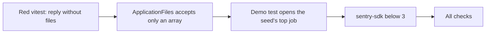

# Notes: ci-fix-2026-11-24

Found 2026-11-28: the remote `main` moved on 2026-11-24 at 17:55 (+08:00) by a push of 13 commits (up to "docs(usage): explain how to apply on the company site", made by the Cursor agent). The push was on hold for the user's live check; the session that pushed is not known here. CI 45369843002 on that push failed: Type Check, Demo E2E, App E2E. The other jobs passed.

## Fix on the scratch clone (2026-11-28)

- `apps/frontend-ts/src/components/jobs/application-files.tsx`: `setFiles(Array.isArray(res?.files) ? res.files : null)`.
- `apps/frontend-ts/tests/components/application-files.test.tsx`: new case "shows nothing, without an error, when the reply has no file list", with a small error boundary in the test so a crash fails the test. A first version without the boundary passed while the crash happened (React removed the section, so "empty" was true for the wrong reason); the boundary version failed red ("crashed" shown), then passed green.
- `apps/frontend-ts/tests/e2e-demo/demo.spec.ts`: the sample-letter test opens "Graduate Machine Learning Engineer" (rk-001, the top job of the demo seed since the project-scoring task) and expects "At Example Analytics". The demo note stays true: the seed letter says "deployed".
- `apps/backend-py/requirements.txt`: `sentry-sdk[fastapi]>=1.40.0,<3` (CI installed 3.0.0, which drops `profiles_sample_rate`; the laptop has 2.75.0).
- Checks on the clone: black, ruff, mypy gate (0 new), full backend pytest 2579 passed; vitest 413 passed (75 files), eslint, tsc, prettier, `build`, `build:demo` pass. The Playwright suites cannot start on this laptop; the next CI run checks them.
- Applied to `main` after "Yes, apply it" (2026-11-28): the 4 files are the same as on the clone; on `main` black, ruff, mypy gate (0 new), full backend pytest 2579 passed, vitest 413 passed, eslint, tsc, prettier. Commit "fix(ci): pin sentry-sdk below 3, guard the apply pack list, and follow the demo seed". Not pushed.

Lesson candidate: after a demo seed run, the demo E2E test that names the top job must change too; the laptop cannot run that suite, so look for job titles in `tests/e2e-demo/` when the seed changes.
