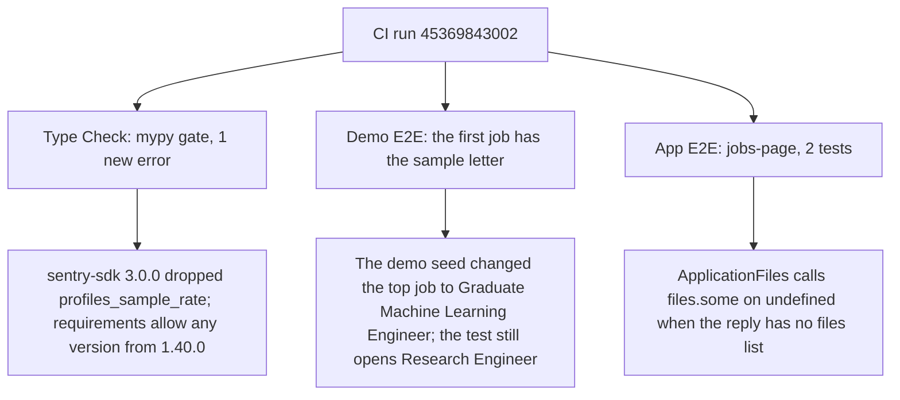

# Task: Fix the Failed CI Run of 2026-11-24

## Goal
Make CI on `main` pass again. The push of 2026-11-24 (13 commits, up to "docs(usage): explain how to apply on the company site") ran CI 45369843002, which failed in three jobs.

## Causes (CI logs, 2026-11-28)

| Job | Error | Cause | Fix |
|---|---|---|---|
| Type Check | `src/utils/sentry.py`: unexpected keyword argument `profiles_sample_rate` for `init` | `sentry-sdk[fastapi]>=1.40.0` let CI install 3.0.0 (released after 2026-11-15); the laptop has 2.75.0 | Pin `sentry-sdk[fastapi]>=1.40.0,<3` in `requirements.txt`, as the laptop runs; a move to 3.x is a separate task |
| Demo E2E | `demo.spec.ts` "the first job has the sample letter and its note": "they miss real errors" not found | The demo seed of the project-scoring task made rk-001 "Graduate Machine Learning Engineer" the top job, with the letter ("At Example Analytics"). The test opens "Research Engineer" (the old top job), which has no letter | The test opens "Graduate Machine Learning Engineer" and expects "At Example Analytics". The note text stays true: the new letter also says "deployed" |
| App E2E | `TypeError: Cannot read properties of undefined (reading 'some')` in job detail; "generates a cover letter" and "keeps the apply row in view" | S2 `ApplicationFiles`: `setFiles(res.files)` with a reply that has no `files` (the E2E mock answers unknown routes with `{}`; an older backend would do the same), then `files.some` | Accept only an array (`Array.isArray`); otherwise show nothing |

## Decision rule
- Red test first (vitest): `ApplicationFiles` with a reply without `files` renders nothing and does not throw.
- Checks: backend black, ruff, mypy gate (0 new), full pytest; frontend eslint, tsc, vitest, prettier, build. The Playwright suites cannot start on this laptop; CI runs them after the push.
- Apply after "Yes, apply it"; push after approval; the next CI run must pass.

## Acceptance Criteria
- [x] Red test fails first; green after the change.
- [x] Checks pass on a scratch clone; applied after "Yes, apply it" (2026-11-28).
- [ ] Pushed after approval; the CI run passes; folder archived.

## Status
`in-progress`
