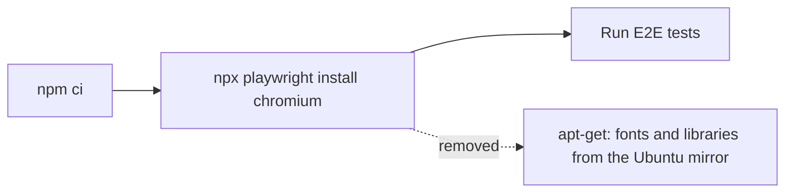

# Task: CI Playwright Install Without the Ubuntu Mirror

## Goal
Make the E2E jobs in CI install Chromium without `apt`, so an outage of the Ubuntu package mirror cannot stop them again.

## Constraints & Context
- On 2026-11-11, CI run 43049667237 (the `AGENTS.md` commit) failed 4 times in the two E2E jobs, from 15:34 to 16:44 UTC. Each time, the step `npx playwright install --with-deps chromium` could not resolve `azure.archive.ubuntu.com`, and `apt` stopped with exit code 100 after about 10 minutes. No test ran. The other 10 jobs passed each time. GitHub status was "All Systems Operational".
- `--with-deps` makes Playwright install system packages with `apt` (fonts and shared libraries). The `ubuntu-24.04` runner image already contains Google Chrome and its shared libraries. The packages that failed are extra fonts (`fonts-ipafont-gothic`, `fonts-wqy-zenhei`, `fonts-unifont`, `xfonts-*`, and others).
- The E2E suites use only Chromium (`playwright.config.ts`: Desktop Chrome and Pixel 5; `playwright.demo.config.ts`: Desktop Chrome) and have no screenshot comparisons, so missing extra fonts cannot change a result.
- Playwright is 1.60.0 (lockfile). The jobs stay on `ubuntu-24.04` (see the pin comment in `ci.yml`).
- The same install line is in three places: `ci.yml` jobs `test-frontend-e2e` and `test-demo`, and `pages.yml` (demo publish). Change all three, so they stay the same. Do not run `pages.yml`: publishing needs the user's approval each time, and `test-demo` runs the same steps.
- A scratch clone cannot prove a GitHub runner change. The proof is a CI run of the changed workflow on a temporary branch (see "Proof"). This needs the user's approval, because it pushes a branch.

## Change

In the three places, replace `npx playwright install --with-deps chromium` with `npx playwright install chromium`, and add a short comment: the runner image has the libraries, and `--with-deps` made the job depend on the Ubuntu mirror (outage of 2026-11-11).

Fallback, if Chromium does not start because a library is missing: stop and plan again. The next option is to run the E2E jobs in the Playwright container image `mcr.microsoft.com/playwright:v1.60.0-noble`, which has all libraries and needs no `apt`.

## Proof
1. Red: the 4 failed attempts of run 43049667237 (recorded above).
2. Make the change on a scratch clone. Check that the three workflow files are valid YAML.
3. With the user's approval: push the clone's commit to a temporary branch `ci-playwright-no-apt`, and start CI on it with `gh workflow run ci.yml --ref ci-playwright-no-apt` (pushes to other branches do not start CI).
4. Green: both E2E jobs pass, and the install step log has no `apt-get` line. This shows the jobs no longer use the mirror, even if the mirror is back by then.
5. Delete the temporary branch on GitHub.

## Acceptance Criteria
- [x] The three install lines no longer use `--with-deps`, each with the comment.
- [x] The three workflow files are valid YAML.
- [x] The CI run on the temporary branch passes `Test Frontend (E2E Tests)` and `Test Demo (E2E on the Static Site)`, with no `apt-get` in the install step log.
- [x] The temporary branch is deleted on GitHub.
- [x] Applied on `main` after "Yes, apply it"; the diff matches the checked commit.
- [ ] Pushed after approval; the CI run on `main` passes all jobs. Recorded in `notes.md`.
- [ ] `docs/lessons.md` has the lesson: in CI, do not make a job depend on the Ubuntu mirror when the runner image already has what it needs.
- [ ] `tasks/todo.md` updated, and this folder moved to `tasks/archive/`.

## Status
`review`
