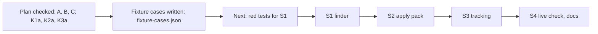

# Hand-over: Apply Through Company Career Sites

For the coding agent that continues this task (user decision 2026-11-20: hand the sprint to the Cursor agent). Read `CLAUDE.md`, `AGENTS.md`, `tasks/todo.md`, the recent sections of `docs/lessons.md`, then `task.md` and `notes.md` in this folder.

## State on hand-over (2026-11-20)

- Done: the plan (`task.md`), checked by the user with the recommended choices:
  - K1a: the finder runs on demand ("Find company site" button in job detail); the result is cached per job.
  - K2a: the search is on by default, with a Settings switch to turn it off.
  - K3a: two match levels, each labelled: exact posting ("Apply on company site") and careers page ("Company careers page").
- Done: 20 labelled fixture cases for rule R1, written before any finder code: `fixture-cases.json` in this folder. Move it to `apps/backend-py/tests/fixtures/company_site/cases.json` when you write the tests. Each case has the job (company, title), the search results in order, the fetched pages (URL to page title and main text; a URL that is not in `pages` is a failed fetch), and the expected level and URL. Do not change a label to fit the code; change it only when the label itself is wrong, and write the reason in `notes.md`.
- Not started: all code. Nothing is committed for this task.

## Steps

1. S1 finder (backend), red tests first (run red with `--maxfail=100`; `pytest.ini` has `--maxfail=5`):
   - New module, for example `apps/backend-py/src/submission/company_site.py`, with the search and fetch functions injected so tests need no network.
   - Reuse `search_duckduckgo_html` and `fetch_page` from `src/generation/company_mission_search.py`, and `registrable_domain` from `src/generation/company_mission.py`.
   - Skip job portals (MyCareersFuture, LinkedIn, Indeed, JobStreet, Glassdoor, JobsDB, aggregators). Accept a page only on a known ATS host (Greenhouse, Lever, Workday, SmartRecruiters, Ashby, Workable, SuccessFactors, and similar) or on the company's own domain.
   - Exact posting: the page names the company (legal suffixes such as "Pte Ltd" removed) and a matching job title (word order may differ; one shared word is not enough). Careers page: on the company's own domain, with careers or jobs in the URL or title, and the page names the company. An ATS board must belong to the job's company (case cs-09). Prefer an exact posting over a careers page (case cs-11).
   - Result: level (`exact`, `careers`, `none`), URL, page title, evidence, time checked. Never a guessed URL.
   - Cache per job; `GET /jobs/{job_id}/company-site` (with a refresh option); run the network work off the event loop.
   - Setting `enable_company_site_search` (default true) in `src/api/settings.py`, next to `enable_company_mission`, and its switch on the Settings page.
2. S2 apply pack: an endpoint that serves the generated CV (`results_dir/resumes/{job_id}.pdf/.docx`) and the saved cover letter (`results_dir/cover_letters/{job_id}.txt`) when they exist; in `apps/frontend-ts/src/components/jobs/job-detail.tsx`, the "Find company site" button, the labelled link next to the portal link, and the downloads.
3. S3 tracking: "Applied on company site" sends `POST /applications/external` with method "Company site" and the company URL; `AppliedGuard` must then mark the portal copy as applied, and the next pipeline run must skip it (rule R3, test).
4. S4: the user runs the finder on about 15 shortlisted jobs and marks each link right or wrong (rule R2); a user guide section with a mermaid diagram.

## Decision rule (fixed in `task.md`)
- R1: on the fixture cases, 0 wrong links, and the exact posting in at least 80 % of the cases that have one.
- R2: live check by the user, about 15 jobs: 0 wrong-company links; a link for at least half.
- R3: tracking test as above.
- R4: CI checks: backend black, ruff, the mypy gate (`apps/backend-py/scripts/mypy_gate.py`, 0 new errors; never run it with `--update`), full pytest; frontend eslint, tsc, vitest, prettier, build. The Playwright suites run in CI (they cannot start on this laptop).
- R5: dry run stays the default; nothing submits a form for the user.

## Workflow and guardrails
- Prove each change on a scratch clone with its own `.venv` and `node_modules`; never link a clone to this repository's environments. Run WSL commands through script files, not inline `wsl.exe bash -c`.
- Apply to `main` only after the user says "Yes, apply it"; push only after a separate approval. Commit only the files the change names; never `git add -A`.
- Never read `apps/backend-py/.env`, `apps/frontend-ts/.env.local`, `user_settings.json`, or the contents of any `data/` folder. Never sign in, enter passwords, or solve CAPTCHAs for the user.
- Documentation in ASD-STE100 Simplified Technical English, with a mermaid diagram, no emojis, and no full host paths (a CI test enforces this).
- Do not change `src/scoring/` or the job card years labels: six scoring commits on `main` wait for the user's live check before the push (`tasks/active/job-card-labels/`).
- The MyCareersFuture applications import is a separate task for the Cursor agent; do not mix it into this one.
- Seen during planning, not part of this task: `_has_easy_apply` in `src/submission/detector.py` loops over the characters of each indicator string, so any HTML would count as Easy Apply. It is safe today only because the detector never gets HTML.
