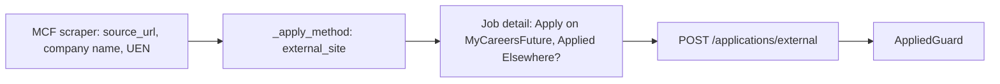

# Notes: company-site-apply

Planned 2026-11-20 from the user's request: friends say that portal applications can go unseen by HR, so the user wants to apply on company websites.

## Code reading (2026-11-20)

- `apply_method`: `apps/backend-py/src/pipeline/shortlist.py` `_apply_method`; MCF, JobStreet, Careers@Gov, and JSearch give `external_site`. `AppliedGuard.annotate_job_dicts` sets `already_applied`.
- Job detail apply row: `apps/frontend-ts/src/components/jobs/job-detail.tsx` (portal link, Copy Link, Simulate Apply for others, Save, Applied Elsewhere?).
- MCF scraper keeps no company website or apply URL; `metadata.mcf_uen` only.
- Submitters: only LinkedIn Easy Apply; unreachable because the detector never gets HTML. Seen: `_has_easy_apply` in `detector.py` loops over the characters of each indicator string; if HTML were ever passed, almost every page would count as Easy Apply. A latent bug, not part of this task.
- Company research to reuse: `src/generation/company_mission_search.py` (DuckDuckGo HTML search, `fetch_page`), `company_mission.py` (`registrable_domain`).
- Generated files: `results_dir/resumes/{job_id}.pdf/.docx`, `results_dir/cover_letters/{job_id}.txt`; no endpoint serves them.

## Hand-over (2026-11-20)

User decision: the sprint goes to the Cursor agent. Done here: the plan check (K1a, K2a, K3a) and 20 labelled fixture cases (`fixture-cases.json`, written before any code). The next agent starts from `handoff.md`. No code written; nothing committed for this task.
