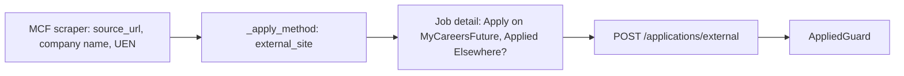

# Notes: company-site-apply

Planned 2026-11-20 from the user's request: friends say that portal applications can go unseen by HR, so the user wants to apply on company websites.

## Code reading (2026-11-20)

- `apply_method`: `apps/backend-py/src/pipeline/shortlist.py` `_apply_method`; MCF, JobStreet, Careers@Gov, and JSearch give `external_site`. `AppliedGuard.annotate_job_dicts` sets `already_applied`.
- Job detail apply row: `apps/frontend-ts/src/components/jobs/job-detail.tsx` (portal link, Copy Link, Simulate Apply for others, Save, Applied Elsewhere?).
- MCF scraper keeps no company website or apply URL; `metadata.mcf_uen` only.
- Submitters: only LinkedIn Easy Apply; unreachable because the detector never gets HTML. Seen: `_has_easy_apply` in `detector.py` loops over the characters of each indicator string; if HTML were ever passed, almost every page would count as Easy Apply. A latent bug, not part of this task.
- Company research to reuse: `src/generation/company_mission_search.py` (DuckDuckGo HTML search, `fetch_page`), `company_mission.py` (`registrable_domain`).
- Generated files: `results_dir/resumes/{job_id}.pdf/.docx`, `results_dir/cover_letters/{job_id}.txt`; no endpoint serves them.

## Hand-over (2026-11-20)

User decision: the sprint goes to the Cursor agent. Done here: the plan check (K1a, K2a, K3a) and 20 labelled fixture cases (`fixture-cases.json`, written before any code). The next agent starts from `handoff.md`. No code written; nothing committed for this task.
- Update (2026-11-20): the user chose the opencode agent for this sprint for now, to see how it goes; bigger tasks may move to Cursor later.

## S1 finder (2026-11-20, scratch clone)
- Fixtures moved to `apps/backend-py/tests/fixtures/company_site/cases.json`; labels unchanged.
- Red first: `apps/backend-py/tests/unit/test_company_site_finder.py` failed on the missing module (ModuleNotFoundError).
- Finder: `apps/backend-py/src/submission/company_site.py`, search and fetch injected.
- Green: 37 tests in the new file. Full backend unit suite: 2436 passed. mypy gate: 0 new errors. black and ruff clean.
- Rule R1 on the 20 fixture cases: 0 wrong links; exact posting found in 8 of 8 cases that have one (100 %, threshold 80 %).
- One bug found by the red test run: portal check used the registrable domain, so `mycareersfuture.gov.sg` was not seen as a portal. Fixed by checking every host label.
- Not yet done in S1: per-job cache, `GET /jobs/{job_id}/company-site`, the `enable_company_site_search` setting, and its Settings page switch.

## S1 cache, route, setting, Settings switch (2026-11-20, scratch clone)
- Red first: `test_company_site_cache.py` (module missing), `test_company_site_route.py` (3 of 4 failed; the 404 case passed because the route did not exist yet), `test_company_site_setting.py` (failed), and the vitest file `tests/app/settings/company-site-setting.test.tsx` (3 of 3 failed).
- Green: cache and service in `src/submission/company_site_cache.py` (one JSON file per job under `data/company_sites/`; unsafe job IDs hashed); route `GET /api/jobs/{job_id}/company-site?refresh=` in `src/api/routes/jobs.py` (search runs in a worker thread); setting `cost_limits.enable_company_site_search`, default on, next to `enable_company_mission`; Settings switch with label "Company site search".

## S1 review fixes (2026-11-20, scratch clone)
- Fixture cases added (labels of cs-01 to cs-20 unchanged): cs-21 (another company's ATS posting with the same title; our company named only as a client in the text; expected none), cs-22 (Software Engineer job against the same company's Senior Software Engineer posting; expected none).
- Red first: cs-21 and cs-22 gave wrong links; `search_failed` missing; a failed search was cached.
- Fix 1: an ATS page must name the company in its title, or the first company word (at least four letters) must start a word of the URL. The text check still applies.
- Fix 2: a page title that adds a seniority word (senior, sr, lead, principal, staff, manager, director, head) that the job title lacks is rejected. Control test: a Senior job still matches a Senior posting.
- Fix 3: `CompanySiteResult.search_failed`; the cache does not store a result with `search_failed`; real "none" results are still cached.
- R1 on 22 cases: 0 wrong links; exact 8 of 8; careers 2 of 2.

## S1 second review fixes (2026-11-20, scratch clone)
- Fixture case cs-23 added: "Acme Logistics" job against an "acmerobotics" ATS board with the same title; the text mentions logistics; expected none. Red: it gave a wrong link under the prefix rule.
- Fix 1 (URL rule): a whole-token rule replaces the prefix rule. Some URL word must equal the first k company words joined (k = 1, 2, ...). A single first word needs at least four letters.
- Fix 2 (cache): a "none" where every fetched candidate page failed to load (pages attempted > 0, pages loaded = 0) is not cached. A "none" with at least one loaded and rejected page is cached. A "none" with no page fetched (for example portal-only results or no results) is cached as before. `CompanySiteResult` gains `pages_attempted` and `pages_loaded`.
- R1 on 23 cases: 0 wrong links; exact 8 of 8; careers 2 of 2.
