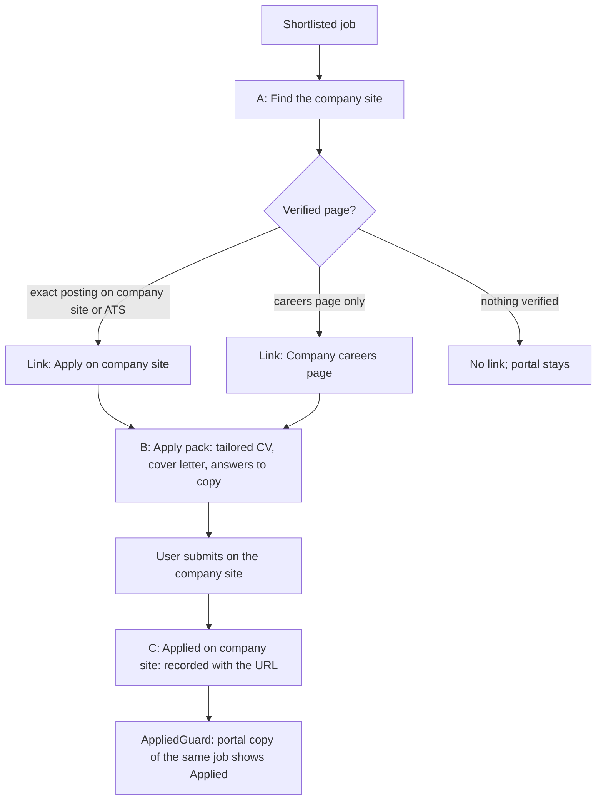
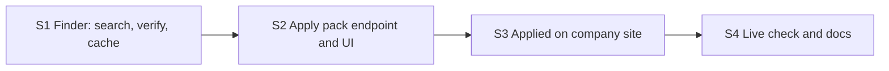

# Task: Apply Through Company Career Sites

## Goal
Give the user a way to apply on the company's own website instead of the job portal, because portal applications can go unseen by HR. For each shortlisted job, the app finds the company's own posting or careers page, prepares the application material, and records where the user applied, so the same job is not applied for twice.

## Context (code reading, 2026-11-20)
- "Apply" on a MyCareersFuture (MCF) job opens the MCF listing (`source_url`). The job detail row (`apps/frontend-ts/src/components/jobs/job-detail.tsx`) shows "Apply on MyCareersFuture", "Copy Link", "Save", and "Applied Elsewhere?".
- MCF data has no company website or apply URL. The only company identifier kept is the UEN (`metadata.mcf_uen`). `JobListing` has no company URL field.
- No code finds a company website, careers page, or applicant tracking system (ATS). `detector.py` only checks whether the job's own URL is on greenhouse.io, lever.co, or myworkdayjobs.com.
- Reusable parts: `src/generation/company_mission_search.py` (DuckDuckGo HTML search, page fetch, no API key) and `company_mission.py` (`registrable_domain`, candidate checks); used today for cover-letter company research, behind a setting.
- Tracking: "Applied Elsewhere?" sends `POST /applications/external` (`application_method: "External site"`); `AppliedGuard` matches jobs by job ID, listing URL, then company and title, and the pipeline filters applied jobs out.
- The pipeline writes tailored CVs (`results_dir/resumes/{job_id}.pdf/.docx`) and saved letters, but no endpoint serves those files. Cover letters can be exported on the Cover Letter page only.
- Only LinkedIn Easy Apply has an auto-submitter, and it stays unreachable. Dry run is the default.

## Options

| Option | What it does | Effort | Risk |
|---|---|---|---|
| A. Company site finder | Search for the job on the company's own site or its ATS (Greenhouse, Lever, Workday, SmartRecruiters, Ashby, SuccessFactors, and others). Fetch each candidate page and keep it only when it names the company and a matching job title. Result: exact posting, careers page only, or not found. Never a guessed link. | Medium | A wrong-company match. Mitigated by verification and by showing the match level. Search requests send the company name and job title to DuckDuckGo (no personal data). |
| B. Apply pack | In job detail: the company-site link, downloads of the tailored CV (PDF, DOCX) and the cover letter, and short answers to copy (for example the "why this company" text). The user fills in and submits the company form. | Small to medium | Low. Needs a new endpoint that serves the generated files. |
| C. Company-site tracking | An "Applied on company site" action records the application with method "Company site" and the company URL. `AppliedGuard` then marks the portal copy as applied, and the pipeline skips it. | Small | Low. Builds on `POST /applications/external`. |
| D. Automatic form filling on company sites | The app fills and submits ATS forms. | Large | High: CAPTCHAs, site rules, account sign-ins, wrong answers sent without review. Not recommended, and it conflicts with the rule that keeps auto-submit unreachable. |

Recommendation: A, B, and C in this sprint; not D.

## Choices for the user (recommendation first)
- K1. When the finder runs: (a) on demand, with a "Find company site" button in job detail, and the result cached per job (recommended: few requests, the user sees each result); (b) for every shortlisted job in the pipeline (more requests, slower runs, rate-limit risk).
- K2. Search setting: (a) on by default, with a Settings switch to turn it off (recommended); (b) off by default.
- K3. Match levels shown: (a) exact posting and careers page, each labelled (recommended); (b) exact posting only.

## Sprint (steps, each through the usual workflow)

1. S1 Finder (backend): new module `src/apply/company_site.py`; ATS host patterns; DuckDuckGo search reuse; page verification (company name, title similarity); `CompanySiteResult` (level, URL, evidence); cache per job; `GET /jobs/{id}/company-site`. Tests use recorded HTML fixtures, no live web in CI.
2. S2 Apply pack: `GET /jobs/{id}/application-files` (tailored CV and letter, when generated); job detail shows "Apply on company site" (or "Company careers page") next to the portal link, with the downloads.
3. S3 Tracking: "Applied on company site" sends `POST /applications/external` with method "Company site" and the company URL; `AppliedGuard` matches the portal copy; the Applications page shows the method.
4. S4 Live check and docs: the user runs the finder on about 15 shortlisted jobs and marks each link right or wrong; a user guide section with a mermaid diagram.

## Decision rule (fixed before any code change)
- R1. Fixtures (recorded pages of constructed companies, about 20 cases): the finder returns no link for any case where the page does not match (0 wrong links), and returns the exact posting in at least 80 % of the cases where one exists.
- R2. Live check by the user (about 15 shortlisted jobs): 0 wrong-company links; exact or careers-page links for at least half of the jobs. A wrong link is worse than no link, so precision decides.
- R3. Tracking: a job applied on the company site shows "Applied" on its portal copy and is skipped by the next pipeline run (test).
- R4. CI checks: backend black, ruff, mypy gate (0 new), pytest; frontend eslint, tsc, vitest, prettier, build; Playwright suites in CI.
- R5. Dry run stays the default; nothing submits a form for the user.

## Constraints & Context
- Never read `apps/backend-py/.env`, `apps/frontend-ts/.env.local`, `user_settings.json`, or the contents of any `data/` folder.
- Never sign in or enter passwords for the user; no CAPTCHA solving.
- Search sends company names and job titles to DuckDuckGo, as the company mission research does; no profile data leaves the machine.
- The MCF applications import is a separate task for a coding agent; this task does not duplicate it.
- Six scoring commits on `main` are waiting for the user's live check before the push; this task does not change `src/scoring/`.

## Acceptance Criteria
- [x] Plan checked by the user, with K1 to K3 chosen (2026-11-20: "Approve, recommended": K1a on demand, K2a on by default with a Settings switch, K3a both levels labelled).
- [ ] S1: red tests first, green; R1 measured.
- [ ] S2 and S3: red tests first, green; R3 holds.
- [ ] CI checks pass on a scratch clone (R4); applied after "Yes, apply it".
- [ ] S4: live check by the user (R2) and docs; pushed after approval; CI passes; `tasks/todo.md` updated; folder archived.

## Status
`handed over` (2026-11-20, to the opencode agent; see `handoff.md`)
