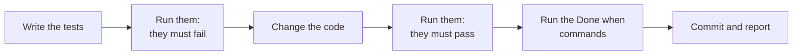

# Agent Brief: Copilot Agent Trial

Read this file and `mh-1-task-store-monotonic.md`. Do not read other task files.

This handoff is a spec handoff. It gives the required behavior, the tests to write, and the commands. It does not give the code. You write the tests and the code.



## How to work

1. Read the handoff and the two files that it names.
2. Write the tests first. Run them and see them fail.
3. Change the code. Run the tests again and see them pass.
4. Run the "Done when" commands of the handoff. All must pass.
5. Commit with the message that the handoff gives. Do not push.
6. Stop and report: the commit hash, the test output before and after the code change, and anything that did not work.

## Rules

- Edit only the files that the handoff names.
- Each new function and method has a docstring with a description, `Args:`, and `Returns:` (where it returns a value), and type hints.
- Do not rename, move, or reformat code that the handoff does not name.
- Do not change a test that already exists, except the one test that the handoff tells you to replace.
- Do not open `.env`, `.env.local`, or anything in `apps/backend-py/data/`.
- Do not start Ollama models, the app, or a pipeline run.
- Do not run `scripts/mypy_gate.py --update`.
- If a step does not work after three tries, stop and report. Do not guess.

## Where to run commands

From `apps/backend-py` in WSL. The project Python is `.venv/bin/python`.

Run the test file:

```bash
.venv/bin/python -m pytest tests/unit/agents/test_task_store.py -q
```
