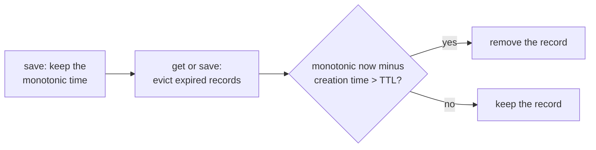

# MH-1: TaskStore expiry uses a monotonic clock

This is a spec handoff: it gives the behavior and the tests to write, not the code. Read `AGENT.md` first.

## Why

`TaskStore` (`apps/backend-py/src/agents/task_store.py`) keeps agent task results for a time-to-live (TTL). It measures the age of a record with `datetime.now()`, the wall clock. The wall clock can move forward or back (for example, in WSL2 after the computer sleeps), so a record can expire too early or too late.

`test_records_expire_after_ttl` failed once in a full test run (2026-10-30) and passed 6 of 6 times alone. It sleeps 1.1 seconds for a TTL of 1.05 seconds, so it also depends on the real time.

After this change, expiry uses `time.monotonic()`, which does not move back, and the tests use a fake clock instead of `time.sleep`.



## Files

- `apps/backend-py/src/agents/task_store.py` (change)
- `apps/backend-py/tests/unit/agents/test_task_store.py` (change)

Do not change other files.

## Required behavior

1. Expiry uses `time.monotonic()`. Do not use `datetime.now()` or `datetime` values for expiry.
2. In `task_store.py`, import the module (`import time`) and call `time.monotonic()`. Do not use `from time import monotonic`, because the tests replace `time.monotonic`.
3. A record expires when more than the TTL has passed since `save` first created it. At exactly the TTL, the record is not expired. This is the same rule as now.
4. A `save` call for a task ID that already exists does not make the life of that record longer.
5. `TaskRecord.created_at` and `TaskRecord.updated_at` stay `datetime` values. `TaskRecord.to_dict()` returns the same eight keys as now: `task_id`, `status`, `agent`, `task_type`, `result`, `error`, `created_at`, `updated_at`. If you keep the monotonic time on `TaskRecord`, `to_dict()` must not return it, and `TaskRecord(...)` must still work without it (the existing test makes a `TaskRecord` with only the current fields).
6. The `TaskStore` constructor arguments do not change. A TTL below 1 second still becomes 1 second. The size limit and the recency order do not change.

## Step 1: write the tests, run them, and see them fail

In `tests/unit/agents/test_task_store.py`:

1. Remove `test_records_expire_after_ttl`. It is the only existing test that you may remove or change.
2. Add a fake clock: a pytest fixture that replaces `time.monotonic` with a function that returns a value that the test can set. Start it at `1000.0`. Keep `import time` in the test file and use `monkeypatch.setattr(time, "monotonic", ...)`. (Do not patch `src.agents.task_store.time`: before your code change, that module does not import `time`, and the tests then stop with an error, not a failure.)
3. Add these tests to `TestTaskStore`. Each one uses the fake clock and `TaskStore(ttl_seconds=10)`. None of them calls `time.sleep`.
   - `test_record_lives_until_the_ttl`: save at `1000.0`. At `1009.9` the record is there. At `1010.0` the record is there. At `1010.1` `get` returns `None`.
   - `test_update_does_not_extend_the_ttl`: save at `1000.0`. At `1009.0`, save the same task ID again with another status. At `1010.1` `get` returns `None`.
   - `test_wall_clock_jump_does_not_expire_records`: save at `1000.0`. Then replace `datetime` in `src.agents.task_store` with a subclass of `datetime` whose `now()` returns the real time plus one day (`import src.agents.task_store as task_store_module`, then `monkeypatch.setattr(task_store_module, "datetime", ...)`). Do not move the fake clock. `get` returns the record.
4. Add this test to `TestTaskRecord`:
   - `test_to_dict_has_only_the_public_fields`: the set of keys of `to_dict()` is the set of eight keys in item 5 above.
Run the test file. The three new `TestTaskStore` tests must fail (`FAILED`, not `ERROR`), because the code still uses the wall clock. The other tests pass:

```bash
.venv/bin/python -m pytest tests/unit/agents/test_task_store.py -q
```

## Step 2: change `src/agents/task_store.py`

Change the expiry so that it obeys the required behavior. Keep the change small. Update the docstrings that talk about the TTL, if they become wrong.

## Done when

Run the test file. All tests pass:

```bash
.venv/bin/python -m pytest tests/unit/agents/test_task_store.py -q
```

Run all agent tests. All tests pass:

```bash
.venv/bin/python -m pytest tests/unit/agents -q
```

Check that the test file does not sleep. The command must print `no sleep`:

```bash
grep -n "time.sleep" tests/unit/agents/test_task_store.py || echo "no sleep"
```

Format the changed files:

```bash
.venv/bin/python -m black src/agents/task_store.py tests/unit/agents/test_task_store.py
```

Check the lint:

```bash
.venv/bin/python -m ruff check src/agents/task_store.py tests/unit/agents/test_task_store.py
```

Run the mypy gate. It must report 0 new errors. It can also say that some baseline errors are fixed; that is correct, and you do nothing about it. Do not add `--update`:

```bash
.venv/bin/python scripts/mypy_gate.py
```

The working tree has other changed files that are not part of this handoff. Do not stage them. Do not use `git add -A`, `git add .`, or `git commit -a`. Stage only your two files:

```bash
git add src/agents/task_store.py tests/unit/agents/test_task_store.py
```

Check that only these two files are staged:

```bash
git diff --cached --name-only
```

Commit with this message:

```text
fix(agents): expire task records with a monotonic clock

TaskStore measured record age with datetime.now(), which can move when
the wall clock changes (WSL2 after sleep), and its TTL test slept 1.1 s
for a TTL of 1.05 s. Expiry now uses time.monotonic(), and the tests
use a fake clock: the TTL edge, an update that does not extend the TTL,
and a wall-clock jump.
```
