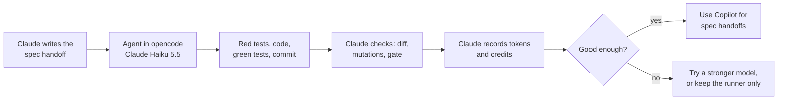

# Task: Copilot Agent Trial

## Goal
Find out if a low-cost GitHub Copilot model in opencode can do a "spec handoff": the handoff gives the required behavior and the tests to write, and the agent writes the code. The trial job is a real backlog fix: `TaskStore` expiry moves from the wall clock to a monotonic clock (`mh-1-task-store-monotonic.md`).

## Constraints & Context
- Since 2026-06-01, Copilot bills each chat and agent token in AI Credits (USD 0.01 each) at the API price of the model. The estimate for this handoff on Claude Haiku 5.5 is below USD 0.05 (`notes.md`).
- The handoff runner (`docs/handoff-runner.md`) stays the tool for handoffs that give the full code. This trial is only for handoffs where the agent writes the code.
- The agent reads `AGENT.md` and the one handoff. It does not open `.env` files or `apps/backend-py/data/`. Copilot Pro sends prompts to hosted models: before the run, set "Allow GitHub to use my data for AI model training" to Disabled at github.com/settings/copilot/features.
- No Ollama model is loaded while the agent runs. The trial does not need the GPU.

## Acceptance Criteria
- [x] The user runs MH-1 in opencode with `github-copilot/claude-haiku-5.5`, and the agent reports a commit. (`c1687ab`, 2026-10-31, one prompt)
- [x] Claude check: the diff matches the required behavior, every preview mutation is caught, and the full backend gate passes. (6 of 6 mutants; 1764 tests)
- [ ] `notes.md` records the tokens (`opencode stats`), the credits (GitHub billing), the number of tries, and each rule that the agent did not obey. (All except the credits)
- [ ] `notes.md` records the decision: the default Copilot model for spec handoffs, or no Copilot agent. Then `docs/handoff-runner.md` and the agent memory note say when to use an agent and which model.

## Status
`in-progress` (2026-10-31: MH-1 done by Claude Haiku 5.5 and checked; the GitHub credits and the decision are open)
