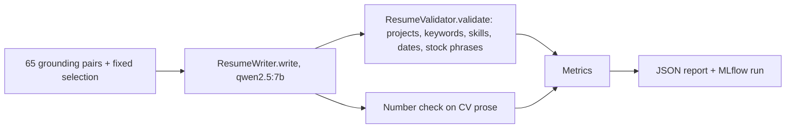

# Task: CV Eval Suite

## Goal
Measure generated CVs the way the writer suite measures cover letters, so that a change to the CV writer (a prompt rule, or the checked sentence rewrite from `tasks/archive/generic-phrasing/`) can be kept or dropped on numbers.

## Constraints & Context
- CVs are written by `ResumeWriter.write(job, profile, selection)` (`src/generation/resume_writer.py`) on the `resume_writing` route (default Ollama `qwen2.5:7b`, temperature 0.7). The method has no model override.
- `ResumeValidator.validate` is deterministic (no LLM): missing selected projects, missing keywords, skills not on the profile (`hallucinated_skill`), date mismatches, and, since the generic-phrasing task, `generic_phrases`.
- The structured suite (Step 3.7) only checks that the CV writer returns valid JSON; it does not look at the CV content.
- The writer suite (`src/evaluation/suites/writer.py`) is the model: the 65 profile-job pairs of the grounding set with a fixed selection, local models of 7B or smaller only, the route checked before any call with no fallback, peak VRAM recorded, the model unloaded once, a JSON report, and an MLflow run.
- `flag_unsupported_number_sentences` (`cover_letter_grounding.py`) flags sentences whose percent, multiplier, or count is not in the profile. It takes any text and a profile, so it can check CV prose for invented numbers.
- Local models only, at most 7B. Before each run: check GPU and RAM, and ask the user.

## Plan

1. `src/evaluation/suites/resume.py` (`SUITE = "resume"`), built like the writer suite and sharing its helpers where they fit (pairs, percentile, rates, VRAM probe, unload): one CV per pair and sample, with a fake writer in tests.
2. Checks for each written CV: the validator issues, the stock phrases (`generic_phrases`), and the number check on the CV prose (summary, experience highlights, project text). CVs from the writer's template fallback are counted, not scored.
3. Metrics: `hallucinated_skill_rate` and `unsupported_number_rate` (the accuracy checks), `missing_project_rate`, `missing_keyword_rate`, `date_inconsistency_rate`, `valid_rate`, `mean_score`, `generic_phrasing_rate`, `generic_per_100w_p50`, fallback count, latency p50 and p95, peak VRAM.
4. `main.py eval resume --model <tag> --samples N`: the run stops before any call when the `resume_writing` route is not Ollama with that model; the route's fallback is set to none for the run.
5. Tests with a fake writer and expected values worked out by hand; red step and mutants.
6. Baseline run with `qwen2.5:7b`, 1 sample per pair, recorded in MLflow and `notes.md`. This is the base for any later CV writer change.

## Decisions (user, 2026-11-13)
1. Accuracy checks: `hallucinated_skill_rate` plus the reused number check (`unsupported_number_rate`).
2. The baseline run uses about 10 minutes of GPU time with `qwen2.5:7b`; Claude checks GPU and RAM and asks right before it runs.
3. Order of the three planned tasks: type-check pins, then LinkedIn country hosts, then this suite.

## Acceptance Criteria
- [x] `suites/resume.py` with docstrings and types; `eval resume` in `main.py`.
- [x] Unit tests with a fake writer (rates, fallback counted not scored, route check, number check on prose only); red step and mutants caught.
- [x] CI checks pass locally (black, ruff, mypy gate 0 new, pytest).
- [ ] Applied after "Yes, apply it"; pushed after approval; the CI run passes.
- [x] Baseline run with `qwen2.5:7b` recorded in MLflow and `notes.md` (after the user approves the GPU time).
- [ ] The Next Up item in `tasks/todo.md` updated; folder archived.

## Status
`review`
