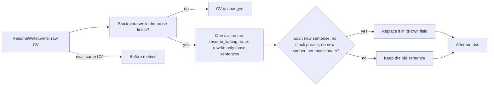

# Task: Checked Rewrite of Stock Phrases in CVs

## Goal
Remove "proven track record" (and any other stock phrase) from generated CVs with the checked sentence rewrite that the cover letters use, and keep the change only if the CV eval suite shows fewer stock phrases with no new accuracy flags.

## Constraints & Context
- CV eval baseline (`tasks/archive/cv-eval-suite/`, `qwen2.5:7b`, 64 CVs): stock phrases in 26 CVs (40.6%), all "proven track record"; skills off the profile 0; numbers not in the profile 1; missing projects and keywords 0; date mismatches 1.
- The cover letter rewrite (`src/generation/stock_phrase_polish.py`, `tasks/archive/generic-phrasing/`): picks up to 5 sentences with stock phrases, one low-temperature call names only the phrases each sentence uses, and a new sentence replaces the old one only when it has no stock phrase, no new number, and is not much longer. It works on one text and calls the cover-letter route. Letters went from 83% to 9.5% with stock phrases.
- A CV is structured (`GeneratedResume`): `summary` (text), `experience[].highlights` and `projects[].highlights` (lists of bullets), `projects[].description` (text). Skill names, titles, companies, and dates are not prose and are never edited.
- Accuracy flags are rare (1 or 0 in 64), so a comparison of two separate runs is mostly writer noise (temperature 0.7). The rewrite is a step after writing, so it can be measured on the same CVs, before and after the step, in one run.
- Local `qwen2.5:7b` only; check GPU and RAM and ask before the run.

## Plan

1. `stock_phrase_polish.py`: the core works on a list of texts, not one text. `polish_stock_phrases(router, content, ...)` stays as it is for letters (a list of one). A new `polish_resume_stock_phrases(router, resume, model=None)` sends the CV's prose fields (summary, each bullet, each project description) in one call, with the CV prose as context, and puts each accepted sentence back into its own field. The route is a parameter: letters keep `cover_letter_writing`, CVs use `resume_writing`. The acceptance checks and the 5-sentence cap stay the same.
2. `ResumeWriter.write(..., polish=True)`: the app and the Generate Resumes stage get the step by default; `GeneratedResume.stock_phrase_edits` counts the replaced sentences. The template fallback is never polished.
3. Resume eval suite: the default writer calls `write(polish=False)`, then the polish step itself, and checks the same CV twice. The report has the usual metrics for the CV after the step, plus `before_*` metrics for the same CVs and the paired counts: CVs that gained an accuracy flag, CVs that lost a stock phrase.
4. Guard (on the same CVs): fewer CVs with stock phrases after the step; no CV gains a `hallucinated_skill`, `unsupported_numbers`, `missing_keyword`, or `missing_project` flag; the step's median extra time is reported.
5. Tests: the list core (letters unchanged: the existing letter tests pass as they are), the CV fields (bullets and summary replaced in place; titles, skills, companies never sent), the route parameter, `write(polish=False)`, and the paired suite metrics with a fake writer and fake polish answers. Red step and mutants.
6. Run: `main.py eval resume --model qwen2.5:7b --samples 1` from a scratch clone, logged into the real MLflow store, so the result is known before anything lands on `main`.

## Acceptance Criteria
- [x] The polish core works on a list of texts; the letter function and all its tests are unchanged in behavior.
- [x] `polish_resume_stock_phrases` edits only prose fields, in place, on the `resume_writing` route; `ResumeWriter.write(polish=True)` by default; the fallback CV is not polished.
- [x] The resume suite reports before, after, and paired counts for the same CVs.
- [x] Unit tests, red step, and mutants; CI checks pass locally.
- [x] Run from a clone with `qwen2.5:7b` (after the user approves the GPU time): fewer CVs with stock phrases, and no CV gains an accuracy flag. Recorded in MLflow and `notes.md`.
- [ ] Applied after "Yes, apply it" only if the guard passes; pushed after approval; the CI run passes.
- [ ] `tasks/todo.md` updated; folder archived.

## Status
`review`
