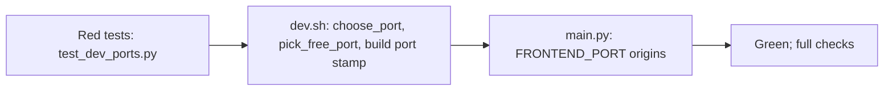

# Notes: free-ports

Planned 2026-11-28 from the user's request: when a port is in use, the app must find a new one. Plan checked: both ports move, 10 ports above each default.

## Build on the scratch clone (2026-11-28)

- `scripts/dev.sh`: `port_in_use` (bash `/dev/tcp`), `pick_free_port`, `choose_port` (a port set by the user is used as given; otherwise the start port or the next free one up to `DEV_PORT_SPAN`, default 10; a clear stop when the range is full). `start_both` chooses both ports before mprocs and prints the two addresses. `start_api` uses `BACKEND_PORT`. `start_frontend` uses `FRONTEND_PORT` and exports `BACKEND_API_URL` and `NEXT_PUBLIC_WS_URL` for the backend port (unless set). `make app` builds again when the backend port differs from the stamp `.next/job-raider-backend-port` (a build without the stamp counts as port 8000).
- `apps/backend-py/src/api/main.py`, `_parse_cors_origins`: `FRONTEND_PORT` adds `http://localhost:<port>` and `http://127.0.0.1:<port>`; only a plain number from 1 to 65535.
- `Makefile` help text; `docs/low-memory-guide.md`: section "Ports in Use" with a mermaid diagram, and two rows in "Problems and Solutions".
- Tests `tests/unit/test_dev_ports.py` (16; free high ports, so a running app does not change the result): red 10 failed (backend moves, keeps a free start port, user port as given, full range stops, frontend moves, backend address for the frontend, rebuild on a changed port, old build counts as 8000, two origin tests), 6 guards passed (the backend already inherits `FRONTEND_PORT`; five bad port values add nothing). Green: 16 passed.
- `tests/unit/test_dev_launcher.py`: the existing tests now set `BACKEND_PORT=8000` and `FRONTEND_PORT=3000`. In the full run, `test_dev_sh_app_api_runs_without_reload` failed because a program listened on 8000 on this machine, and the script moved to 8001, as designed. The tests check the start flags, not the port search.
- Checks on the clone: black, ruff, mypy gate (0 new), full backend pytest 2579 passed. No frontend code changed.
- Applied to `main` after "Yes, apply it" (2026-11-28): the 6 files are the same as on the clone; `scripts/dev.sh` keeps mode 755 and runs; on `main` black, ruff, mypy gate (0 new), full backend pytest 2579 passed. Commit "feat(dev): start on the next free port when 3000 or 8000 is in use". Not pushed. The live check (port 3000 taken, a pipeline run with progress) is for the user after the apply.
