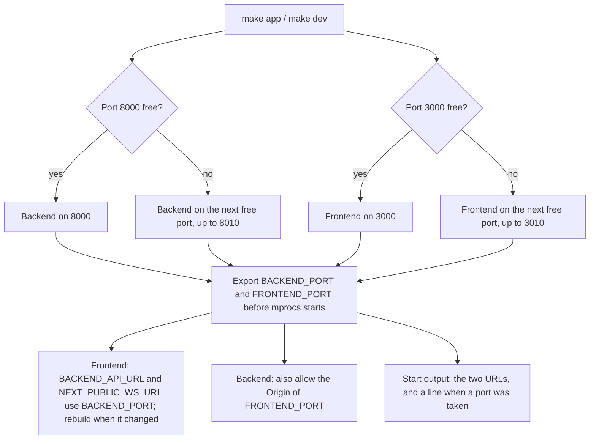

# Task: Free Ports for make app and make dev

## Goal
When port 3000 (frontend) or 8000 (backend) is already in use, for example by another project, `make app` and `make dev` pick the next free port instead of failing, and the app keeps working: the proxy reaches the backend, the pipeline progress WebSocket connects, and the start output says which ports are in use.

## Context (code reading, 2026-11-28)
- `scripts/dev.sh` starts uvicorn with `--port 8000` and Next.js with `--port 3000`, fixed. `make app` and `make dev` run the two processes in mprocs (`mprocs.app.yaml`, `mprocs.yaml`) through `dev.sh app-api` / `app-frontend` (`api` / `frontend`).
- The frontend reaches the backend in two ways:
  - the proxy (`apps/frontend-ts/src/app/api/proxy/[...path]/route.ts`): `BACKEND_API_URL`, default `http://localhost:8000`, read at run time;
  - the pipeline progress WebSocket (`apps/frontend-ts/src/app/pipeline/page.tsx`): `NEXT_PUBLIC_WS_URL`, default `ws://localhost:8000`. A `NEXT_PUBLIC_` value is fixed into the production build, so `make app` must rebuild when the backend port changes.
- The backend accepts the WebSocket only from an allowed Origin (`_parse_cors_origins` in `apps/backend-py/src/api/main.py`): `CORS_ALLOWED_ORIGINS`, or the development defaults `http://localhost:3000` and `http://127.0.0.1:3000`. A frontend on 3001 would be refused.
- The proxy guard (`guard.ts`) compares Origin with Host and accepts loopback hosts on any port, so it needs no change. `TrustedHostMiddleware` checks host names without ports, so it needs no change.
- `scripts/find-port.sh` exists (used by `docker-run.sh`), but it needs `netstat`, `lsof`, or `nc`, which a fresh Ubuntu may not have.

## Proposed change (fixed before any code change)

| Part | Change |
|---|---|
| P1 | `scripts/dev.sh`: `pick_free_port START LAST`, a loopback check with bash `/dev/tcp` (no extra tools). `BACKEND_PORT` (default 8000) and `FRONTEND_PORT` (default 3000) are chosen once in `start_both`, before mprocs, and exported, so both processes see the same values. A port that the user sets in the environment is used as given (no search). When a port is taken, the output says so, for example "Port 3000 is in use; the frontend uses 3001." No free port in the range stops the start with a clear message. |
| P2 | `start_api` uses `BACKEND_PORT`. `start_frontend` uses `FRONTEND_PORT` and sets `BACKEND_API_URL=http://127.0.0.1:$BACKEND_PORT` and `NEXT_PUBLIC_WS_URL=ws://127.0.0.1:$BACKEND_PORT`, unless the user set them. Single modes (`dev.sh api`, `dev.sh frontend`) pick their own port the same way. |
| P3 | `make app`: the production build is made again when the backend port differs from the port of the last build (a stamp file in `.next`), because the WebSocket address is fixed into the build. |
| P4 | Backend `_parse_cors_origins`: when `FRONTEND_PORT` is set, also allow `http://localhost:$FRONTEND_PORT` and `http://127.0.0.1:$FRONTEND_PORT`, in addition to `CORS_ALLOWED_ORIGINS` or the defaults. Only loopback origins are added. |
| P5 | `Makefile` help and the start output show the real URLs; `docs/low-memory-guide.md` (or the usage guide) gets a short section with a mermaid diagram. |

Not changed: the loopback-only binds, the proxy guard, the Docker setup (`docker-run.sh` keeps `find-port.sh`).

## Decision rule
- Red tests first (`--maxfail=100`), in the style of `tests/unit/test_dev_launcher.py` (the real `dev.sh` in a temporary layout, with stubs that record their arguments):
  - with a listener on 3000, `dev.sh app-frontend` starts Next.js on 3001 and exports `BACKEND_API_URL` and `NEXT_PUBLIC_WS_URL` for the chosen backend port;
  - with a listener on 8000, `dev.sh app-api` starts uvicorn on 8001;
  - with both free, the ports stay 3000 and 8000 (guard);
  - a port set by the user is used as given (guard);
  - a changed backend port makes `make app` rebuild; the same port reuses the build;
  - `_parse_cors_origins` adds the loopback origins of `FRONTEND_PORT`, and adds nothing for a non-number.
- Checks: backend black, ruff, mypy gate (0 new), full pytest; frontend checks only if frontend code changes (not planned).
- Live check by the user: start another server on 3000 (for example `python3 -m http.server 3000`), run `make app`, open the printed address, start a pipeline run, and see the progress update (the WebSocket). Then stop the other server.

## Choices for the user (recommendation first)
- C1. Ports that move: (a) both the frontend and the backend (recommended: the earlier clash was on 8000); (b) the frontend only.
- C2. Search range: (a) 10 ports above the default (3000 to 3010, 8000 to 8010) (recommended); (b) another range.

## Constraints & Context
- Never read `apps/backend-py/.env` or `apps/frontend-ts/.env.local`; the start script reads them at run time as today.
- Workflow: plan check, scratch clone with its own environments, red tests first, "Yes, apply it", push with the waiting commits after approval.
- Setup scripts never change paths outside the repository.

## Acceptance Criteria
- [x] Plan checked by the user, with C1 and C2 chosen (2026-11-28: "Approve, recommended": both ports move; 10 ports above each default).
- [x] Red tests fail first; green after the change.
- [x] Checks pass on a scratch clone; applied after "Yes, apply it" (2026-11-28).
- [ ] Live check by the user with port 3000 taken.
- [ ] Pushed with CI passing; folder archived.

## Status
`review`
