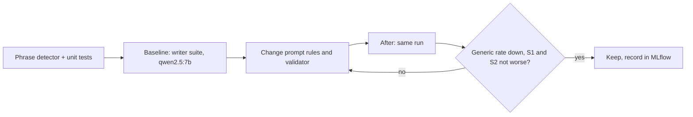
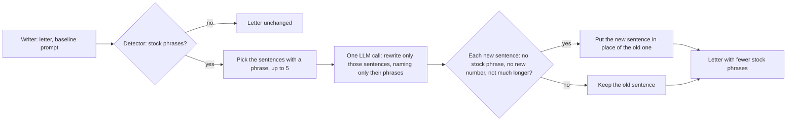

# Task: Measure and Reduce Generic Phrasing in Cover Letters and CVs

## Goal
Make generated cover letters and CVs sound less generic, and prove it with a number. First measure how often the local writer uses stock phrases. Then change the writer and the validator, and keep a change only when the number goes down and grounding does not get worse.

## Background
The user asked to link Turnitout-Humanizer (2026-11-12) so that letters and CVs do not sound generic. It cannot be linked like llmfit: the repository has no engine code, the engine is a closed cloud API, the license forbids any use, and it would send personal letters off the machine. Its method (word-order scrambling to defeat AI detectors) also works against the grounding checks. This task does the same job inside the project, local and measured.

## What exists now
- `src/generation/cover_letter_writer.py`: the prompt rules already say "Do NOT use generic phrases", ban two cliche openings, and list four stock phrases (rules 4, 7, 9). Nothing measures whether the model obeys them.
- `src/generation/cover_letter_validator.py`: `GENERIC_OPENINGS` checks 5 phrases in the first 100 characters only (tone score minus 20). `CALL_TO_ACTION_PHRASES` *requires* a stock closing ("I look forward to", "thank you for considering"), so a fresh closing loses 15 points. These two rules pull in opposite directions.
- `src/generation/resume_writer.py`: the prompt says "Use action verbs" and "professional tone". There is no generic-phrase rule and no CV eval suite.
- `src/evaluation/suites/writer.py`: writes letters with one local model on the grounding set (65 profile-job pairs) and logs check rates to MLflow. The checks are grounding checks only.

## Plan

1. **Detector.** A new module `src/generation/generic_phrasing.py` with one pure function: text in, matched phrases and the count per 100 words out. Phrase groups: cliche openings, stock self-descriptions ("team player", "results-driven", "detail-oriented"), filler and AI-style words ("delve", "leverage", "furthermore", "in today's fast-paced"), and CV filler ("responsible for", "duties included"). Whole-word, case-insensitive matches. Claude drafts the list; the user checks it once.
2. **Precision check.** Run the detector on the 15 real letters of Step 3.2 (`data/eval/grounding_real/`). Report counts per phrase only, never letter text. The user looks at the phrases with the most hits and removes any that are not generic in context.
3. **Writer suite.** Add the detector to `suites/writer.py`: `generic_phrasing_rate` (share of letters with one or more hits) and `generic_per_100w_p50`. Keep `ungrounded_claims` as the main check.
4. **Baseline.** Run the writer suite with `qwen2.5:7b` (the default writer), 1 sample per pair, before any prompt change. Record it in MLflow and `notes.md`.
5. **Changes.**
   - Validator: replace the 5-phrase opening check with the detector over the whole letter (new issue `GENERIC_PHRASING`, tone score penalty by count). Detect a call to action by intent (a closing sentence that asks for a conversation or next step), not by a stock phrase list.
   - Cover letter prompt: replace the four example phrases with the detector's list (one source, so the prompt and the check cannot drift).
   - Strip zero-width characters and a BOM from final letter text (small normalizer function, unit tested).
6. **After run.** The same writer suite run as the baseline. Compare in MLflow, and with `scripts/compare_writer_reports.py --secondary` (baseline first). Keep the change only when `generic_phrasing_rate` is lower, the S1 interval (mean flagged ungrounded sentences per letter, paired) is not above 0, and the S2 interval (`scope_inflation` share, paired) is not above 0.
7. **CVs, after the letters are settled.** CV prompt: add a rule from the CV filler group. Run the detector on the generated CV text (summary and bullets) and save the hits with the CV result. Apply the same zero-width normalizer to CV text.

## Attempt 2: targeted sentence rewrite (planned 2026-11-12, after attempt 1 failed its guard)

Attempt 1 (51 phrases listed in the prompt) gave more stock phrases and more flagged sentences. Attempt 2 leaves the prompt as it is, and fixes only the sentences that contain a stock phrase, after the letter is written.

- New module `src/generation/stock_phrase_polish.py`: `polish_stock_phrases(router, content, style, model)`. It finds the sentences with stock phrases (`split_letter_sentences` from the grounding module; classic style skips the opening and closing groups, as the validator does), up to 5 sentences.
- One call on the cover-letter route, low temperature (0.2), no thinking. The prompt gives the letter as context and a numbered list of the target sentences, each with only the phrase it uses. It asks for the same meaning in plain, specific words, with only facts already in the letter, and no new facts, numbers, technologies, or claims. The answer is one numbered line per sentence.
- Each new sentence is accepted only when it is not empty, has no stock phrase from any group, has no number that the old sentence did not have, and is at most 1.5 times the old word count plus 5 words. Otherwise the old sentence stays. A wrong line count, a parse failure, or an error keeps the whole letter as written.
- The accepted sentences replace the old ones in place (first exact match), so the other sentences and the paragraph breaks do not change.
- `CoverLetterWriter.write` calls it for modern and classic letters, not for short answers and not for the template fallback. The letter records how many sentences were replaced.
- Measure: the same writer suite run (65 letters, `qwen2.5:7b`, 1 sample) from the clone, with the same guard (stock-phrase rate lower; S1 and S2 intervals not above 0). Also report the extra latency.
- Tests with a fake router: no stock phrase means no call; each acceptance rule; a wrong line count; an error; the splice; classic skips.

## Decisions (2026-11-12)
1. Cover letters first: the user generates letters much more often than CVs. Steps 1 to 6 are for letters; step 7 (CVs) starts only after the letter result is in.
2. CV scope: the prompt rule and the per-CV hit list only. A CV eval suite is a follow-up task if the user wants one.
3. Guard (user, after the baseline): `ungrounded_claims_rate` is at its ceiling (1.0), so the guard uses the Step 3.8 secondary analysis: S1 (mean flagged ungrounded sentences per letter) and S2 (`scope_inflation` share), paired, not above 0.

## Constraints
- Local models only, 7B or smaller. Before each `qwen2.5:7b` run: check idle GPU memory, ask the user to close RuneScape, and unload the model after the run.
- Never read the contents of `data/`. Runs on real letters print counts only.
- New code adds 0 mypy errors; never run `mypy_gate.py --update`.
- Build and check on a scratch clone with its own `.venv`; small changes through the handoff runner. Apply only after "Yes, apply it"; push only after approval.
- A CV eval suite (generic rate measured over many CVs) is out of scope. This task measures letters; CVs get the rule and the per-CV hit list. A CV suite is a follow-up if the user wants one.

## Acceptance Criteria
- [x] `generic_phrasing.py` exists with docstrings, types, and unit tests (whole-word matching, case, counts per 100 words, empty text).
- [x] The user has checked the phrase list after the precision check on the real letters (counts only).
- [x] The writer suite reports `generic_phrasing_rate` and `generic_per_100w_p50`; unit tests with a fake writer.
- [x] Baseline run with `qwen2.5:7b` recorded in MLflow and `notes.md`.
- [x] Validator: `GENERIC_PHRASING` issue over the whole letter; call to action detected by intent. Unit tests, including a fresh closing that now passes.
- [x] Cover letter prompt uses the detector's phrase list.
- [x] Zero-width characters and BOM stripped from final letter text, with a unit test.
- [x] After run: `generic_phrasing_rate` lower than the baseline (attempt 2, 2026-11-12); S1 and S2 intervals (`compare_writer_reports.py --secondary`) not above 0. Recorded in MLflow and `notes.md`.
- [ ] CVs (after the letter result): the CV prompt has the filler rule, CV results carry the detector hits, and CV text goes through the same normalizer.
- [ ] CI checks pass locally and in CI (black, ruff, mypy gate 0 new, pytest; frontend unchanged).
- [ ] Applied after "Yes, apply it"; pushed after approval; CI run recorded.
- [ ] Lesson in `docs/lessons.md` if the run teaches one; `tasks/todo.md` updated; folder archived.

## Status
`review`
