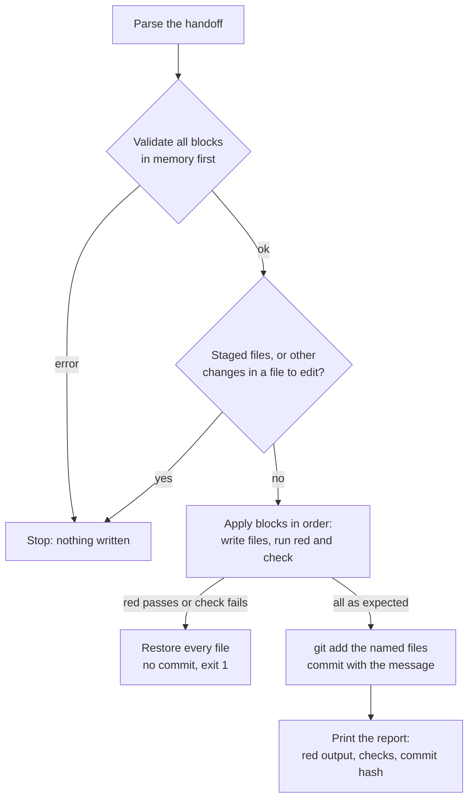

# Notes: Handoff Runner

## Why not a local model (2026-10-30, Claude)

Findings from the inventory (Ollama 0.33.1, RTX 3070 Ti 8 GB, about 1.7 GB used by the desktop):

- The WSL opencode config reaches Ollama through the OpenAI-compatible `/v1` endpoint with `qwen2.5-coder:7b`, which has no `num_ctx` in its Modelfile. The `limit.context` value in opencode does not change the context that Ollama loads, so the model probably ran with Ollama's default context, too small for opencode's system prompt, tool schemas, `AGENTS.md`, and the enabled `codebase-memory-mcp` tools. This matches "tool calls as plain text".
- `qwen3.5-4b-16k` and `qwen3.5-9b-16k` use temperature 1, `top_k` 20, and `presence_penalty` 1.5, with thinking on. A presence penalty works against copying a long file exactly, and thinking uses the output budget ("truncated after two output token limit continuations").
- A 7B model with a 16k context needs about 5.6 GB, so about 7.3 GB with the desktop: at the BSOD limit.
- The handoffs give the complete code and the exact edits. The agent only copies text and runs commands, which a script does exactly.

The user chose the runner (2026-10-30).

## Format (plan)

The runner reads only fenced blocks whose info string has a runner attribute. Other blocks (Mermaid, examples) are ignored. It processes the blocks in document order.

| Info string | Action |
|---|---|
| ` ```<lang> new=<path>` | Create the file with the block text. Stop if it exists with other text; skip if it exists with the same text. |
| ` ```<lang> edit=<path>` | The block holds one pair: `<<<<<<< OLD`, the old text, `=======`, the new text, `>>>>>>> NEW`. The old text must occur exactly once. |
| ` ```bash red cwd=<dir>` | Run the command; it must fail (exit code not 0). |
| ` ```bash check cwd=<dir>` | Run the command; it must pass (exit code 0). |
| ` ```text commit` | The commit message. Exactly one. |

Paths are relative to the repository root. `cwd` is relative to the repository root (default: the root). Commands run with `bash -lc`, so a check can start with `source ~/.nvm/nvm.sh && nvm use 24`.



**Safety rules:**

- Validation before any write: the format, one commit block, paths inside the repository, no path in `apps/backend-py/data/` or named `.env*` (except `.env.example`), each new file absent (or the same), and each old text found exactly once in the file as the earlier blocks leave it.
- The run stops when anything is staged, or when a file to edit has changes other than line endings.
- On any failure, the runner restores each edited file to its first text and removes each new file, and it does not commit.
- It stages only the files that the handoff names (a `check` that formats them, such as black, is included).
- `--dry-run` validates and prints the plan, and writes nothing.

## Build (2026-10-30, Claude, test-first)

- `tests/unit/test_run_handoff.py` first: it failed at collection (no script). Each test makes its own git repository in a temporary folder and a handoff with a new file, a red command, an edit, a check in `cwd=app`, a Mermaid block, and a commit block.
- `scripts/run_handoff.py`: the 19 tests pass; black (one file reformatted) and ruff pass.
- Mutation preview (each on its own copy in WSL's native disk; the repository file did not change): R1 a passing red command accepted, R2 a failing check accepted, R3 no restore on failure, R4 staged files allowed, R5 other changes allowed, R6 the old-text count not checked, R7 the data folder allowed, R8 `.env` files allowed, R9 parent paths allowed, R10 a missing commit block allowed, R11 CRLF kept, R12 a new file with other text replaced, R13 the dry run applies, R14 the commit message ignored, R15 every change staged, R16 `cwd` ignored. All 16 were caught.
- MH-B and MH-C of `step-3-2-real-letters` now use the format (`new=`, `red`, `check`, `text commit`, and an "Apply with the runner" section). `--dry-run` on the real repository accepts both: new test, red, new script, 3 checks, commit.
- `docs/handoff-runner.md` (the format, the safety rules, a flow diagram, labeled commands, and rules for Claude), and a pointer in `tasks/index.md`.

## Blockers / Questions

- None.
