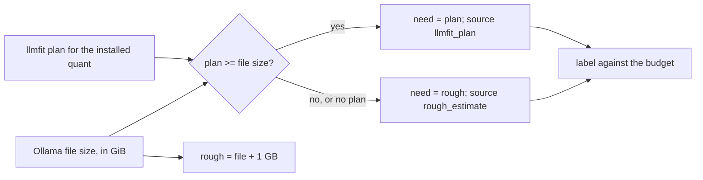

# MH-1: File-size floor and one unit for hardware fit

## Apply with the runner

The handoff runner applies this file: it changes the tests, runs the red command (it must fail), makes the changes, runs the checks, and commits. The runner does not push.

Apply this handoff (WSL, from `apps/backend-py`):

```bash
.venv/bin/python scripts/run_handoff.py ../../tasks/active/hardware-fit-floor/mh-1-file-size-floor.md
```

## Why

On the user's machine, Settings labelled `gemma4:e4b` "Fits" next to an 8.9 GB file on an 8 GB card. llmfit planned 5.79 GB for it, probably because a Gemma "e" model keeps part of its weights off the GPU in some runtimes. Ollama loads the whole file, so the model cannot fit. It was the only mapped model whose plan was below its file size.

Also, the rough estimate divided bytes by 10^9, while the VRAM (from nvidia-smi and llmfit) and the Size column use 1024^3. The two numbers on one row used different units.



## Decisions

- The floor is the file size itself: a plan below the weights cannot be right, because Ollama loads the whole file. A plan between the file size and the file size plus 1 GB is still used, so a well-mapped model keeps its plan.
- When the floor wins, the source is `rough_estimate`, so the hover text says the number comes from the file size.
- GB means 1024^3 bytes everywhere in `fit.py`. On this machine the rough estimates drop by about 7%. Two labels change: `gemma4:e4b` goes from Fits to Too large (9.95 GB), and `granite4.1:8b` goes from Over budget to Fits (5.98 GB in GiB, against the 6.0 GB budget; it was 6.35 in decimal GB).
- Suggestions do not change: a model that is not installed has no file size yet. The docs say what the floor does.

## Files

- `apps/backend-py/tests/unit/test_hardware_fit.py`, `tests/unit/test_hardware_service.py` (change)
- `apps/backend-py/src/hardware/fit.py`, `docs/hardware-fit.md` (change)

## Step 1: change the tests, run them, and see them fail

```python edit=apps/backend-py/tests/unit/test_hardware_fit.py
<<<<<<< OLD
        """A 4.68 GB file needs about 5.68 GB."""
        assert rough_need_gb(4_680_000_000) == 5.68
=======
        """A file of 4.68e9 bytes (4.36 GiB) needs about 5.36 GiB."""
        assert rough_need_gb(4_680_000_000) == 5.36
>>>>>>> NEW
```
```python edit=apps/backend-py/tests/unit/test_hardware_fit.py
<<<<<<< OLD
        assert fit.source == FitSource.LLMFIT_PLAN
        assert fit.need_gb == 5.35
        assert fit.label == FitLabel.FITS
=======
        assert fit.source == FitSource.LLMFIT_PLAN
        assert fit.need_gb == 5.35
        assert fit.label == FitLabel.FITS

    def test_the_file_size_is_a_floor_for_the_plan(self) -> None:
        """A plan below the installed file is not used: Ollama loads the file."""
        # gemma4:e4b on the user's machine: llmfit planned 5.79 GiB for a
        # 9.61e9-byte file, which alone is more than the 8 GiB card.
        fit = label_installed("gemma4:e4b", "Q4_K_M", 9_610_000_000, 5.79, 6.0, 8.0)
        assert fit.need_gb == 9.95
        assert fit.source == FitSource.ROUGH_ESTIMATE
        assert fit.label == FitLabel.TOO_LARGE

    def test_a_plan_without_a_file_size_is_used(self) -> None:
        """With no file size there is no floor, so the plan decides."""
        fit = label_installed("x:7b", "Q4_K_M", None, 5.35, 6.0, 8.0)
        assert fit.source == FitSource.LLMFIT_PLAN
        assert fit.need_gb == 5.35
>>>>>>> NEW
```
```python edit=apps/backend-py/tests/unit/test_hardware_fit.py
<<<<<<< OLD
        assert fit.need_gb == 7.59
=======
        assert fit.need_gb == 7.14
>>>>>>> NEW
```
```python edit=apps/backend-py/tests/unit/test_hardware_service.py
<<<<<<< OLD
        assert report.installed[0].need_gb == 5.68
=======
        assert report.installed[0].need_gb == 5.36
>>>>>>> NEW
```

```bash red cwd=apps/backend-py
.venv/bin/python -m pytest -q -p no:cacheprovider tests/unit/test_hardware_fit.py tests/unit/test_hardware_service.py
```

## Step 2: add the floor, and use one unit

```python edit=apps/backend-py/src/hardware/fit.py
<<<<<<< OLD
ROUGH_ALLOWANCE_GB = 1.0
"""Context and runtime memory added to a file size for a rough estimate.
=======
ROUGH_ALLOWANCE_GB = 1.0
"""Context and runtime memory added to a file size for a rough estimate.

A plan below the file size itself is not used: Ollama loads the whole
file, so such a plan is replaced with this rough estimate.
>>>>>>> NEW
```
```python edit=apps/backend-py/src/hardware/fit.py
<<<<<<< OLD
BYTES_PER_GB = 1_000_000_000
=======
BYTES_PER_GB = 1024**3
"""GB in this module means 1024**3 bytes (GiB), the unit of the VRAM that
nvidia-smi and llmfit report (8192 MiB is 8.0) and of the Size column in
Settings, so a file size and a budget compare in one unit."""
>>>>>>> NEW
```
```python edit=apps/backend-py/src/hardware/fit.py
<<<<<<< OLD
    The llmfit plan for the installed quantization is used when there is one.
    Otherwise the label uses a rough estimate from the file size.
=======
    The llmfit plan for the installed quantization is used when there is one,
    unless it is below the file size itself: a plan can assume that part of
    the weights stays off the GPU, but Ollama loads the whole file. Otherwise
    the label uses a rough estimate: the file size plus ``ROUGH_ALLOWANCE_GB``.
>>>>>>> NEW
```
```python edit=apps/backend-py/src/hardware/fit.py
<<<<<<< OLD
    if plan_need_gb is not None:
        need: Optional[float] = round(plan_need_gb, 2)
        source = FitSource.LLMFIT_PLAN
    else:
        need = rough_need_gb(size_bytes)
        source = FitSource.ROUGH_ESTIMATE if need is not None else FitSource.NONE
=======
    file_gb = size_bytes / BYTES_PER_GB if size_bytes and size_bytes > 0 else None
    if plan_need_gb is not None and (file_gb is None or plan_need_gb >= file_gb):
        need: Optional[float] = round(plan_need_gb, 2)
        source = FitSource.LLMFIT_PLAN
    else:
        need = rough_need_gb(size_bytes)
        source = FitSource.ROUGH_ESTIMATE if need is not None else FitSource.NONE
>>>>>>> NEW
```
```markdown edit=docs/hardware-fit.md
<<<<<<< OLD
- **Rough estimate**: when llmfit does not know the model (for example a tag that you made yourself), the need is the file size plus 1 GB for the context and the runtime.
=======
- **Rough estimate**: when llmfit does not know the model (for example a tag that you made yourself), the need is the file size plus 1 GB for the context and the runtime.
- **File-size floor**: Ollama loads the whole file, so an llmfit plan below the file size is not used. This happens for a Gemma "e" model, where llmfit assumes that part of the weights stays off the GPU. The label then uses the rough estimate and says so.
- **Units**: GB here means 1024³ bytes, as `nvidia-smi` and llmfit report the VRAM and as the Size column shows a file.
>>>>>>> NEW
```

## Step 3: checks

```bash check cwd=apps/backend-py
.venv/bin/python -m pytest -q -p no:cacheprovider tests/unit/test_hardware_fit.py tests/unit/test_hardware_service.py tests/unit/test_llmfit_client.py
```

```bash check cwd=apps/backend-py
.venv/bin/python -m black --check src/hardware/fit.py tests/unit/test_hardware_fit.py tests/unit/test_hardware_service.py
```

```bash check cwd=apps/backend-py
.venv/bin/python -m ruff check src/hardware/fit.py tests/unit/test_hardware_fit.py tests/unit/test_hardware_service.py
```

```bash check cwd=apps/backend-py
.venv/bin/python scripts/mypy_gate.py
```

```text commit
fix(hardware): never label a model below its file size, and use GiB

Settings labelled gemma4:e4b "Fits" next to an 8.9 GB file on an 8 GB
card: llmfit planned 5.79 GB for it, but Ollama loads the whole file. An
installed model now never gets a plan below its file size; such a plan
gives way to the rough estimate (file + 1 GB). The rough
estimate also used 10^9 bytes per GB while the VRAM and the Size column
use 1024^3; fit.py now uses 1024^3 throughout. On the user machine this
moves gemma4:e4b to Too large and granite4.1:8b (5.98 GiB) to Fits.

Co-Authored-By: Claude Opus 5.5 <noreply@anthropic.com>
```
