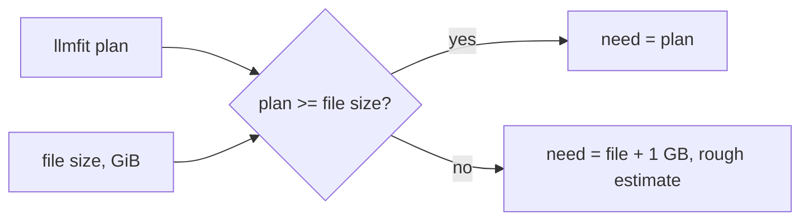

# Task: File-Size Floor and One Unit for Hardware Fit

## Goal
An installed model's hardware-fit label must never say it needs less memory than the file that Ollama loads. On the user's machine, `gemma4:e4b` showed "Fits" next to an 8.9 GB file on an 8 GB card, because llmfit planned 5.79 GB for it. Also, use one unit (GiB) for file sizes and the VRAM budget.

## Constraints & Context
- Only installed models change; suggestions have no file size yet.
- No model is loaded for the checks (GPU limits).
- One runner handoff (`mh-1-file-size-floor.md`). It needs the user's "Yes, apply it". Push only after the user approves.

## Acceptance Criteria
- [x] A plan below the file size is not used; the rough estimate (file + 1 GB) takes its place, with the source `rough_estimate`; `gemma4:e4b` becomes "Too large".
- [x] `fit.py` uses 1024^3 bytes per GB; the tests use the new values.
- [x] A smoke run with the real llmfit and Ollama shows the expected changes only (`gemma4:e4b` to Too large; `granite4.1:8b` to Fits from the unit change).

## Status
`in-progress` (2026-11-10: checked on a clone, not applied)
