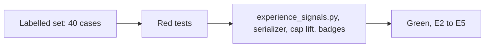
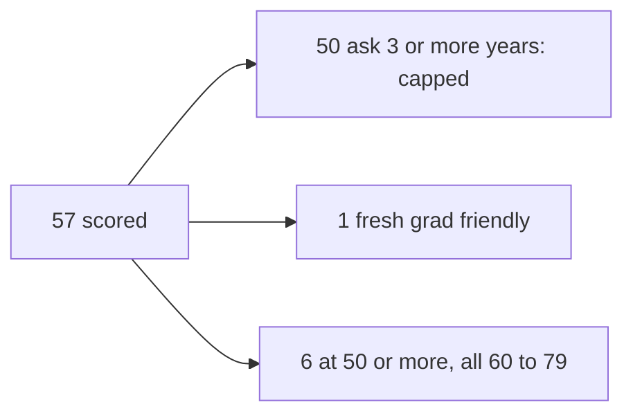

# Notes: job-card-labels

Planned 2026-11-16 on the laptop, during the project-scoring task (user: "Do this task here").

## Code reading (2026-11-16)

- Card: `apps/frontend-ts/src/components/jobs/job-list-item.tsx`, badges in one wrap row; used only by `apps/frontend-ts/src/app/jobs/page.tsx` and, through the demo handlers, by the demo.
- Serializer: `apps/backend-py/src/pipeline/shortlist.py`, `serialize_listing` (no `requirements`, no `metadata`; description cut to 5000 characters) and `serialize_scored_job`. Tests: `tests/unit/test_shortlist.py`; card test: `apps/frontend-ts/tests/components/job-list-item.test.tsx`.
- Existing patterns: `jd_extractor.py` `EXPERIENCE_PATTERNS` (fixed ranges only, maps to a level), `career_stage.py` `_GRADUATE_RE` (candidate text, not jobs), `cover_letter_grounding.py` `_DURATION_CLAIM_RE` (letter claims).
- The demo seed shortlist has one description with "5 years of experience" and none with "fresh grad".

## Build on the scratch clone (2026-11-16, after the plan check)

Choices: C1a (text years label only; the cap uses structured years), C2a (change D and this task in one apply), C3a (no new demo seed).

- Labelled set written first: `apps/backend-py/tests/fixtures/eval/experience_signals/cases.jsonl`, 40 constructed postings: 23 state years, 13 welcome fresh graduates, 16 traps (company years, age, contract length, programme length, preferred or bonus years, negated or non-welcome mentions of fresh graduates).
- Red: backend `test_experience_signals.py` (10): 7 failed (years rule, fresh-grad rule, structured before text, serializer fields, text after the 5000-character cut, cap lift, distribution count), 3 guards passed (set complete, senior cap kept, text years do not cap). Frontend `job-list-item.test.tsx` (+2): 1 failed (labels shown), 1 guard passed (labels hidden). All tests ran.
- Code: `src/scoring/experience_signals.py` (`years_from_text`, `is_fresh_grad_friendly`, `structured_required_years`, `job_signal_text`, `job_required_years`, `job_is_fresh_grad_friendly`); `matcher.py` (`required_years` uses `structured_required_years`; `asks_too_many_years` is false for a fresh-grad-friendly posting); `distribution.py` (`fresh_grad_friendly` count, with `required_years_at_or_above_3`); `shortlist.py` `serialize_listing` (`required_years`, `fresh_grad_friendly`); frontend type and two badges ("N+ yrs" neutral outline, "Fresh grad friendly" green outline, each with a title text).

| Rule | Target | Result |
|---|---|---|
| E2 years exact | at least 90 % of 23 | 23 of 23 |
| E2 invented years | 0 of 17 | 0 |
| E3 fresh-grad precision | 1.0 | 1.0 (0 false labels) |
| E3 fresh-grad recall | at least 0.85 | 1.0 (13 of 13) |
| E4 ranking pins | not below | unchanged (`fresh_ml` 0.9455 / 0.875, `mid_backend` 0.8685 / 0.6364, BM25 unchanged) |
| E5 backend | black, ruff, mypy 0 new, pytest | pass; pytest 2484 passed |
| E5 frontend | eslint, tsc, vitest, prettier, build | pass; vitest 394 passed (71 files); `build` and `build:demo` pass |

- No revision was needed. Limit: the same agent wrote the set and the patterns, so a full score on the set is weak evidence; the live run (E6) and the user's reading of the cards are the real check.
- Seen, not from this change: eslint warns about an unused directive in the generated `public/mockServiceWorker.js`; vitest prints a logged error from `tests/app/cover-letter/page.test.tsx` (an expected failure path), and all tests pass.

## Applied to main with change D (2026-11-16, after "Yes, apply it")

- Patch from the clone applied with `git apply` (no mode lines); the 11 files on `main` are byte-for-byte the same as on the clone (change D of `tasks/active/project-scoring/` and this task, choice C2a).
- Checks on `main`: black, ruff, mypy gate (0 new), full backend pytest 2484 passed, vitest 394 passed, eslint, tsc, prettier. The builds ran on the clone only, so they do not replace the production build that `make app` uses.
- Commit "feat(scoring): cap fresh graduate jobs that ask for 3 or more years, and label required years and fresh-grad-friendly postings". Not pushed.

## Live run (2026-11-16, user, `run_7b7f03e34804`)

Settings as before (dry run, MyCareersFuture, Singapore, fresh graduate on, Min Score 50, Max Jobs 10). App restarted after the apply (the first try ran on the old backend process, which started before the commit; no run reached it). Counts only, through the results endpoint.

| | `run_4d7909177390` (project scoring only) | `run_7b7f03e34804` (with change D and labels) |
|---|---|---|
| Scored; removed internship / no keyword | 57; 3 / 8 | 57; 3 / 8 |
| Levels | Entry 5, Mid 33, Senior 10, Lead 8, Executive 1 | the same |
| At 50 or more / at 60 or more | 24 / 16 | 6 / 6 |
| Band 30-39 | 30 | 50 |
| `required_years_at_or_above_3` | not recorded | 50 |
| `fresh_grad_friendly` | not recorded | 1 |
| Component means | projects 16.1, skills 18.5, education 17.0, experience 3.6, location 5.0 | the same |

- The scrape returned the same jobs as the previous run (same counts and levels), so this is a close pair.
- 50 of 57 scored jobs state 3 or more minimum years on MyCareersFuture. The 18 senior, lead, and executive jobs were capped already, so about 32 of the 33 Mid Level jobs are now capped too. Passed jobs fall from 24 to 6.
- This works against the user decision of 2026-11-16 that Mid Level jobs stay in fresh graduate results. The limit of 3 needs the user's decision again before the push.
- Only 1 scored job is fresh grad friendly by the text rules; the user checks the cards.

## User decision after the live run (2026-11-16)

"Raise the limit to 5, and then do our best to target the ones with the fresh grads friendly thing inside the JD, even though it's 5+ years." Change E: `FRESH_GRAD_MAX_YEARS` 3 to 5 (the count becomes `required_years_at_or_above_5`); a fresh-grad-friendly posting stays exempt from the years cap at any years. Same guards as change D; one live rerun before the push.

## Change E on the scratch clone: limit 5 (2026-11-16)

- Tests moved to the new limit first: capped at 5 and 6 years; not capped with no years, 2, 3, or 4 years; Entry Level with 5 years capped; the fresh-grad lift tested at 6 years; count key `required_years_at_or_above_5`. Red: 3 failed (3 and 4 years must pass; the new count key), 20 passed (the 5 and 6 year cases also pass under the old limit of 3).
- Code: `FRESH_GRAD_MAX_YEARS` 3 to 5 in `matcher.py`, with the reason in its comment; docstrings in `distribution.py`. Frontend unchanged.
- Green: 23 passed. Ranking pins unchanged (`fresh_ml` 0.9455 / 0.875, `mid_backend` 0.8685 / 0.6364, BM25 unchanged). Black, ruff, mypy gate (0 new), full backend pytest 2486 passed.
- Applied to `main` after "Yes, apply it" (2026-11-16): the 4 files are the same as on the clone; on `main` black, ruff, mypy gate (0 new), full backend pytest 2486 passed. Commit "fix(scoring): raise the fresh graduate years cap to 5". Not pushed.
