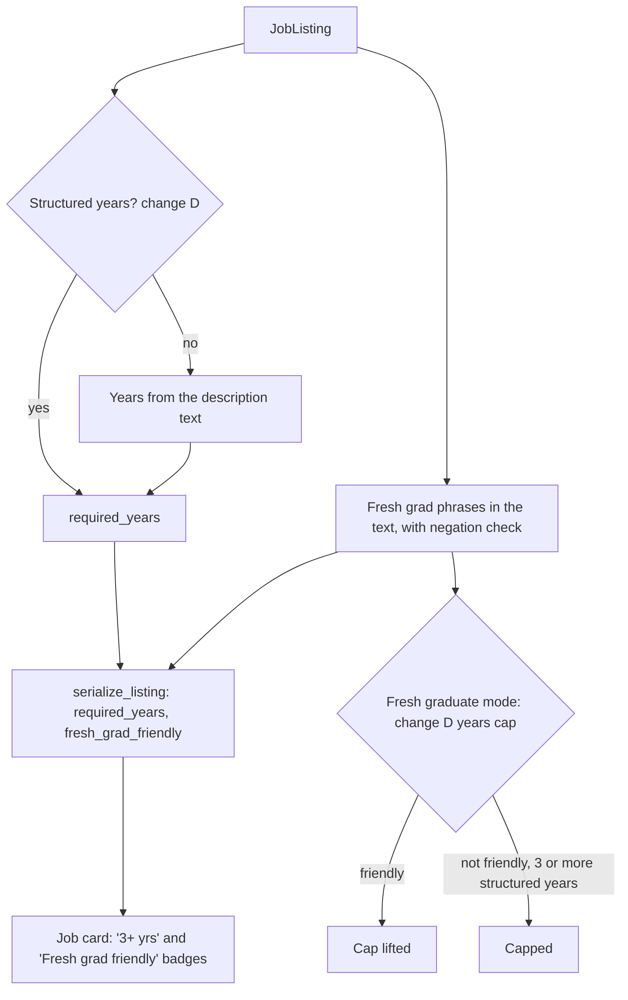
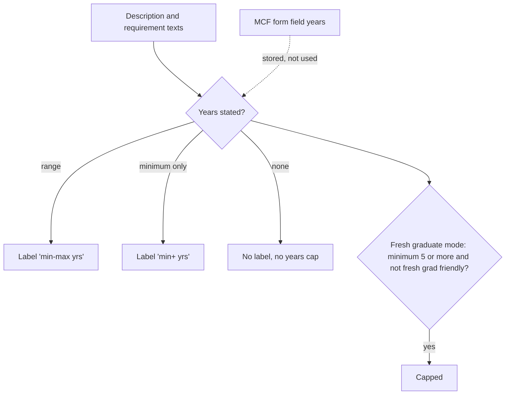

# Task: Job Card Labels (Required Years, Fresh Grad Friendly)

## Goal
Show on each job card, before the user opens the listing, how many years of experience the job asks for, and a "Fresh grad friendly" label when the posting says that fresh graduates are welcome. A fresh-grad-friendly posting must not be hidden by the required-years cap of change D.

## Context (2026-11-16)
- User idea during the project-scoring task (`tasks/active/project-scoring/`), after a full-stack job that asks for 4 years scored 84. Change D of that task (built on the scratch clone, not applied) keeps the MyCareersFuture minimum years as a `JobRequirement` with `years_of_experience`, and caps fresh graduate jobs that ask for 3 or more years.
- The job card is `apps/frontend-ts/src/components/jobs/job-list-item.tsx` (badges: source, Remote, Applied Elsewhere, Expired, Scraped today, Applied, score). It is used on the Jobs page (latest shortlist and search results) and in the demo.
- The card data comes from `serialize_listing` in `apps/backend-py/src/pipeline/shortlist.py`. It sends `description` (cut to 5000 characters) and no `requirements` or `metadata`. So the backend must compute the two values and send them.
- No code reads years or "fresh graduates welcome" from job text today. `cover_letter_grounding.py` has a duration pattern for letter claims; it is a reference, not a dependency.

## Proposed change (fixed before any code change)

| Part | Change |
|---|---|
| L1 | New module `src/scoring/experience_signals.py`: `years_from_text(text)` and `is_fresh_grad_friendly(text)`. |
| L1 years | Phrases such as "at least 3 years", "minimum of 3 years", "3+ years", "3 or more years", "3-5 years", "three years", each followed within a few words by "experience". The value is the lower bound. When there are several, the largest lower bound counts. A sentence that says "preferred", "advantage", "a plus", "bonus", or "nice to have" does not count. Numbers without "experience" nearby (for example "10 years in business", "aged 21 years") do not count. |
| L1 fresh grad | Phrases such as "fresh graduates are welcome", "fresh grads welcome to apply", "fresh graduates are encouraged to apply", "open to fresh graduates", "suitable for fresh graduates", "no experience required". A negation in the same sentence ("not suitable for fresh graduates", "fresh graduates need not apply") cancels it. |
| L2 | `job_required_years(job)`: the structured value (change D `required_years`) when there is one, else `years_from_text` over the full description and requirement texts (before the 5000-character cut). |
| L3 | `serialize_listing` adds `required_years` (number or null) and `fresh_grad_friendly` (true or false). |
| L4 | Frontend: `JobListing` type gets the two fields; `JobListItem` shows "N+ yrs" when `required_years` is set and "Fresh grad friendly" when true. Neutral colors (the years label is information, not a warning). |
| L5 | Matcher (change D): in fresh graduate mode the years cap does not apply when the posting is fresh grad friendly. The senior cap (`is_senior_role`) does not change. |
| L6 | `score_distribution` adds `fresh_grad_friendly` (count of scored jobs), numbers only, for the live check. |

Choices for the user (recommendation first):
- C1. Years from the description text: (a) label only; the cap uses only the structured years of change D (recommended: a wrong text parse must not hide a job); (b) also cap on text years.
- C2. Apply: (a) change D and this task go to `main` together, in one "Yes, apply it" (recommended: L5 needs D, and D alone would hide fresh-grad-friendly jobs); (b) D first, then this task.
- C3. Demo seed: (a) no new seed run; the demo cards show no new labels until the next seed (recommended: the fields are optional, and a new seed changes the letter again); (b) run the seed again.

## Decision rule (fixed before any code change)
- E1. Labelled set: `apps/backend-py/tests/fixtures/eval/experience_signals/cases.jsonl`, about 40 constructed postings (no copy of a real posting), labelled with the expected years and the fresh-grad flag before the detector code exists. It includes traps: "10 years in business", preferred years, ranges, number words, negated fresh-grad phrases, and both signals in one posting.
- E2. Years: the exact value on at least 90 % of the cases that state years; no value on any case that states none (0 invented values).
- E3. Fresh grad: precision 1.0 (no false label; a false label misleads the user and lifts the cap) and recall at least 0.85.
- E4. Change D guards still hold; ranking pins not below (`fresh_ml` 0.9455 / 0.875, `mid_backend` 0.8685 / 0.6364); standard mode unchanged.
- E5. CI checks: backend black, ruff, mypy gate (0 new), full pytest; frontend eslint, tsc, vitest, prettier, build. The Playwright suites run in CI.
- E6. Live: after the apply, one run with the usual settings; record `required_years_at_or_above_3` and `fresh_grad_friendly` counts and the passed count; the user reads the labels on the cards and judges them before the push.

If E2 or E3 fails, one revision of the patterns is allowed, and both results go into `notes.md`. A labelled case is changed only when the label itself is wrong, with the reason in `notes.md`.

## Steps
1. Plan check by the user, with C1 to C3.
2. Write the labelled set (E1), then red tests: detector cases, serializer fields, the cap lift, the distribution count, the card badges (vitest).
3. Build L1 to L6 on the scratch clone (on top of change D); green tests.
4. Measure E2 to E4; CI checks (E5).
5. "Yes, apply it": apply change D and this task to `main` (C2), with the same checks on `main`.
6. Live run (E6) and the user's judgement; push after approval; CI; `tasks/todo.md`; archive both task folders.

## Constraints & Context
- Never read `apps/backend-py/.env`, `apps/frontend-ts/.env.local`, `user_settings.json`, or the contents of any `data/` folder. The live check reads counts only; the user reads the cards.
- Mid Level jobs stay in fresh graduate results (user decision 2026-11-16).
- Playwright cannot start on this laptop; CI runs the browser suites. Node 24 (CI) is not installed in WSL here; local frontend checks use Node 20.

## Acceptance Criteria
- [x] Plan checked by the user, with C1 to C3 chosen (2026-11-16: "Approve, recommended": C1a label only, C2a one apply with change D, C3a no new seed).
- [x] Labelled set written before the detector code.
- [x] Red tests: every new behaviour test fails first (failed plus passed equals the number of new tests).
- [x] Green tests; E2 to E4 measured and recorded in `notes.md`.
- [x] CI checks pass on the clone (E5).
- [x] Applied to `main` after "Yes, apply it"; the same checks pass on `main` (2026-11-16, with change D).
- [ ] Live run (E6) recorded; the user's judgement of the labels recorded.
- [ ] Pushed after approval; the CI run passes; `tasks/todo.md` updated; folder archived.

## Status
`review`

## Change F: years from the description only, as a range (added 2026-11-16)

User finding in `run_f9cfd32ec0e9`: the MSI Global software engineer job says "1 to 5 years" in its description, but the card showed "3+ yrs" (the MyCareersFuture form field). User decisions: show the range that the description states, use no fallback ("we do not want to assume"), and cap on the description minimum.

| Part | Change |
|---|---|
| F1 | `years_range_from_text(text)`: the stated phrase with the largest lower bound, as (minimum, maximum or None). "Up to N years" is (0, N). `years_from_text` returns its minimum. |
| F2 | The signal text leaves out requirements that carry `years_of_experience` (the scraper's form-field requirement), so the form field never reaches the label or the cap. |
| F3 | `job_required_years` and the new `job_required_years_range` use the text only (no structured fallback). |
| F4 | The years cap and the `required_years_at_or_above_5` count use the description minimum. Fresh-grad-friendly postings stay exempt. |
| F5 | API: `required_years_max` next to `required_years`. Card: "1-5 yrs" for a range, "5+ yrs" for a minimum, nothing when the text states no years. |

Decision rule for F (fixed before the code change):
- F-G1. Labelled set with range cases added (and `years_max` on every case): minimum exact on at least 90 % of the cases that state years, maximum exact on at least 90 % of the range cases, no invented values; fresh-grad rule unchanged (precision 1.0, recall at least 0.85).
- F-G2. Tests: the form field alone gives no label and no cap; form field 3 with text "1 to 5 years" gives (1, 5) and no cap; text minimum 5 or more caps unless fresh grad friendly.
- F-G3. Ranking pins not below; backend and frontend CI checks pass.
- Live: one rerun; the user checks the MSI Global card and others before the push.
