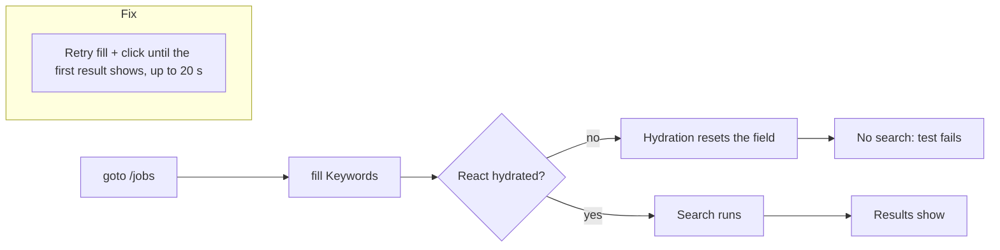

# MH-1: Stable Jobs page E2E search

## Apply with the runner

The handoff runner applies this file: it makes the change, runs the checks, and commits. The runner does not push.

Apply this handoff (WSL, from `apps/backend-py`):

```bash
.venv/bin/python scripts/run_handoff.py ../../tasks/active/jobs-e2e-flake/mh-1-jobs-search.md
```

## Why

Two Jobs page E2E tests fail about 1 time in 10 (2 to 4 failures in 24 runs, measured during the font task). The screenshot of a failure shows the cause: the Search button has the focus, but the Keywords field is empty and no result shows. The test typed into the server-rendered input before React hydrated it, and hydration reset the field. This is the same race as the Step 5 sidebar flake.



## Decisions

- The fix is in the test: a `searchJobs` helper retries the fill and the click until the first result shows (`expect.toPass`, 3 s per try, 20 s in all). The mocked search is safe to repeat, and a search that never works still fails.
- There is no red step: a flake cannot fail on demand. The proof is a forced race (the page's JavaScript chunks delayed by 3 s, so the fill comes before hydration) and repeated runs, recorded in the task notes.
- The app is not changed. In the dev server, a field typed in before hydration loses its text; a production build hydrates much sooner.

## Files

- `apps/frontend-ts/tests/e2e/jobs-page.spec.ts` (change)

## Step 1: change the test

```ts edit=apps/frontend-ts/tests/e2e/jobs-page.spec.ts
<<<<<<< OLD
import { test, expect } from "./support/test";
=======
import type { Page } from "@playwright/test";

import { test, expect } from "./support/test";

/**
 * Search for jobs, and wait for the first mocked result.
 *
 * On a cold dev server, a fill or a click before hydration can be lost: the
 * hydrated input resets to its empty state, so no search runs. Retry until
 * the results show; the mocked search is safe to repeat, and a search that
 * never works still fails after the overall timeout.
 *
 * @param page - The page on /jobs.
 * @param keywords - Text for the Keywords field.
 * @returns Resolved once the first result is visible.
 */
async function searchJobs(page: Page, keywords: string): Promise<void> {
  const firstResult = page.getByText("Senior Software Engineer").first();
  await expect(async () => {
    await page.locator('input[name="keywords"]').fill(keywords);
    await page.locator('button[type="submit"]').click();
    await expect(firstResult).toBeVisible({ timeout: 3_000 });
  }).toPass({ timeout: 20_000 });
}
>>>>>>> NEW
```
```ts edit=apps/frontend-ts/tests/e2e/jobs-page.spec.ts
<<<<<<< OLD
  test("renders results after a search", async ({ page }) => {
    await page.locator('input[name="keywords"]').fill("Software Engineer");
    await page.locator('button[type="submit"]').click();

    // The mocked POST /jobs/search returns sampleJobs; the first result's
    // title renders in the left-hand results list.
    await expect(
      page.getByText("Senior Software Engineer").first(),
    ).toBeVisible({
      timeout: 10000,
    });
  });
=======
  test("renders results after a search", async ({ page }) => {
    // The mocked POST /jobs/search returns sampleJobs; the first result's
    // title renders in the left-hand results list.
    await searchJobs(page, "Software Engineer");
  });
>>>>>>> NEW
```
```ts edit=apps/frontend-ts/tests/e2e/jobs-page.spec.ts
<<<<<<< OLD
    await page.locator('input[name="keywords"]').fill("Software Engineer");
    await page.locator('button[type="submit"]').click();

    await expect(
      page.getByText("Senior Software Engineer").first(),
    ).toBeVisible({
      timeout: 10000,
    });

    // Open the first job detail panel by clicking the row's overlay button.
=======
    await searchJobs(page, "Software Engineer");

    // Open the first job detail panel by clicking the row's overlay button.
>>>>>>> NEW
```

## Step 2: checks

```bash check cwd=apps/frontend-ts
source ~/.nvm/nvm.sh && nvm use 24 && npx prettier --check tests/e2e/jobs-page.spec.ts
```

```bash check cwd=apps/frontend-ts
source ~/.nvm/nvm.sh && nvm use 24 && npx eslint --max-warnings 0 tests/e2e/jobs-page.spec.ts
```

```bash check cwd=apps/frontend-ts
source ~/.nvm/nvm.sh && nvm use 24 && npx tsc --noEmit
```

```text commit
test(e2e): retry the Jobs page search until results show

On a cold dev server, the Jobs page E2E tests typed into the Keywords
field before React hydrated it, hydration reset the field, and no search
ran (about 1 failure in 10). A searchJobs helper now retries the fill and
the click until the first result shows, as the Step 5 sidebar helper
does.

Co-Authored-By: Claude <noreply@anthropic.com>
```
