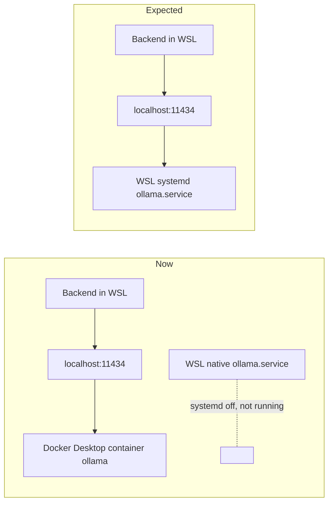
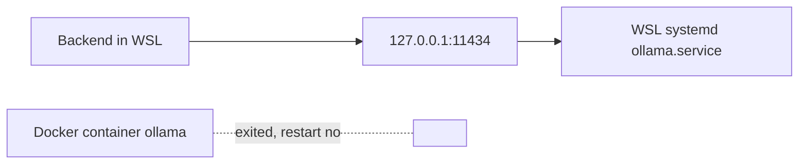

# Notes: laptop-workstation

Created 2026-11-14 when the work moved to the laptop.

## Laptop checks (2026-11-14, 22:10 +08)

Measured from WSL (`nvidia-smi`, `free -m`, `ss`, `docker inspect`) and from Windows (`Get-CimInstance`, `Get-Counter`). `make dev` was running (mprocs, uvicorn on port 8000, `next dev` on port 3000). No model was loaded (`/api/ps` empty).

### Hardware

| Item | Value |
|---|---|
| GPU | NVIDIA GeForce RTX 2070 with Max-Q Design |
| VRAM | 8192 MiB (8 GB); confirmed |
| Driver | 621.24 (Windows), CUDA 13.5 in WSL |
| Host RAM | 16 GB installed, 15.8 GB visible to Windows |
| WSL RAM | 7.8 GB (7841 MiB) and 2 GB swap. No `.wslconfig`, so WSL gets the default of half the host RAM |
| CPU threads in WSL | 12 |

### Idle use with `make dev` running, no model loaded

| Item | Value |
|---|---|
| GPU memory | 16 MiB of 8192 MiB used, 0 % use, P8 |
| WSL RAM | 1152 MiB used, 6448 MiB available, swap 0 |
| Backend (uvicorn, `python3`) | 762 MB RSS |
| Frontend (`next-server`) | 184 MB RSS |
| Ollama container | 36 MiB |
| Windows | 0.9 GB free of 15.8 GB; commit 25.0 of 32.8 GB. The largest users are the browser (Opera, about 3 GB in total), Notion (about 0.9 GB), and the Claude app (about 0.8 GB) |

### Ollama

Result: the check fails. Ollama is not the WSL systemd service. It runs in a Docker container.

- WSL does not boot systemd: `/etc/wsl.conf` has no `[boot] systemd=true`. `systemctl` reports "System has not been booted with systemd".
- The native install is present but does not run: `/usr/local/bin/ollama` and `/etc/systemd/system/ollama.service` (both from 2026-07-28).
- The Docker Desktop container `ollama` (image `ollama/ollama`, Ollama 0.32.5) serves port 11434. It has restart policy `unless-stopped`, all GPUs, and the named volume `ollama`. It was created on 2026-07-28 and is not from this repository (no compose labels, no reference in the repository). This is against the guardrail "never add an Ollama container".
- Only one instance serves port 11434 at this time.
- Models in the container volume: `qwen2.5:7b` (4.7 GB) and `qwen2.5:3b` (1.9 GB) are present. Also present: `nomic-embed-text` (274 MB), `qwen3.5:9b` (6.6 GB), and `gemma4:e4b` (9.6 GB). The last two are larger than the 7B guardrail; the app does not use them.



### Other differences from the expected setup

- The repository was in a folder on the C: drive (the Windows file system, reached through `/mnt/c`), not in the WSL file system as `AGENTS.md` states. File access and file watching through `/mnt/c` are slower than in the WSL file system. Moved on 2026-11-14 (see "Move to the WSL file system" below).
- WSL has 7.8 GB, not 16 GB. A `qwen2.5:7b` load in this VM, with `make dev` and Docker Desktop in the same VM, has less room than on the desktop.

### Steps for the user (system settings; agents do not change them)

1. Turn on systemd in WSL. Add these two lines to `/etc/wsl.conf`:

   ```ini
   [boot]
   systemd=true
   ```

   Then restart WSL. Command (Windows PowerShell):

   ```powershell
   wsl --shutdown
   ```

2. Stop the container and keep it from starting again. Commands (WSL):

   ```bash
   docker update --restart=no ollama
   ```

   ```bash
   docker stop ollama
   ```

3. Start the native service. Command (WSL):

   ```bash
   sudo systemctl enable --now ollama
   ```

4. Pull the models into the native store (the container volume is separate). Commands (WSL):

   ```bash
   ollama pull qwen2.5:7b
   ```

   ```bash
   ollama pull qwen2.5:3b
   ```

   ```bash
   ollama pull nomic-embed-text
   ```

   The backend health check loads `nomic-embed-text` (the embedding model), so pull it too.

5. Optional: remove the container and its volume after the native service works, to free disk space.
6. Optional: decide on the repository location (the C: drive or the WSL file system; done, see below) and on a `.wslconfig` memory limit.

## Move to the WSL file system (2026-11-14)

The user asked to move the repository to a folder in the WSL file system (ext4), as `AGENTS.md` states.


- `rsync -a` copied the working tree with `.git` and the private files. Agents did not read the private files; the check was for existence only (`.env`, `.env.local`, and `data/` are present).
- The environments are not portable (absolute paths in the `.venv` and in `.tools`), so they were not copied. `make dev-deps` builds them again in the new folder.
- Checks: 1026 files in each folder (same exclusions), the same commit (`git log -1`), the same `git status`, and `git fsck` passes.
- The old folder on the C: drive is kept until the new folder is checked. The user removes it.
- Open: the MLflow store (`apps/backend-py/data/mlflow.db`) can keep absolute artifact paths to the old folder (see the lesson "Absolute paths in a moved store"). Agents do not read `data/`, so the user checks it, or approves a check of the artifact paths only.
- `make dev-deps` in the new folder: Python 3.11.17 installed into `.tools/python` (pinned uv), new backend `.venv` (its scripts point into the new folder), `npm ci` passed. `git status` did not change (the lockfile is the same).
- Start check from the new folder (`make dev-api` and `make dev-frontend`, then stopped): `/api/health` gives 7 of 8 checks healthy; the MLflow server check is degraded, as expected (no MLflow container on the laptop). The frontend answers 307 (redirect).
- Node: `.nvmrc` asks for Node 24, but nvm on the laptop has only Node 20.19.6 (the default). The build and the start work with Node 20, but CI uses Node 24. Install command (WSL):

  ```bash
  nvm install 24
  ```

- `scripts/dev.sh` loads Node only through the shell `PATH`. In a non-interactive shell (no `~/.bashrc`, so no nvm), it finds the Ubuntu Node 12, and `npm ci` fails with "Cannot find module 'node:fs'". `make dev-deps` stops, but the `--silent` flag hides the cause. Agents load nvm first in their WSL scripts.
- MLflow store check (user approved, artifact paths only): `apps/backend-py/data/mlflow.db` does not exist on the laptop, so no old paths need a fix. The first eval run creates the store in the new folder.
- Check before the user removes the old folder (`rsync -rcn` with checksums, same exclusions): only `.git/index` (the stat cache, which git writes again) and this `notes.md` (newer in the new folder) differ. No file exists only in the old folder. The git refs and stashes are the same. No process runs from the old folder. The old folder is safe to remove.

## Ollama after the switch to the native service (2026-11-14)

The user stopped the container (restart policy `no`), turned on systemd in WSL, started `ollama.service`, and ran `./setup.sh` to pull the models into the native store.



- systemd is PID 1 (`systemctl is-system-running`: degraded, which is normal in WSL). `ollama.service` is active and enabled; it runs `ollama serve` (version 0.32.5).
- One instance only: `127.0.0.1:11434` is held by the native `ollama serve`. The container has exited, with restart policy `no`.
- Models in the native store (`/usr/share/ollama/.ollama/models`): `qwen2.5:7b` (4.7 GB), `qwen2.5:3b` (1.9 GB), `nomic-embed-text` (274 MB). The two large models from the container are not in the native store.
- Ollama finds the GPU through CUDA (RTX 2070 Max-Q, compute 7.5, 7.0 of 8.0 GiB available).
- GPU check through `/api/generate` (one short prompt per model, then unloaded):

| Model | Wall time | Load time | Size | In VRAM | GPU memory used |
|---|---|---|---|---|---|
| `qwen2.5:3b` (first load after the start) | 89.8 s | 45.3 s | 2059 MB | 2059 MB (100 %) | 2185 MiB |
| `qwen2.5:7b` | 20.9 s | 22.3 s | 4528 MB | 4528 MB (100 %) | 4661 MiB |

- After the unload: no model loaded, 16 MiB GPU memory used.
- The first cold call took 89.8 s, near the 120 s chat timeout of the client. This supports `tasks/active/ollama-load-timeout/`.
- Optional clean-up for the user: remove the container and its volume (about 23 GB) when the native service has worked for some time.
