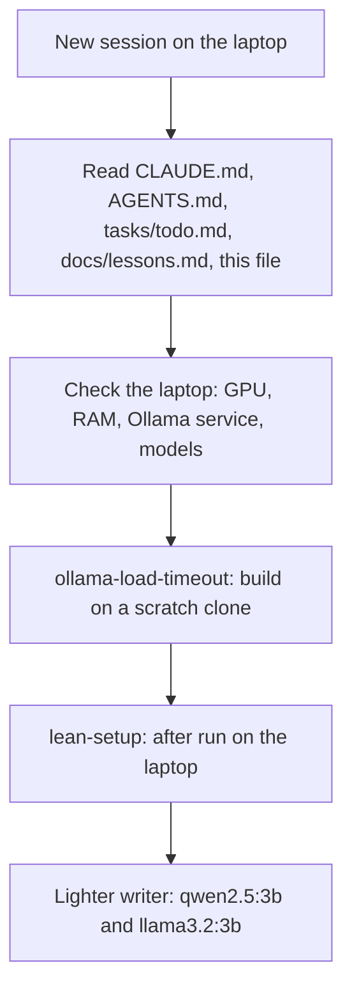

# Task: Laptop as the Workstation

## Goal
Continue the project on the laptop while the desktop waits for its SSD and RAM upgrades. Each new session on the laptop starts from this file.

## Context (2026-11-14)
- Laptop: RTX 2070 Max-Q (8 GB VRAM, confirmed), 16 GB RAM (WSL gets 7.8 GB), WSL Ubuntu 22.04, system Python 3.10.
- `setup.sh` installed Python 3.11 into `.tools/python` (pinned uv, no sudo). `make dev` starts the backend and the frontend.
- Ollama runs on the laptop; the models must be `qwen2.5:7b` and `qwen2.5:3b`.
- No MLflow container: the eval suites log to `apps/backend-py/data/mlflow.db`.
- Private files (`apps/backend-py/.env`, `apps/frontend-ts/.env.local`, `apps/backend-py/data/`) are copied by the user only when needed. Agents never read them.
- The desktop is not used for the project until its upgrades. Its RAM figures in `tasks/active/lean-setup/notes.md` are for the desktop only; measure again on the laptop.

## Work order
1. Ollama steps (user): turn on systemd, retire the container, start the WSL service, pull the models. Done 2026-11-14 (`notes.md`).
2. `tasks/archive/ollama-load-timeout/`: the load-timeout fix. Done 2026-11-15 (CI passed; laptop run: 0 cancelled loads, 0 timeouts).
3. `tasks/active/lean-setup/`: the lean-setup measurements, measured again on the laptop. The desktop numbers are a reference only. Apply `make-app.patch` on a scratch clone first.
4. Lighter writer (`tasks/todo.md`, Next Up): compare `qwen2.5:7b`, `qwen2.5:3b`, and `llama3.2:3b` with the writer and CV suites, on accuracy, stock phrases, speed, and peak memory.

Memory note for steps 3 and 4 (user, 2026-11-14): WSL on the laptop gets 7.8 GB, so a `qwen2.5:7b` load has less room than on the desktop. Record Windows memory during these runs (the recorder does this), and note which Windows apps are open; the browser (Opera) uses about 3 GB.

## Acceptance Criteria
- [x] `setup.sh` runs to the end on the laptop; `make dev` starts both services (2026-11-14).
- [x] Laptop hardware recorded in `notes.md`: GPU name and VRAM, RAM, idle GPU and RAM use with `make dev` running (2026-11-14).
- [x] Ollama checked: WSL systemd service (one instance only), `qwen2.5:7b` and `qwen2.5:3b` present. First check 2026-11-14 failed (Docker container, no systemd); passed after the switch to the native service on the same day (`notes.md`).
- [ ] The three tasks in the work order are done or moved on with the user.
- [ ] When the desktop is upgraded and back in use: this task closed and archived.

## Status
`in-progress`
