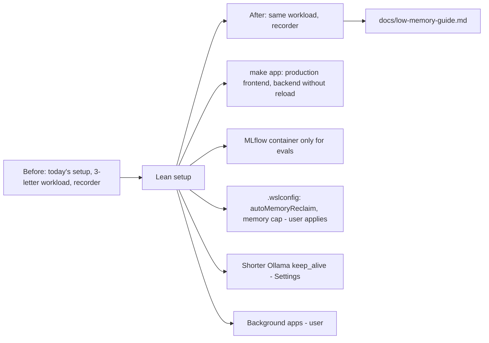

# Task: Lean Setup for 16 GB RAM and 8 GB VRAM

## Goal
Make Job Raider comfortable to use on a 16 GB RAM machine with an 8 GB GPU (the user's desktop, RTX 3070 Ti, and laptop, RTX 2070), measure a lean setup against today's setup, and write a short low-memory guide.

## Constraints & Context
- Measured on the desktop (2026-11-14): RAM often 0.6 to 2 GB free, paging spikes up to 18,000 pages/sec, 22 to 31 GB committed on 16 GB. Inside WSL: backend worker 834 MB, Next.js dev server about 680 MB, Claude Code and its MCP tools about 1.5 GB (development only), MLflow container 0.5 to 1.9 GB, WSL file cache 4.3 GB (WSL keeps it; Windows cannot use it). Windows side: Edge WebView apps about 2 GB, Claude desktop 1.6 GB, Brave 1 to 1.4 GB (keeps running after its window closes), Discord, Spotify, Steam about 0.8 GB each.
- `make dev` runs the dev servers with auto-reload; the only production path is Docker (Docker Desktop adds its own VM). With `make dev`, eval and cost runs log to a local SQLite store, so the MLflow container is not needed for `make dev`.
- GPU: one model at a time is on (`tasks/active/one-model-at-a-time/`); peak GPU stays at the idle baseline plus one model. The desktop's idle GPU baseline is 3 to 4 GB (Windows draws the desktop on the NVIDIA GPU). Many laptops draw the desktop on the built-in GPU, so the RTX 2070 may have more free memory; check on the laptop.
- Changes outside the project (`.wslconfig`, Windows apps) are documented, not automated (user rule). Restarting WSL (`wsl --shutdown`) stops `make dev` and Ollama for a moment; the user does it.
- A smaller writer model (`qwen2.5:3b`) is a separate task (Next Up), because it needs a quality guard.

## Plan

1. Recorder: add total committed memory and the `vmmemWSL` size to each sample, so whole-machine RAM is visible, not only free RAM.
2. Before: today's setup (`make dev`, MLflow up, apps as usual), the 3-letter workload (`measure_letter_flow.py`: full letter flow, 3 grounding pairs), with the recorder.
3. Project change: `make app` (Makefile and `scripts/dev.sh`): build the frontend once (`npm run build`), then run `next start` and the backend without `--reload` in the same split view as `make dev`. `make dev` stays as it is for development.
4. Lean setup for the after run: `make app` instead of `make dev`; MLflow container stopped; `.wslconfig` with `autoMemoryReclaim=gradual` (and a memory cap per decision 2), applied by the user with a WSL restart; Ollama keep_alive 2m in Settings; Brave, Discord, Spotify, Steam closed.
5. After: the same workload and recorder. Compare free RAM, committed memory, `vmmemWSL`, paging, GPU, and time per letter.
6. `docs/low-memory-guide.md` (STE, mermaid flow, each command in its own block with a label): what uses memory, the lean setup steps (project and machine), the laptop check (which GPU draws the desktop, free VRAM), and the measured result. Link it from `docs/index.md`.

## Decisions (user, 2026-11-14)
1. Add `make app`.
2. `.wslconfig`: `autoMemoryReclaim=gradual` only at first; a memory cap only after measuring.
3. Claude Code's tools run in both measurements; their memory is listed separately as development-only.

## Acceptance Criteria
- [x] Recorder logs committed memory and `vmmemWSL`.
- [x] Before run recorded.
- [ ] `make app` added (per decision 1) with a check that it starts both services and serves the app; `make dev` unchanged.
- [ ] After run with the lean setup recorded; the comparison in `notes.md`.
- [ ] `docs/low-memory-guide.md` written and linked from `docs/index.md`.
- [ ] CI checks pass; applied after "Yes, apply it"; pushed after approval; the CI run passes.
- [ ] `tasks/todo.md` updated (the RAM item in Next Up closed or narrowed); folder archived.

## Status
`review`
