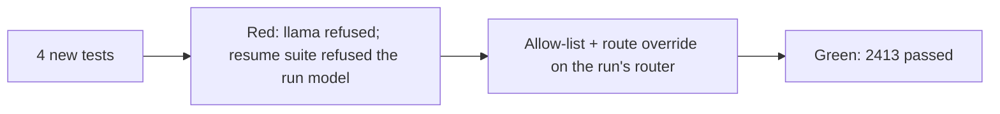

# Notes: lighter-writer

Planned 2026-11-15 on the laptop (work order step 4). `llama3.2:3b` pulled (2.0 GB, digest checked) the same day.

## Code change on a scratch clone (2026-11-15)

- Finding: the resume suite had no model override, and the writer suite passes its model per call (`CoverLetterWriter.write(model=...)`). `ResumeWriter.write` has no model argument.
- Change:
  - `writer.py`: `llama3.2:3b` added to `WRITER_MODELS`.
  - `resume.py`, `local_resume_writer`: resolves the route with `model` as an override (the router accepts it only for a model installed in Ollama), then sets `model` on the run's in-memory `resume_writing` route, so the CV writer and the polish step use it. The saved Settings do not change. The error message now says "Pull the model, or set the resume writing route to Ollama in Settings."
- Tests: `test_lighter_writer_models.py` (4): `llama3.2:3b` passes `check_model`; a model off the list is still refused; the resume suite uses the run model when the saved route has another model; a model that Ollama does not have is refused, and the route does not change. Red: 2 failed (the allow-list, the run model), 2 passed.
- `test_writer_command.py`: the allow-list test listed the four models of Step 3.8; it now lists five (the plan check approved `llama3.2:3b`).
- Checks on the clone: 37 tests in the three suite files; black (369 unchanged), ruff, mypy gate (0 new), full backend pytest (2413 passed).
