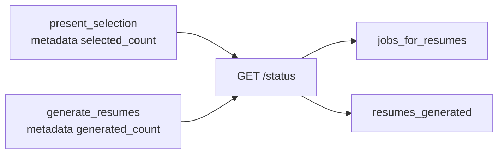

# MH-1: The status response has the resume counts

Read `AGENT.md` first.

## Why

The Live Monitor shows "N shortlisted". That is the ranked list for the Jobs page, not the jobs that Max Jobs selects for resumes. The status response has no count for the jobs that went to Generate Resumes, so the page cannot show it. After this change, the status response has two new counts:

- `jobs_for_resumes`: the `selected_count` of the Select Jobs stage (`present_selection`). Max Jobs limits this count.
- `resumes_generated`: the `generated_count` of the Generate Resumes stage (`generate_resumes`).

Each count is 0 when its stage did not run (for example, in discover mode).



## Files

- `apps/backend-py/src/api/models/responses.py` (change)
- `apps/backend-py/src/api/routes/pipeline.py` (change)
- `apps/backend-py/tests/unit/test_pipeline_status_resume_counts.py` (new)

## Step 1: add this test file, run it, and see it fail

`apps/backend-py/tests/unit/test_pipeline_status_resume_counts.py`:

```python
"""Tests for the resume counts of GET /api/pipeline/status (monitor resume count, MH-1)."""

from datetime import datetime
from typing import Dict, Iterator

import pytest
from fastapi.testclient import TestClient

from src.api.auth import verify_api_key
from src.api.main import app
from src.api.routes.pipeline import pipeline_runs
from src.models.pipeline_stage import PipelineStage
from src.pipeline.orchestrator import PipelineResult
from src.pipeline.stages import StageResult


@pytest.fixture
def client() -> Iterator[TestClient]:
    """Build a test client without the API key check.

    Yields:
        A FastAPI test client.
    """
    app.dependency_overrides[verify_api_key] = lambda: None
    yield TestClient(app, raise_server_exceptions=False)
    app.dependency_overrides.clear()


def store_run(run_id: str, metadata: Dict[str, Dict[str, int]]) -> None:
    """Store a completed run whose stages report the given metadata.

    Args:
        run_id: The run ID.
        metadata: The stage value and the metadata of each stage.
    """
    now = datetime.now()
    result = PipelineResult(
        success=True,
        stages_completed=list(metadata),
        stage_results={
            stage: StageResult(
                stage_name=stage, success=True, data=[], metadata=meta, timestamp=now
            )
            for stage, meta in metadata.items()
        },
        start_time=now,
        end_time=now,
    )
    pipeline_runs[run_id] = {
        "run_id": run_id,
        "status": "completed",
        "created_at": now,
        "result": result,
        "jobs_selected": 20,
        "stage_progress": 100,
    }


def test_status_reports_the_jobs_and_resumes_of_a_full_run(client: TestClient) -> None:
    """The status has the Select Jobs count and the generated resume count."""
    store_run(
        "run_resume_counts",
        {
            PipelineStage.PRESENT_SELECT.value: {
                "presented_count": 2,
                "selected_count": 2,
            },
            PipelineStage.GENERATE_RESUMES.value: {
                "attempted_count": 2,
                "generated_count": 1,
            },
        },
    )

    data = client.get("/api/pipeline/status/run_resume_counts").json()
    pipeline_runs.pop("run_resume_counts")

    assert data["jobs_selected"] == 20
    assert data["jobs_for_resumes"] == 2
    assert data["resumes_generated"] == 1


def test_status_reports_zero_for_a_discover_run(client: TestClient) -> None:
    """A run without the Select Jobs and Generate Resumes stages reports 0."""
    store_run(
        "run_discover_counts", {PipelineStage.SCRAPE.value: {"listings_count": 5}}
    )

    data = client.get("/api/pipeline/status/run_discover_counts").json()
    pipeline_runs.pop("run_discover_counts")

    assert data["jobs_for_resumes"] == 0
    assert data["resumes_generated"] == 0
```

## Step 2: change `src/api/models/responses.py`

In `PipelineStatusResponse`, after the line `    cloud_documents: int = 0`, add these two lines:

```text
    jobs_for_resumes: int = 0  # Select Jobs selected_count (limited by Max Jobs)
    resumes_generated: int = 0  # Generate Resumes generated_count
```

## Step 3: change `src/api/routes/pipeline.py`

In `get_pipeline_status`:

1. After the line `    cloud_documents = 0`, add these two lines:

```text
    jobs_for_resumes = 0
    resumes_generated = 0
```

2. Change this block:

```text
        stage_results = getattr(result, "stage_results", None) or {}
        generate = stage_results.get("generate_resumes")
        if generate is not None:
            meta = getattr(generate, "metadata", None) or {}
            cloud_documents = int(meta.get("cloud_documents") or 0)
```

to:

```text
        stage_results = getattr(result, "stage_results", None) or {}
        select = stage_results.get("present_selection")
        if select is not None:
            meta = getattr(select, "metadata", None) or {}
            jobs_for_resumes = int(meta.get("selected_count") or 0)
        generate = stage_results.get("generate_resumes")
        if generate is not None:
            meta = getattr(generate, "metadata", None) or {}
            cloud_documents = int(meta.get("cloud_documents") or 0)
            resumes_generated = int(meta.get("generated_count") or 0)
```

3. In the `PipelineStatusResponse(...)` call at the end of the function, after the line `        cloud_documents=cloud_documents,`, add these two lines:

```text
        jobs_for_resumes=jobs_for_resumes,
        resumes_generated=resumes_generated,
```

## Done when

Run the new tests and the existing route tests:

```bash
.venv/bin/python -m pytest tests/unit/test_pipeline_status_resume_counts.py tests/unit/test_pipeline_routes.py -q
```

Format the changed files:

```bash
.venv/bin/python -m black src/api/models/responses.py src/api/routes/pipeline.py tests/unit/test_pipeline_status_resume_counts.py
```

Check the lint:

```bash
.venv/bin/python -m ruff check src/api/models/responses.py src/api/routes/pipeline.py tests/unit/test_pipeline_status_resume_counts.py
```

Commit message: `feat(api): report the jobs selected for resumes in the pipeline status`
