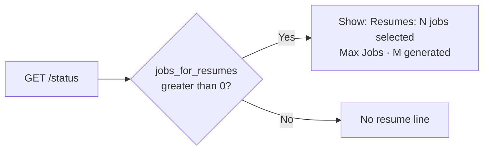

# MH-2: The Live Monitor shows the resume line

Read `AGENT.md` first. Do MH-1 first: this step uses `jobs_for_resumes` and `resumes_generated` from the status response.

## Why

The Live Monitor shows "60 scraped · 20 scored · 20 shortlisted". The user set Max Jobs to 2 and read "20 shortlisted" as the Max Jobs count. After this change, a full-mode run also shows a second line, for example "Resumes: 2 jobs selected (Max Jobs) · 2 generated". A run that selected no jobs for resumes (discover mode) does not show the line.



## Files

- `apps/frontend-ts/src/lib/types/api.ts` (change)
- `apps/frontend-ts/src/app/pipeline/page.tsx` (change)
- `apps/frontend-ts/tests/app/pipeline/resume-counts.test.tsx` (new)

## Step 1: add this test file, run it, and see it fail

`apps/frontend-ts/tests/app/pipeline/resume-counts.test.tsx`:

```tsx
/**
 * Pipeline Live Monitor shows the jobs selected for resumes and the resumes
 * generated (monitor resume count, MH-2).
 */

import { afterEach, beforeEach, describe, expect, it, vi } from "vitest";
import { render, screen } from "@testing-library/react";
import userEvent from "@testing-library/user-event";
import { QueryClient, QueryClientProvider } from "@tanstack/react-query";
import PipelinePage from "@/app/pipeline/page";
import type { PipelineStatusResponse } from "@/lib/types/api";

const mockGetStatus = vi.fn();

vi.mock("@/lib/api/pipeline", () => ({
  pipelineApi: {
    start: vi.fn(),
    getStatus: (...args: unknown[]) => mockGetStatus(...args),
    getHistory: vi.fn().mockResolvedValue({ runs: [] }),
    cancel: vi.fn(),
  },
}));

vi.mock("@/lib/api/jobs", () => ({
  jobsApi: {
    getSources: vi.fn().mockResolvedValue({ sources: ["mycareersfuture"] }),
  },
}));

vi.mock("@/app/providers", () => ({
  useAppState: () => ({
    activeRunId: "run_counts01",
    setActiveRunId: vi.fn(),
  }),
}));

vi.mock("@/lib/hooks/use-profile-targets", () => ({
  useProfileTargets: () => ({ targets: null, hasKeywords: false }),
}));

vi.mock("sonner", () => ({
  toast: { success: vi.fn(), error: vi.fn() },
}));

/** WebSocket stand-in that never connects. */
class QuietWebSocket {
  onopen: (() => void) | null = null;
  onmessage: ((event: { data: string }) => void) | null = null;
  onerror: (() => void) | null = null;
  onclose: (() => void) | null = null;

  /** Ignore close. */
  close(): void {}
}

/**
 * Build a status poll response.
 *
 * @param overrides - Fields to change.
 * @returns A status response.
 */
function status(
  overrides: Partial<PipelineStatusResponse>,
): PipelineStatusResponse {
  return {
    run_id: "run_counts01",
    status: "completed",
    stage_progress: 100,
    jobs_scraped: 60,
    jobs_scored: 20,
    jobs_selected: 20,
    applications_submitted: 0,
    stages_planned: ["generate_resumes"],
    stages_completed: ["generate_resumes"],
    cloud_documents: 0,
    jobs_for_resumes: 0,
    resumes_generated: 0,
    ...overrides,
  };
}

/**
 * Open the Live Monitor tab.
 *
 * @returns Resolves when the monitor is open.
 */
async function openMonitor(): Promise<void> {
  const client = new QueryClient({
    defaultOptions: { queries: { retry: false }, mutations: { retry: false } },
  });
  render(
    <QueryClientProvider client={client}>
      <PipelinePage />
    </QueryClientProvider>,
  );
  await userEvent
    .setup()
    .click(screen.getByRole("tab", { name: /Live Monitor/ }));
}

describe("PipelinePage resume line", () => {
  beforeEach(() => {
    vi.stubGlobal("WebSocket", QuietWebSocket);
    mockGetStatus.mockReset();
  });

  afterEach(() => {
    vi.unstubAllGlobals();
  });

  it("shows the jobs selected for resumes and the resumes generated", async () => {
    mockGetStatus.mockResolvedValue(
      status({ jobs_for_resumes: 2, resumes_generated: 2 }),
    );
    await openMonitor();
    expect(
      await screen.findByText(
        "Resumes: 2 jobs selected (Max Jobs) · 2 generated",
      ),
    ).toBeInTheDocument();
  });

  it("says job for one job", async () => {
    mockGetStatus.mockResolvedValue(
      status({ jobs_for_resumes: 1, resumes_generated: 0 }),
    );
    await openMonitor();
    expect(
      await screen.findByText(
        "Resumes: 1 job selected (Max Jobs) · 0 generated",
      ),
    ).toBeInTheDocument();
  });

  it("hides the resume line when no job was selected for resumes", async () => {
    mockGetStatus.mockResolvedValue(status({ jobs_for_resumes: 0 }));
    await openMonitor();
    expect(await screen.findByText("Complete")).toBeInTheDocument();
    expect(screen.queryByText(/^Resumes:/)).not.toBeInTheDocument();
  });
});
```

## Step 2: change `src/lib/types/api.ts`

In `PipelineStatusResponse`, after the line `  cloud_documents?: number;`, add these lines:

```text
  /** Jobs that Select Jobs passed to Generate Resumes (limited by Max Jobs). */
  jobs_for_resumes?: number;
  /** Resumes that Generate Resumes saved. */
  resumes_generated?: number;
```

## Step 3: change `src/app/pipeline/page.tsx`

1. After the line `  const jobsSelected = status.data?.jobs_selected ?? 0;`, add these lines:

```text
  const jobsForResumes = status.data?.jobs_for_resumes ?? 0;
  const resumesGenerated = status.data?.resumes_generated ?? 0;
```

2. In the "Counts" box, after this paragraph:

```text
          <p className="text-sm text-foreground">
            {jobsScraped} scraped · {jobsScored} scored
            {jobsSelected > 0 ? ` · ${jobsSelected} shortlisted` : ""}
          </p>
```

add this block (before the closing `</div>` of the box):

```text
          {jobsForResumes > 0 && (
            <p className="text-sm text-foreground">
              {`Resumes: ${jobsForResumes} ${jobsForResumes === 1 ? "job" : "jobs"} selected (Max Jobs) · ${resumesGenerated} generated`}
            </p>
          )}
```

## Done when

Use Node 24 in this shell:

```bash
source ~/.nvm/nvm.sh && nvm use 24
```

Run the new tests and the other Live Monitor tests (`--no-cache`, because the vitest cache folder in `node_modules/.vite` belongs to root):

```bash
npx vitest run --no-cache tests/app/pipeline/resume-counts.test.tsx tests/app/pipeline/cloud-badge.test.tsx tests/app/pipeline/live-monitor.test.tsx
```

Format the changed files:

```bash
npx prettier --write src/lib/types/api.ts src/app/pipeline/page.tsx tests/app/pipeline/resume-counts.test.tsx
```

Check the lint:

```bash
npx eslint src/lib/types/api.ts src/app/pipeline/page.tsx tests/app/pipeline/resume-counts.test.tsx
```

Check the types:

```bash
npm run type-check
```

Commit message: `feat(frontend): show the jobs selected for resumes on the Live Monitor`
