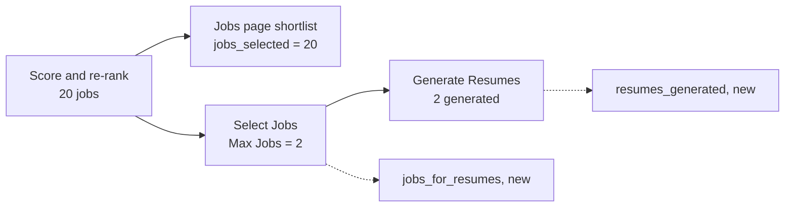

# Notes: Monitor Resume Count

## Observations (2026-10-29, Claude)

- In two full-mode dry runs with Max Jobs 2 (`run_0e3dbf88`, `run_0de31c69`), the Live Monitor showed "60 scraped · 20 scored · 20 shortlisted". The user expected 2 jobs.
- Max Jobs works. It is `max_jobs_to_present`, the limit of the Select Jobs stage (`present_selection`). Both runs selected 2 jobs and generated 2 resumes.
- "Shortlisted" is `jobs_selected = len(rag_ranked_listings or scored_listings)` in `routes/pipeline.py`: the ranked list that the run saves for the Jobs page. The status response has no count for the jobs that went to Generate Resumes.
- `get_pipeline_status` already reads the Generate Resumes metadata for `cloud_documents`. The new counts use the same pattern.

## Decisions (2026-10-29)

1. The user asked for a handoff (not a fix by Claude). Two micro-handoffs, one per layer: MH-1 backend (the status counts), MH-2 frontend (the resume line).
2. Keep `jobs_selected` and the "shortlisted" text as they are; add a second line. The database column and the History tab do not change.
3. The frontend tests run in WSL with Node 24 (`nvm use 24`), because `node_modules` has Linux binaries.

## Dry run of the micro-handoffs (2026-10-29, Claude)

On scratch copies in WSL's native disk (`/tmp/mrc`, not the repository). The frontend copy uses the repository's `node_modules` through a link.

- MH-1: before the change, the 2 new tests fail. After the change, the 23 tests pass (2 new, 21 in `test_pipeline_routes.py`). The given test and the 3 changed files pass black and ruff. (The first draft of the test had one line that black wraps; the handoff now has black's form.)
- MH-2: before the change, 2 of the 3 new tests fail (the "hides" test passes, because the line does not exist yet). After the change, the 7 Live Monitor tests pass (3 new, `cloud-badge`, `live-monitor`). prettier, eslint, and `npm run type-check` pass. (The first draft of the test had one line that prettier wraps; the handoff now has prettier's form.)
- `node_modules/.vite` and `coverage/` in `apps/frontend-ts` belong to root (some `node_modules/.bin` links too), probably from an earlier install or run as root. Vitest then fails with `EACCES` when it writes `node_modules/.vite/vitest/results.json`. `npx vitest run --no-cache` does not write that file and passes in the repository, so the handoff and `AGENT.md` use `--no-cache`. A lasting fix needs the user (`sudo chown`).

## Blockers / Questions

- None. MH-1 and MH-2 are with the agent.
