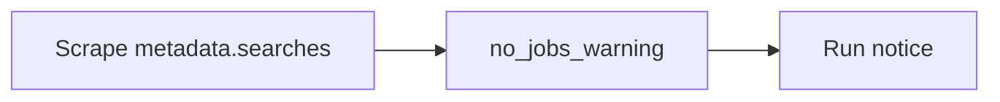

# Notes: no-jobs-notice

Found 2026-11-20 in the live run `run_ae8e0017062d`: all 3 MyCareersFuture searches failed with HTTP 504 "Endpoint request timed out", but the notice said "No jobs found for these keywords and sources" and suggested other keywords.

## Change on the scratch clone (2026-11-20)

- New `src/pipeline/no_jobs.py`: `NO_JOBS_WARNING` (moved, text unchanged), `SOURCE_NAMES`, `no_jobs_warning(scrape_metadata)`. `orchestrator.py` imports both names (so `from src.pipeline.orchestrator import NO_JOBS_WARNING` still works) and builds the notice from the Scrape metadata.
- Notices: every search failed: "No jobs came in because the job source did not answer: MyCareersFuture timed out (HTTP 504). The run stopped after Scrape. Try again later." Some failed: "No jobs found, and some searches failed: ... Try again later, or try other keywords." None failed or no rows: the old notice.
- Red: 6 failed (5 notice tests, 1 run test), 2 existing passed. Green: 8 passed; with the status tests 22 passed.
- Checks: black, ruff, mypy gate (0 new), full backend pytest 2494 passed (before a wording change of the two notices; the notice and orchestrator tests passed again after it).
- Applied to `main` after "Yes, apply it" (2026-11-20): the 4 files are the same as on the clone; on `main` black, ruff, mypy gate (0 new), full backend pytest 2494 passed. Commit "fix(pipeline): say when the job source failed in the no-jobs notice". Not pushed.
