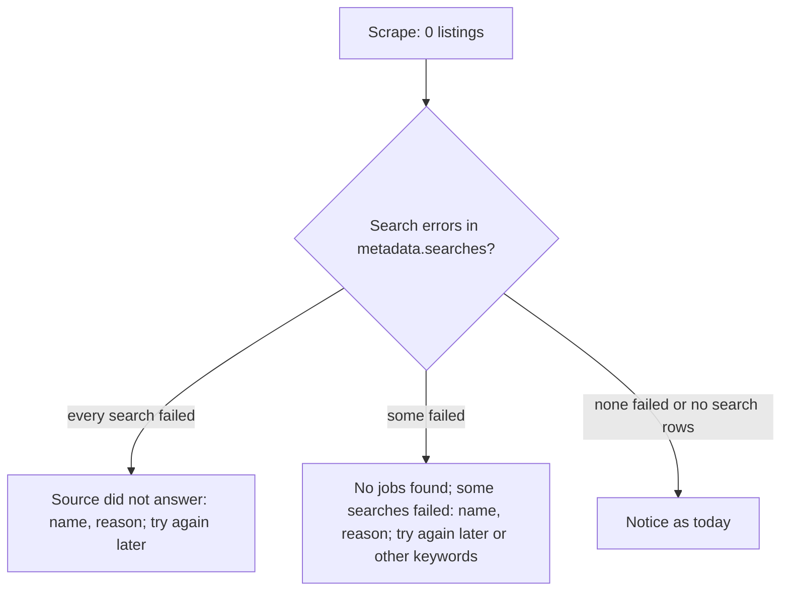

# Task: Clear Notice When a Job Source Fails

## Goal
When a run scrapes no jobs because the job source failed (for example MyCareersFuture HTTP 504 "Endpoint request timed out"), the run notice must say that the source did not answer and suggest trying again later. Today it says "No jobs found for these keywords and sources" and suggests other keywords, although no keyword was searched (`run_ae8e0017062d`, 2026-11-20).

## Change (user: "Yes, fix it here", 2026-11-20)

- `src/pipeline/orchestrator.py`: `no_jobs_warning(scrape_metadata)` builds the notice from `searches` rows (`source`, `count`, `error`). The reason is short: "timed out (HTTP 504)", "HTTP 503", or "an error"; no raw response text. Source names read as shown in the app (for example "MyCareersFuture").
- The run still stops after Scrape; only the notice text changes. The frontend shows `warning_message` as it is, so it does not change.

## Decision rule
- Red tests first (`--maxfail=100`): every search failed; some failed; none failed (notice unchanged); no search rows (unchanged); the orchestrator puts the source notice on the result.
- Backend checks: black, ruff, mypy gate (0 new), full pytest. Apply after "Yes, apply it"; push with the other waiting commits after approval.

## Acceptance Criteria
- [x] Red tests fail first; green after the change.
- [x] Backend checks pass on the scratch clone; applied after "Yes, apply it" (2026-11-20).
- [ ] Pushed with CI passing; folder archived.

## Status
`in-progress`
