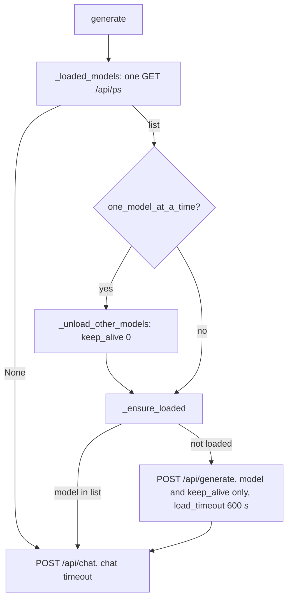

# Notes: ollama-load-timeout

Planned 2026-11-14 after the lean-setup before run found the load retry loop. Review section to be added when the task is done.

## Build on a scratch clone (2026-11-14, laptop)

- `src/llm/ollama_client.py`: `DEFAULT_LOAD_TIMEOUT = 600`; constructor argument `load_timeout`; `_loaded_models()` returns the names from `/api/ps` or `None`; `_unload_other_models(loaded)` takes that list; `_ensure_loaded(loaded, keep_alive)` sends the load request and logs the load time, or a warning on an error or a timeout. `generate()` calls `/api/ps` once and uses the result for both steps. The load uses the keep_alive of the chat request (the call value, else the client value); without one, the body has only the model.
- Change to the plan: one `/api/ps` call for both steps, not one call in each step. The existing one-model call sequences do not change.
- Existing tests changed:
  - `test_ollama_one_model.py`: `test_option_off_does_not_ask_ollama` asserted no `/api/ps` call with the option off. The plan makes the load step run for every setting, so the test is now `test_option_off_does_not_unload_other_models` (no unload; `/api/ps` and the load still run).
  - `test_ollama_token_counts.py`, `test_ollama_client_content.py`, `test_router_structured_options.py`: these mocked only `requests.post`, so the new `/api/ps` call went to a real Ollama server when one ran (3 tests failed on the laptop with the native service; in CI they would pass by chance). They now patch `_loaded_models`, so no unit test sends a request to a real server.
- Red: 10 new tests failed (no load step). Green: 38 tests in the five files pass.
- CI checks on the clone: black (367 files unchanged), ruff (all passed), mypy gate (177 known, 0 new), full backend pytest 2399 passed with the native Ollama running. No model was loaded during the run (GPU 17 MiB before and after, `/api/ps` empty).
- Run with `OLLAMA_HOST=127.0.0.1:9`: 1 failure, `test_one_generation_makes_one_http_request`. It compares the URL with `http://localhost:11434`; it fails in the same way on `main` without this change. CI does not set `OLLAMA_HOST`.
- Open: the measurement run (plan step 3) needs the app with the user's data, so it runs on `main` after the change is applied.
