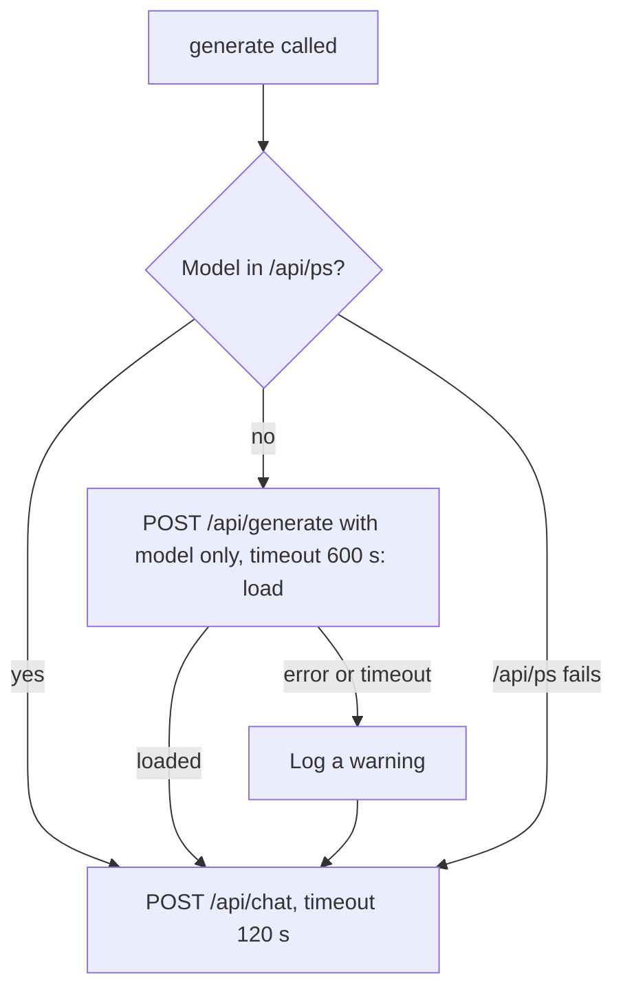

# Task: Ollama Model Load Timeout

## Goal
Stop the retry loop that restarts a slow model load. When the model is not loaded, the client loads it first with a long timeout. The chat timeout (120 s) then applies to the answer only.

## Problem (measured 2026-11-14, `tasks/active/lean-setup/notes.md`)
- With low free RAM, a cold model load took more than 120 s.
- The chat request timed out at 120 s. The timeout cancelled the load in Ollama ("Load failed ... timed out waiting for llama-server to start: context canceled").
- The retry started the load again from zero. Ollama logged 9 cancelled loads in 20 minutes. The first letter took 1,285 s, and its selection step failed ("Request timed out after 120s").

## Plan
1. `src/llm/ollama_client.py`:
   - Add `_loaded_models()`: one `GET /api/ps` (timeout 5 s); it returns the names, or `None` on error. `_unload_other_models()` uses it (no change in behaviour).
   - Add `_ensure_loaded()`: if the client's model is not in the list, send `POST /api/generate` with `{"model": <model>, "keep_alive": <keep_alive>}` (no prompt; Ollama then only loads the model) and `timeout=self.load_timeout`. On an error or a timeout, log a warning and continue; the chat request then works as before.
   - `generate()` calls `_ensure_loaded()` after the optional unload, for all settings (the defect does not depend on `one_model_at_a_time`).
   - New constructor argument `load_timeout: int = 600` (seconds). No new setting in the Settings page.
2. Unit tests (`tests/unit/test_ollama_load_timeout.py`), red first:
   - Model not loaded: the load request goes before `/api/chat`, with the model, the keep_alive, no prompt, and timeout 600.
   - Model loaded: no load request.
   - `/api/ps` fails: no load request; the chat request runs.
   - Load request fails or times out: a warning; the chat request runs.
   - `one_model_at_a_time=False`: the load step still runs.
   - The existing one-model tests still pass (unload first, then load).
3. Measurement (same workload and setup as the lean-setup before run: `make dev`, 3 letters, Deep validation and Review & rewrite on, recorder on):
   - 0 "context canceled" loads in the Ollama log.
   - No "Request timed out" in the app log.
   - Report time per letter, words, stock phrases, score, peak GPU memory, and RAM. Compare with the before run (1,285 / 140 / 50 s).
   - Limit: the page cache state differs between runs, so a cold load may not happen. The unit tests prove the behaviour; the run shows the effect when it happens.

## Constraints & Context
- Small change in one module. The public `generate()` signature does not change.
- The writer and resume suites are not needed: the change does not alter prompts or outputs, only when the load happens.
- Local models stay at 7B or smaller; one Ollama service in WSL.
- Follow the workflow: build and check on a scratch clone, apply after "Yes, apply it", push after a separate approval.
- Out of scope: the `llama3.2:3b` experiment (next task, user choice (a)); the lean-setup after run (it waits for this fix).

## Acceptance Criteria
- [ ] `_ensure_loaded()` and `_loaded_models()` added, with docstrings and type hints; `_unload_other_models()` uses `_loaded_models()`.
- [ ] Unit tests written red first, then green; existing Ollama client tests pass.
- [ ] CI checks pass on the clone: black, ruff, mypy gate (0 new), full backend pytest.
- [ ] Measurement run: 0 cancelled loads and 0 request timeouts; results in `notes.md`.
- [ ] Applied after "Yes, apply it"; pushed after approval; the CI run passes.
- [ ] `tasks/todo.md` updated; folder archived.

## Status
`review`
