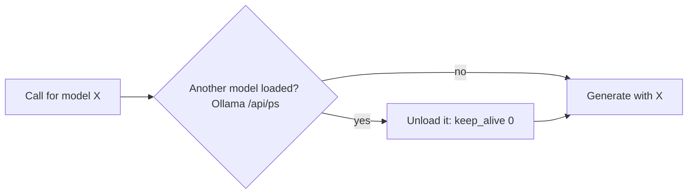

# Task: One Local Model in GPU Memory at a Time

## Goal
Keep only one Ollama model in GPU memory at a time, so that the app fits smaller GPUs and does not push this machine past its 8 GB, without changing any output.

## Constraints & Context
- Cover letter test (2026-11-14, Deep validation and Review & rewrite on): `qwen2.5:3b` (2.2 GB) loaded first, then `qwen2.5:7b` (4.7 GB); from 11:06 both were in GPU memory together, and the Windows GPU counters summed to 9.3 GB on an 8 GB card. Model activity lasted about 8 minutes for one letter. RAM was 0.7 to 2.2 GB free.
- Routes on `qwen2.5:3b`: cover letter review, validation, scoring, selection, trust analysis, question answering, general. Writing (letters and CVs) uses `qwen2.5:7b`. Ollama keeps a model loaded for `keep_alive` (default 5 minutes; the app passes the Settings value `cost_limits.ollama_keep_alive` when set).
- The app's 90% VRAM guard does nothing: `OllamaClient.generate` calls `_check_vram_before_inference()` and ignores its result. Its reading is also too low on this machine (`GPUMonitor.get_vram_usage()` gave 0.149 while the Windows counters showed about 3 of 8 GB), because it sees only what WSL sees.
- Memory note correction: the earlier note said the app's guard moved `qwen2.5:7b` to the CPU (2026-11-05); the guard cannot have done that.
- Local models only, at most 7B (BSOD history). One Ollama service in WSL, shared with other projects: an app-level rule reaches every install; an Ollama server setting (`OLLAMA_MAX_LOADED_MODELS=1`) is outside the project and would only be documented.

## Plan

1. Before an Ollama call, the client asks Ollama which models are loaded (`/api/ps`) and unloads any other model (a request with `keep_alive: 0`). One small helper in `ollama_client.py`, on by default, with a Settings switch to turn it off for machines with a large GPU.
2. The VRAM guard (see decision 1).
3. Tests with a fake HTTP layer: another model loaded means one unload call before the request; the same model means no unload; the switch off means no check; an `/api/ps` error does not block the call.
4. Measurement (the output does not change, so only resources and time): the full cover letter service (Deep validation and Review & rewrite on) on 3 grounding pairs, from a scratch clone, before and after, with the resource recorder: peak GPU memory, models loaded together, and time per letter. Model reloads cost load time, so the time may go up or down; both are reported.

## Decisions (user, 2026-11-14)
1. The VRAM guard: (a) remove it.
2. Measurement: 3 grounding pairs per run, before and after, with Deep validation and Review & rewrite on.
3. Order: build `letter-rewrite-polish` first, then this task.

## Acceptance Criteria
- [x] Only one model in GPU memory at a time by default; a Settings switch turns the rule off.
- [x] The no-op VRAM guard removed (`_check_vram_before_inference` and its call).
- [x] Unit tests, red step, and mutants; CI checks pass locally.
- [x] Measurement before and after (3 pairs or per decision 2): never two models loaded together after the change; peak GPU memory and time per letter reported.
- [x] The memory note about the guard corrected.
- [ ] Applied after "Yes, apply it"; pushed after approval; the CI run passes.
- [ ] `tasks/todo.md` updated; folder archived.

## Status
`review`
