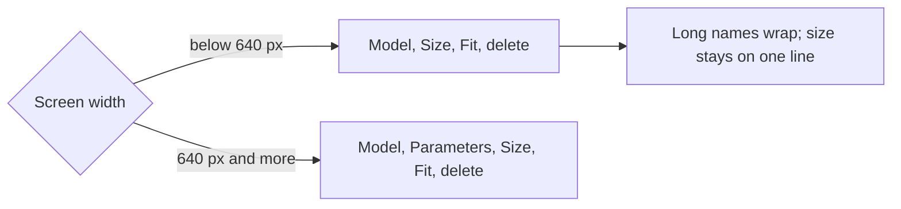

# MH-1: Local models table on a phone

## Apply with the runner

The handoff runner applies this file: it writes the test, runs the red command (it must fail), makes the changes, runs the checks, and commits. The runner does not push.

Apply this handoff (WSL, from `apps/backend-py`):

```bash
.venv/bin/python scripts/run_handoff.py ../../tasks/active/phone-model-table/mh-1-phone-table.md
```

## Why

Step 6 added a Fit column to the Local models table in Settings. On a phone (375 px), the table now has 5 columns, so the Fit badge is cut and the delete button needs a sideways scroll (Step 6 review, open item; user choice "Fix the phone table").



## Decisions

- The Parameters column hides below the `sm` breakpoint (640 px). The model tag already shows the size class (for example `7b`), so the phone loses little.
- A long model name wraps (`break-all`), and the size stays on one line (`whitespace-nowrap`).
- A unit test checks the classes (it is the red step). A Mobile Chrome E2E test checks the real layout: the Parameters header is hidden, and the delete button is inside the screen. Desktop is unchanged.

## Files

- `apps/frontend-ts/tests/components/ollama-models-card-phone.test.tsx` (new)
- `apps/frontend-ts/src/components/settings/ollama-models-card.tsx`, `tests/e2e/hardware-fit.spec.ts` (change)

## Step 1: add the test, run it, and see it fail

```tsx new=apps/frontend-ts/tests/components/ollama-models-card-phone.test.tsx
/**
 * Job Raider - Local models table on a phone.
 *
 * On a narrow screen the table hides the Parameters column, keeps the size
 * on one line, and lets a long model name wrap, so the Fit badge and the
 * delete button stay on the screen. The layout itself is checked by the
 * Mobile Chrome E2E test in tests/e2e/hardware-fit.spec.ts.
 */

import { beforeEach, describe, expect, it, vi } from "vitest";
import { render, screen } from "@testing-library/react";
import { QueryClient, QueryClientProvider } from "@tanstack/react-query";

import { OllamaModelsCard } from "@/components/settings/ollama-models-card";
import type { OllamaModelList } from "@/lib/types/api";

const mockList = vi.fn();

vi.mock("@/lib/api/settings", () => ({
  settingsApi: {
    listOllamaModels: (...a: unknown[]) => mockList(...a),
    pullOllamaModel: vi.fn(),
    getOllamaPullStatus: vi.fn().mockResolvedValue({ status: "idle" }),
    deleteOllamaModel: vi.fn(),
    getHardwareFit: vi.fn().mockRejectedValue(new Error("no llmfit")),
  },
}));

vi.mock("sonner", () => ({
  toast: { success: vi.fn(), error: vi.fn() },
}));

const LIST: OllamaModelList = {
  host: "localhost:11434",
  reachable: true,
  in_use: [],
  models: [
    {
      name: "qwen2.5-coder-7b-16k:latest",
      size: 4_680_000_000,
      parameter_size: "7.6B",
      in_use: false,
    },
  ],
};

describe("OllamaModelsCard on a phone", () => {
  beforeEach(() => {
    mockList.mockResolvedValue(LIST);
    const client = new QueryClient({
      defaultOptions: { queries: { retry: false } },
    });
    render(
      <QueryClientProvider client={client}>
        <OllamaModelsCard />
      </QueryClientProvider>,
    );
  });

  it("hides the Parameters column below the sm breakpoint", async () => {
    await screen.findByText("qwen2.5-coder-7b-16k:latest");
    const header = screen.getByRole("columnheader", { name: "Parameters" });
    expect(header).toHaveClass("hidden", "sm:table-cell");
    expect(screen.getByText("7.6B").closest("td")).toHaveClass(
      "hidden",
      "sm:table-cell",
    );
  });

  it("keeps the size on one line and lets a long name wrap", async () => {
    const name = await screen.findByText("qwen2.5-coder-7b-16k:latest");
    expect(name.closest("td")).toHaveClass("break-all");
    expect(screen.getByText("4.4 GB").closest("td")).toHaveClass(
      "whitespace-nowrap",
    );
  });
});
```

```bash red cwd=apps/frontend-ts
source ~/.nvm/nvm.sh && nvm use 24 && npx vitest run --no-cache tests/components/ollama-models-card-phone.test.tsx
```

## Step 2: change the table

```tsx edit=apps/frontend-ts/src/components/settings/ollama-models-card.tsx
<<<<<<< OLD
                  <th className="pb-2 pr-4">Parameters</th>
=======
                  <th className="hidden pb-2 pr-4 sm:table-cell">Parameters</th>
>>>>>>> NEW
```
```tsx edit=apps/frontend-ts/src/components/settings/ollama-models-card.tsx
<<<<<<< OLD
                    <td className="py-2 pr-4 font-mono text-xs text-foreground">
                      {m.name}
=======
                    <td className="break-all py-2 pr-4 font-mono text-xs text-foreground">
                      {m.name}
>>>>>>> NEW
```
```tsx edit=apps/frontend-ts/src/components/settings/ollama-models-card.tsx
<<<<<<< OLD
                    <td className="py-2 pr-4 text-muted-foreground">
                      {m.parameter_size ?? "—"}
=======
                    <td className="hidden py-2 pr-4 text-muted-foreground sm:table-cell">
                      {m.parameter_size ?? "—"}
>>>>>>> NEW
```
```tsx edit=apps/frontend-ts/src/components/settings/ollama-models-card.tsx
<<<<<<< OLD
                    <td className="py-2 pr-4 text-muted-foreground">
                      {formatGb(m.size)}
=======
                    <td className="whitespace-nowrap py-2 pr-4 text-muted-foreground">
                      {formatGb(m.size)}
>>>>>>> NEW
```
```ts edit=apps/frontend-ts/tests/e2e/hardware-fit.spec.ts
<<<<<<< OLD
  });
});
=======
  });

  test("keeps the table on a phone screen", async ({ page }, testInfo) => {
    test.skip(testInfo.project.name !== "Mobile Chrome", "phone layout only");
    await page.goto("/settings");
    const card = page.getByRole("region", { name: "Local models" });
    const row = card.getByRole("row", { name: /examplereason:8b/ });

    await expect(row.getByText("Over budget")).toBeVisible();
    await expect(
      card.getByRole("columnheader", { name: "Parameters" }),
    ).toBeHidden();
    const button = await row
      .getByRole("button", { name: "Delete examplereason:8b" })
      .boundingBox();
    const width = page.viewportSize()?.width ?? 0;
    expect(button).not.toBeNull();
    expect((button?.x ?? 0) + (button?.width ?? 0)).toBeLessThanOrEqual(width);
  });
});
>>>>>>> NEW
```

## Step 3: checks

```bash check cwd=apps/frontend-ts
source ~/.nvm/nvm.sh && nvm use 24 && npx vitest run --no-cache
```

```bash check cwd=apps/frontend-ts
source ~/.nvm/nvm.sh && nvm use 24 && npx prettier --check tests/components/ollama-models-card-phone.test.tsx src/components/settings/ollama-models-card.tsx tests/e2e/hardware-fit.spec.ts
```

```bash check cwd=apps/frontend-ts
source ~/.nvm/nvm.sh && nvm use 24 && npx eslint --max-warnings 0 tests/components/ollama-models-card-phone.test.tsx src/components/settings/ollama-models-card.tsx tests/e2e/hardware-fit.spec.ts
```

```bash check cwd=apps/frontend-ts
source ~/.nvm/nvm.sh && nvm use 24 && npx tsc --noEmit
```

```text commit
fix(settings): keep the Local models table on a phone screen

Below the sm breakpoint the table hides the Parameters column, keeps the
size on one line, and lets a long model name wrap, so the Fit badge and
the delete button stay on the screen. A Mobile Chrome E2E test checks the
layout. Desktop is unchanged.

Co-Authored-By: Claude Opus 5.5 <noreply@anthropic.com>
```
